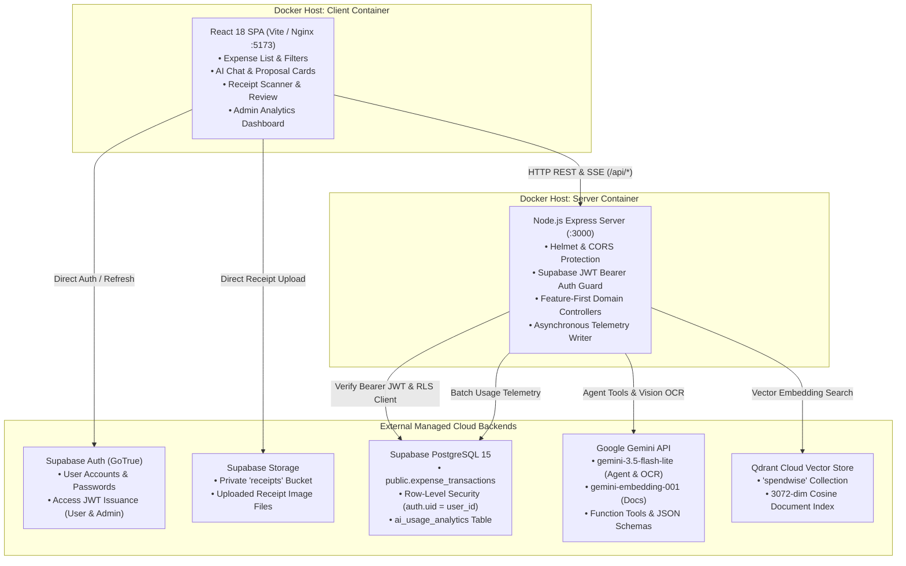
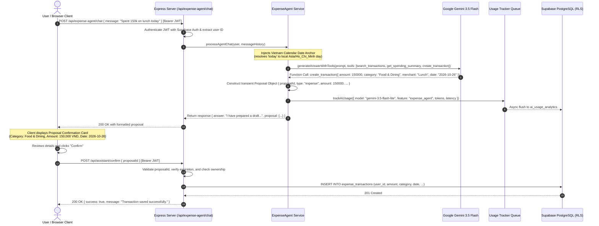

# SpendWise System Architecture

This document provides a clear architectural overview of SpendWise for engineering team members, evaluators, and project defense.

---

## 1. System Overview & Scope

SpendWise is an AI-assisted personal expense tracking web application. It combines traditional transaction ledger management with conversational AI assistance, automated receipt digitization, and usage telemetry.

### 1.1. Core Capabilities in Milestone 1 (M1)

In accordance with approved Milestone 1 requirements, the system implements three specific AI capabilities:
* **Capability B (Tool-Using Agent)**: Natural-language conversational agent using Google Gemini function calling to query transaction statistics in SQL and draft expense proposals.
* **Capability C (Structured Output)**: Receipt OCR extraction constrained to a strict, validated JSON schema via Gemini's `responseJsonSchema` and backend Zod schemas (`server/src/features/expenses/receipt.schemas.js`).
* **Capability D (Multimodal Input)**: Direct ingestion of physical receipt images (JPEG, PNG, WebP) into Gemini 3.5 Flash vision models without external OCR engines.

### 1.2. Scope Classification

To avoid ambiguity during evaluation, capabilities are categorized into three tiers:

| Tier | Status | Components Included |
|---|---|---|
| **Implemented Capabilities** | Committed & Active | User Authentication (Supabase GoTrue), Transaction CRUD, Spending Breakdown Charts, Multimodal Receipt Extraction, Tool-Using Expense Assistant with Proposal-Confirmation Gate, AI Usage Telemetry, Admin Analytics Dashboard, and System Prompt Management. |
| **Optional Infrastructure** | Operational Platform Code | Knowledge Base chunking (`data/knowledge/`), Qdrant Cloud vector indexing, and Cosine similarity document retrieval. These support platform documentation Q&A, but RAG is not a committed Milestone 1 User Story. |
| **Future / Planned Work** | Out of Scope for M1 | Autonomous unconfirmed database writes, multi-agent coordination frameworks, bank API sync, and custom category budget threshold alerts. |

---

## 2. Multi-Service Architecture Diagram

The system consists of two containerized application services managed via Docker Compose, communicating externally with three managed cloud providers:



---

## 3. Component Responsibilities & Rationale

### 3.1. Frontend Client (`client/`)
* **Technology**: React 18, Vite 6, Nginx (Alpine-based Docker container on port `5173`).
* **Responsibility**: Renders the responsive user interface, manages client-side authentication state, displays live spending charts, provides receipt upload previews, and renders interactive proposal cards.
* **Why It Exists**: Delivers a fast, zero-latency single-page application (SPA) experience with client-side routing while keeping sensitive backend database keys out of the browser.

### 3.2. Backend Server (`server/`)
* **Technology**: Node.js 20+, Express 4/5 (Docker container on port `3000`).
* **Responsibility**: Exposes feature-first REST endpoints, validates input payloads using Zod schemas, authenticates caller identity via Supabase JWTs, coordinates AI provider interactions, and buffers AI telemetry records.
* **Why It Exists**: Serves as the central API gateway and business logic coordinator, ensuring security policies are enforced on every request before touching database tables or calling external AI models.

### 3.3. Supabase Cloud (Auth, PostgreSQL, Storage)
* **Supabase Auth (GoTrue)**: Handles user registration, email/password verification, and access token issuance. Eliminates custom cryptographic password-handling code.
* **PostgreSQL with Row-Level Security (RLS)**: Stores financial transactions and analytics. RLS policies guarantee that a tenant can only view and mutate rows where `auth.uid() = user_id`, preventing data leakage across users even if an application filter has an error.
* **Supabase Storage**: Stores receipt image files in a private `receipts` bucket, returning secure reference URLs for expense records.

### 3.4. Google Gemini API
* **Technology**: Official `@google/genai` Node.js SDK.
* **Responsibility**: Powers the tool-using conversational assistant (`gemini-3.5-flash-lite`), performs zero-shot receipt multimodal vision OCR, and generates 3072-dimensional vector embeddings (`gemini-embedding-001`).
* **Why It Exists**: Native multimodal vision and strict JSON schema adherence eliminate brittle OCR pipelines and prevent JSON syntax parsing failures.

### 3.5. Qdrant Cloud Vector Database
* **Technology**: Managed Qdrant cluster over HTTPS (port `6333`).
* **Responsibility**: Stores 3072-dimensional vector embeddings of section-chunked platform documentation (`spendwise` collection) for similarity search.
* **Why It Exists**: Provides fast cosine similarity matching for the documentation assistant without requiring heavy local vector database containers on developer workstations.

---

## 4. Key Terminology Explained

* **Row-Level Security (RLS)**: A PostgreSQL security feature where database policies automatically filter rows returned by queries based on the identity of the authenticated user (`auth.uid() = user_id`). Even if `SELECT * FROM expense_transactions` is executed, the user only receives their own rows.
* **Function Calling (Tools)**: An LLM capability where the model does not attempt to calculate answers itself; instead, it outputs a structured function call request (e.g. `get_spending_summary({ startDate, endDate })`) that the backend executes against real SQL databases before returning the verified result to the LLM.
* **Structured Output**: Forcing the AI model to output syntactically valid JSON conforming to an explicit schema, preventing hallucinated keys or invalid markdown text.
* **Server-Sent Events (SSE)**: A lightweight, unidirectional HTTP protocol allowing the server to stream real-time text chunks and metadata events to the browser client.

---

## 5. Representative AI Request Flow (Tool-Using Agent)

This sequence diagram illustrates an end-to-end AI interaction: a user submits a natural-language request (*"I spent 150k on lunch today, please add it"*), the agent resolves calendar dates, invokes the proposal tool, and requires explicit user confirmation before committing changes to PostgreSQL.



---

## 6. Source Code Directory Structure

SpendWise adopts a feature-first architectural pattern across both frontend and backend codebases, co-locating routes, controllers, services, schemas, and UI components with their respective domain domains.

### 6.1. Frontend Architecture (`client/src/`)

```
client/src/
├── app/                                  # Application entry & routing
│   ├── App.jsx                           # Root component, router routes & layout mounts
│   └── guards/                           # Client-side session and role route guards
│       ├── AdminRouteGuard.jsx           # Verifies 'admin' role in app_metadata
│       └── AuthenticatedRouteGuard.jsx   # Verifies active Supabase session
├── features/                             # Feature-first domain modules
│   ├── analytics/                        # Admin AI telemetry charts & KPI metrics
│   │   ├── AnalyticsCharts.jsx           # Token & latency visualization
│   │   ├── AnalyticsFilters.jsx          # Date and feature filters
│   │   ├── AnalyticsHistoryTable.jsx     # Paginated AI request log table
│   │   ├── AnalyticsKpiCards.jsx         # Summary KPI cards (requests, tokens, cost)
│   │   ├── AnalyticsPage.jsx             # Admin analytics dashboard view
│   │   └── useAnalytics.js               # State & fetch management hook
│   ├── auth/                             # User authentication flows
│   │   ├── AuthCallbackPage.jsx          # OAuth / email confirmation token exchange
│   │   ├── AuthPage.jsx                  # Sign-in & Sign-up tabs with validation
│   │   └── ResetPasswordPage.jsx         # Password recovery form
│   ├── categories/                       # Category management view
│   │   └── CategoriesView.jsx            # Category inspection interface
│   ├── chat/                             # Assistant drawer & handbook Q&A
│   │   ├── ChatComposer.jsx              # Message input with streaming abort
│   │   ├── ChatDrawer.jsx                # Collapsible assistant chat drawer
│   │   └── useChat.js                    # Chat streaming & history state hook
│   ├── documents/                        # Admin knowledge base document CRUD
│   │   ├── ChunkReview.jsx               # Paginated vector chunk reviewer
│   │   ├── DocumentEditor.jsx            # Markdown document editor
│   │   └── DocumentTable.jsx             # Knowledge document table
│   ├── expense/                          # Personal expense management (Core M1)
│   │   ├── assistant/                    # AI Expense Assistant sub-components
│   │   │   ├── ExpenseAssistant.jsx      # Conversational assistant panel
│   │   │   ├── ExpenseToolResult.jsx     # Visual result renderer for tool calls
│   │   │   └── TransactionProposalCard.jsx # Interactive proposal card (Confirm/Cancel)
│   │   ├── ExpensePage.jsx               # Main workspace view
│   │   ├── ExpenseSummaryCards.jsx       # Month-to-date spending metric cards
│   │   ├── TransactionFields.jsx         # Shared transaction input controls
│   │   ├── TransactionForm.jsx           # Modal dialog for manual add/edit
│   │   └── TransactionTable.jsx          # Filterable, sortable, paginated ledger
│   ├── knowledgeBase/                    # Vector index status & cloud re-indexing
│   │   ├── KnowledgeBasePage.jsx         # Status overview and re-index trigger
│   │   └── KnowledgeBaseStats.jsx        # Chunk count & synchronization metrics
│   ├── receipts/                         # Multimodal receipt scanning & review
│   │   ├── ReceiptReview.jsx             # Editable review modal with OCR pre-fill
│   │   └── ReceiptsView.jsx              # Drag-and-drop receipt upload dropzone
│   └── systemPrompt/                     # Admin system prompt configuration
│       └── SystemPromptEditor.jsx        # Prompt editor with template restore
├── layouts/                              # Shared application layouts
│   ├── AppSidebar.jsx                    # Nav rail with role-based links
│   ├── sidebarConfig.js                  # Navigation route items and icons
│   └── WorkspaceLayout.jsx               # Shell layout with header & sidebar
└── shared/                               # Reusable design system & utilities
    ├── components/                       # Shared UI widgets (Button, Card, Dialog, Pagination)
    ├── contexts/                         # React context providers (ConfirmContext, ToastContext)
    ├── hooks/                            # Shared React hooks (usePagination, useSort, useSession)
    ├── services/                         # Base HTTP clients (apiClient.js, supabaseAuth.js)
    ├── styles/                           # Modular CSS tokens and component styles
    └── utils/                            # Pure utilities (formatters, validation, collection math)
```

### 6.2. Backend Architecture (`server/src/`)

```
server/src/
├── config.js                             # Environment variable loader & defaults
├── server.js                             # Express app setup, middleware, and startup
├── constants/                            # HTTP status codes, chunk limits, default configs
├── features/                             # Feature-first domain modules
│   ├── analytics/                        # AI usage telemetry aggregation & persistence
│   │   ├── analytics.controller.js       # Admin telemetry HTTP endpoints
│   │   ├── analytics.repository.js       # Dual-mode storage (Supabase + memory fallback)
│   │   ├── analytics.routes.js           # Routes for overview, timeseries, and history
│   │   ├── analytics.writer.js           # In-memory FIFO queue with batched flushes
│   │   └── usageTracker.js               # Helper to format and enqueue AI telemetry records
│   ├── assistant/                        # Platform knowledge base Q&A assistant (RAG)
│   │   ├── assistant.controller.js       # Chat & SSE streaming controllers
│   │   └── assistant.service.js          # RAG query retrieval and LLM response generation
│   ├── auth/                             # Authentication & role management
│   │   ├── auth.schemas.js               # Role and user validation schemas
│   │   └── auth.service.js               # Service-role user lookup and role update
│   ├── documents/                        # Markdown knowledge base document CRUD
│   │   ├── documents.controller.js       # File read/write/delete handlers
│   │   └── documents.service.js          # Filesystem I/O for data/knowledge/
│   ├── expenseAgent/                     # Tool-Using AI Agent (Capability B)
│   │   ├── expenseAgent.controller.js    # Agent chat and confirmation endpoints
│   │   ├── expenseAgent.service.js       # Proposal lifecycle and tool execution coordinator
│   │   └── geminiExpenseAgent.js         # Gemini function-calling declarations and tool dispatcher
│   ├── expenses/                         # Personal expenses & multimodal receipt OCR (Capabilities C & D)
│   │   ├── expenses.controller.js        # Transaction CRUD & spending summary endpoints
│   │   ├── expenses.service.js           # RLS-scoped PostgreSQL queries & aggregations
│   │   ├── receipt.schemas.js            # Strict Zod schema for OCR extraction
│   │   ├── receipt.service.js            # Receipt processing and storage coordinator
│   │   ├── receiptGuardrails.js          # OCR output normalization & non-receipt detection
│   │   └── receiptUpload.middleware.js   # Multer memory storage & Sharp image validation
│   ├── knowledgeBase/                    # Documentation chunking & vector search (Infrastructure)
│   │   ├── chunker.js                    # Markdown Level-2 header section splitter
│   │   ├── indexer.js                    # Vector embedding generation & Qdrant upsertion
│   │   ├── retriever.js                  # Cosine similarity candidate search in Qdrant
│   │   └── vectorStore.js                # Qdrant client connection & collection management
│   └── systemPrompt/                     # System prompt persistence
│       ├── systemPrompt.controller.js    # Prompt read/write/reset handlers
│       └── systemPrompt.service.js       # File I/O for data/prompts/
├── routes/                               # Route composition
│   └── adminRoute.js                     # Root admin router mounting protected features
├── shared/                               # Shared cross-cutting modules
│   ├── errors/                           # AppError and domain operational error classes
│   ├── guardrails/                       # Security filters (prompt injection, scope check)
│   ├── integrations/                     # External provider interfaces
│   │   ├── ai/                           # AI provider abstraction & geminiProvider.js
│   │   └── supabase.js                   # Scoped Supabase client factory (createScopedSupabaseClient)
│   ├── middleware/                       # Express middleware (authenticate, authorize, validateRequest, rateLimiter)
│   └── validation/                       # Shared validation helpers (zodIntegerParam)
└── scripts/                              # Server CLI scripts
    └── set-user-role.js                  # Administrative role assignment CLI script
```

---

## 7. Architecture Decision Records (ADRs)

SpendWise architectural decisions are formally documented in:
* [ADR 0001: SpendWise Authentication and Expense Ownership Architecture](adr/0001-spendwise-authentication-architecture.md)
* [ADR 0002: Multimodal AI and Structured Output for Receipt Processing](adr/0002-multimodal-receipt-extraction.md)
* [ADR 0003: Agent Tool Calling and Confirmation Gate for Financial Operations](adr/0003-agent-tool-calling-and-confirmation-gate.md)

---

## 8. Detailed AI Execution Flows & Data Architecture

Comprehensive, source-traceable implementation-level documentation with exact file paths, line ranges, prompt files, tool declarations, guardrails, and tests is maintained in `docs/ai-data-flows/`:

* **[AI Architecture & Flow Overview](../ai-data-flows/README.md)**: System-level architecture diagram, flow map, capability classification, and source traceability standard.
* **[Flow 01: Multimodal Receipt Scanning & Structured Extraction](../ai-data-flows/01-receipt-multimodal.md)**: End-to-end receipt pipeline from file picker to database write, prompt resolution, Zod normalization, subtotal guardrails, and Nginx reverse-proxy configuration.
* **[Flow 02: Tool-Using Expense Agent](../ai-data-flows/02-tool-using-agent.md)**: Conversational assistant, tool declaration inventory (`search_transactions`, `get_spending_summary`, `create_transaction`), proposal lifecycle, and two-phase confirmation security gate.
* **[Flow 03: RAG & Knowledge Base](../ai-data-flows/03-rag-flow.md)**: Document chunking, Qdrant vector indexing, similarity threshold gate (`0.65`), policy amendment overrides, and grounding prompt construction.
* **[Flow 04: Admin AI Analytics](../ai-data-flows/04-admin-analytics.md)**: Asynchronous telemetry lifecycle, bounded queue writer, metric provenance table, full-dataset search/sort, and token estimation.
* **[Flow 05: Prompts, Guardrails & Telemetry Catalogue](../ai-data-flows/05-prompts-guardrails-and-telemetry.md)**: Single source of truth for all 8 prompt files, 16 deterministic guardrails, and platform external dependencies.
