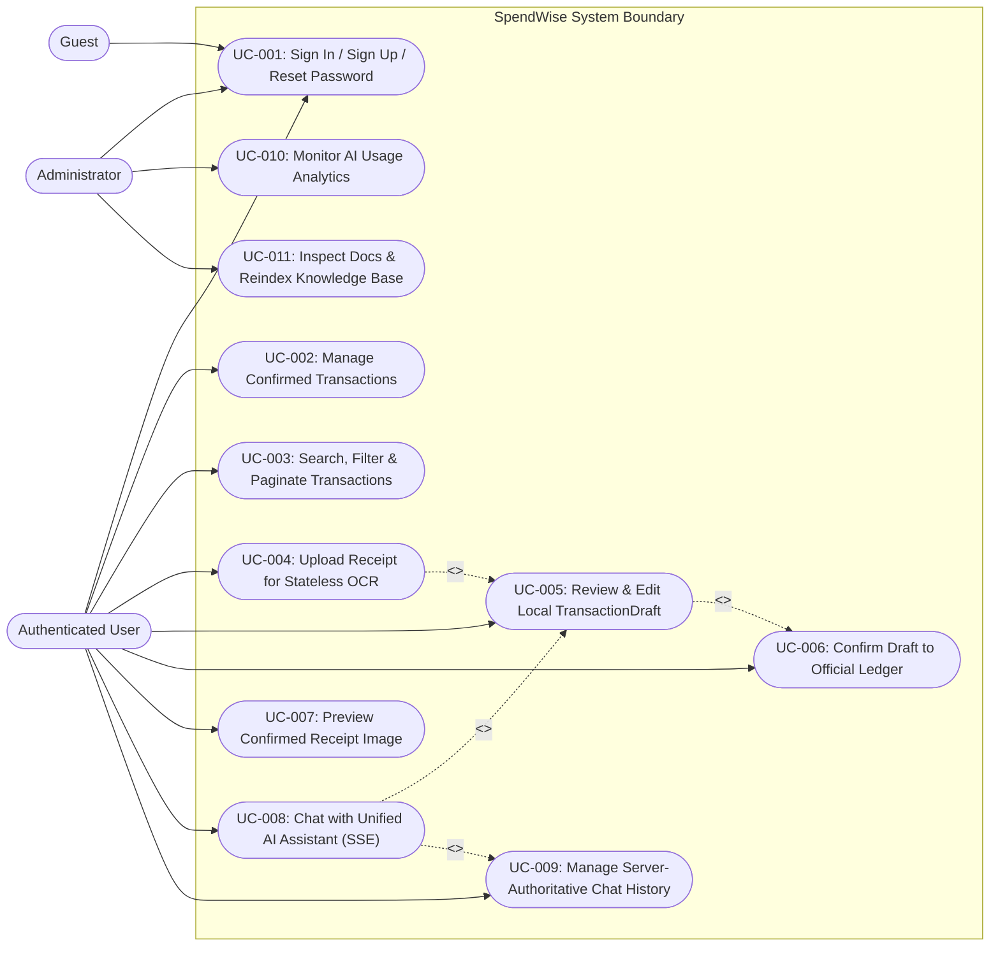

# 03 — Use Case Diagram

> **Package:** SpendWise Academic Software Requirements Specification (SRS)  
> **Related Documents:** [`01-scope-and-user-roles.md`](./01-scope-and-user-roles.md), [`04-use-case-specifications.md`](./04-use-case-specifications.md)

---

## 1. System Use Case Diagram

The diagram below depicts the implemented SpendWise system boundary, primary human actors (**Guest**, **Authenticated User**, **Administrator**), and core use cases (`UC-001` through `UC-011`). Note that **Administrator** does not inherit **Authenticated User** finance or chat use cases (`BR-002`).

---

## 2. Relationship Summary

- **UC-004 → UC-005 (`<<extend>>`):** Successful stateless OCR extraction stages a local `TransactionDraft` in browser IndexedDB for review.
- **UC-008 → UC-005 (`<<extend>>`):** When the Unified AI Assistant invokes `propose_transaction`, the client stages an optional `TransactionDraft` card for user review/confirmation.
- **UC-005 → UC-006 (`<<include>>`):** Confirming a reviewed `TransactionDraft` commits it to the official PostgreSQL ledger (and uploads/links receipt storage for receipt drafts).
- **UC-008 → UC-009 (`<<include>>`):** Streaming chat turns (`POST /api/chat-assistant/stream`) register and persist user/assistant turns in server-authoritative Chat History.
