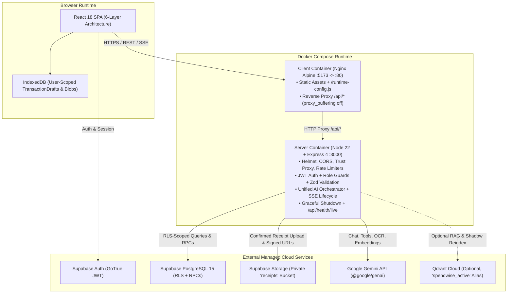

# 05 — System Architecture

> **Package:** SpendWise Academic Software Requirements Specification (SRS)  
> **Related Documents:** [`06-data-design-erd.md`](./06-data-design-erd.md), [`07-sequence-diagrams.md`](./07-sequence-diagrams.md), [`docs/engineering/architecture.md`](../../engineering/architecture.md)

---

## 1. Architectural Overview & Style

SpendWise uses a **modular monolith backend + single-page application (SPA) frontend** architecture:
- **Logical Style:** Feature-first modular separation on both client (strict 6-layer unidirectional hierarchy: `app` → `features` → `layouts` → `composites` → `primitives` → `shared`) and server (Controllers → Services → Repositories + Provider Adapters).
- **Physical Deployment:** Two Docker Compose containers (`client` Nginx Alpine serving static SPA + runtime `/runtime-config.js` and reverse-proxying `/api/*`, and `server` Node.js 22 Express 4 API) communicating with managed external cloud services (Supabase Cloud, Google Gemini API, and optional Qdrant Cloud).

---

## 2. System Architecture Diagram

---

## 3. Component & Interaction Boundaries

1. **Client SPA (`client/src/`):** Manages UI rendering, Supabase GoTrue session tokens, HTTP 401 session expiration (`handleUnauthorized()`), and browser-local IndexedDB `TransactionDraft` staging.
2. **Express API (`server/src/`):** Enforces Bearer JWT verification (`authenticate`), strict role isolation (`authorize('user')` vs `authorize('admin')`), Zod validation, and PostgREST query hardening.
3. **AI & RAG Boundary:** `assistantOrchestrator.js` runs a bounded tool-calling loop with untrusted data envelopes (`search_knowledge_base`, `search_transactions`, `get_spending_summary`, `propose_transaction`), citation validation, and asynchronous AI usage telemetry.
4. **Deployment & Lifecycle:** `client/Dockerfile` builds without `.env` and injects public config at container startup via `40-runtime-config.sh`. `server` exposes `/api/health/live` so `client` (`service_healthy`) is not blocked when optional Qdrant is unavailable.
