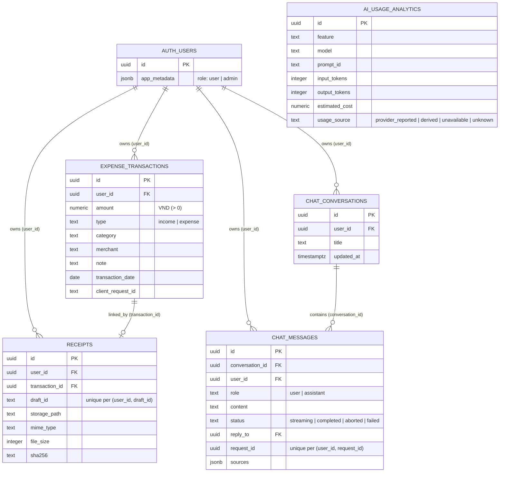

# 06 — Data Design & Entity-Relationship Diagram (ERD)

> **Package:** SpendWise Academic Software Requirements Specification (SRS)  
> **Related Documents:** [`02-business-rules.md`](./02-business-rules.md), [`docs/engineering/database-and-data-lifecycle.md`](../../engineering/database-and-data-lifecycle.md)  
> **Remote Schema Note:** This ERD reflects the **locally defined migration baseline** (`20261020000000` through `202611170014`). Migrations `202611170009`–`202611170014` are marked `LOCAL ONLY`; remote Supabase schema equivalence is **UNKNOWN / NOT VERIFIED**.

---

## 1. Persistence Boundary: PostgreSQL vs. Browser IndexedDB

- **PostgreSQL (`public.*` via Supabase):** Stores only **confirmed** financial ledger rows (`expense_transactions`), confirmed receipt metadata (`receipts`), server-authoritative chat persistence (`chat_conversations`, `chat_messages`), and AI telemetry (`ai_usage_analytics`).
- **Browser IndexedDB (`TransactionDraft`):** Unconfirmed receipt OCR extractions, image `Blob`s, and AI `propose_transaction` drafts are staged strictly in browser-local IndexedDB (`userId`-scoped) and are **not** a server-side database table (legacy `public.transaction_drafts` and `public.receipt_extractions` are retired in `202611170011`).

---

## 2. Entity-Relationship Diagram (Local PostgreSQL Baseline)

---

## 3. Key Constraints, RLS & RPC Functions

- **Row-Level Security (RLS):** Enabled on `expense_transactions`, `receipts`, `chat_conversations`, and `chat_messages` (`auth.uid() = user_id`).
- **`confirm_staged_receipt_transaction` (`202611170009`):** `SECURITY DEFINER` RPC validating caller UID, `<uid>/<draft_id>/original` storage path, MIME type, and VND fields before atomically committing `receipts` + `expense_transactions`.
- **`begin_chat_stream_turn` (`202611170012` / `202611170013`):** `SECURITY INVOKER` RPC providing idempotent `(user_id, request_id)` turn registration and conversation ownership checks.
