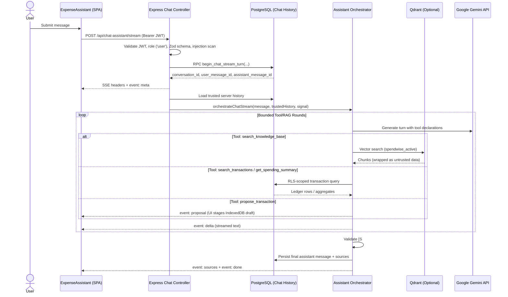
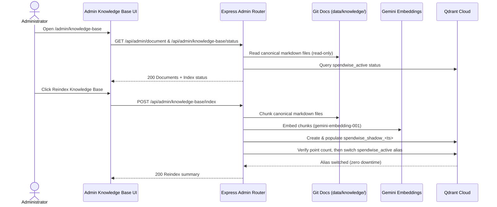

# 07 — Sequence Diagrams

> **Package:** SpendWise Academic Software Requirements Specification (SRS)  
> **Related Documents:** [`04-use-case-specifications.md`](./04-use-case-specifications.md), [`05-system-architecture.md`](./05-system-architecture.md)

---

## 1. Stateless Receipt Upload, Draft Review & Atomic Confirmation

Separates stateless OCR (`POST /api/receipt/upload`), browser-local IndexedDB staging, and atomic confirmation (`POST /api/receipt/confirm`).

```mermaid
sequenceDiagram
    actor User
    participant Client as React SPA + IndexedDB
    participant API as Express API
    participant Gemini as Google Gemini Vision
    participant Storage as Supabase Storage
    participant DB as PostgreSQL (RPC + RLS)

    User->>Client: Select receipt image & Upload
    Client->>API: POST /api/receipt/upload (multipart)
    API->>Gemini: Extract structured JSON (responseJsonSchema)
    Gemini-->>API: Extracted fields + currency warnings
    API-->>Client: 201 { receipt } (stateless; no DB/Storage write)
    Client->>Client: Stage TransactionDraft + Blob in IndexedDB (userId-scoped)

    User->>Client: Review/edit draft & Confirm
    Client->>API: POST /api/receipt/confirm (draftId + Blob + fields)
    API->>Storage: Upload image to private receipts/<uid>/<draftId>/original
    API->>DB: RPC confirm_staged_receipt_transaction(...)
    DB-->>API: Atomic { receipt, transaction }
    API-->>Client: 201 Created (or 200 on idempotent replay)
    Client->>Client: Mark/remove local IndexedDB draft
```

---

## 2. Unified AI Assistant SSE Streaming, Tool/RAG Loop & Chat History

Illustrates pre-stream validation, server-authoritative history loading, untrusted RAG wrapping, citation validation, and optional `propose_transaction` staging.



---

## 3. Knowledge Base Inspection & Zero-Downtime Reindexing (Admin)


