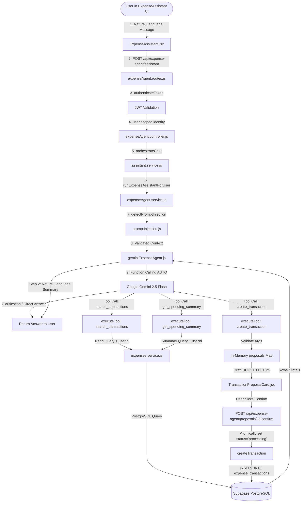
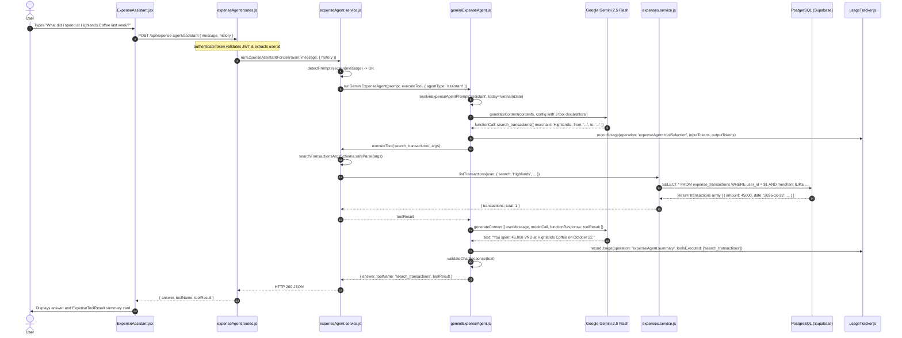
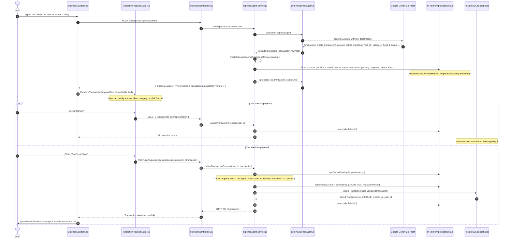

# SpendWise AI Data Flow 02: Tool-Using Expense Agent

> **Inspection Baseline**: Commit `3634a4e6c61c797a9aed12d81043494c65e5d817`  
> **Inspection Date**: October 27, 2026  
> **Capability Classification**: Milestone 1 Core Capability (Capability B: Tool-Using Agent)

---

## 1. Overview & Architecture

The SpendWise Expense Agent provides conversational natural-language expense tracking. Unlike unconstrained chatbot architectures, SpendWise enforces a strict, deterministic boundary between AI reasoning and database operations:

1. **Model Reasoner**: Google Gemini (`gemini-2.5-flash`) receives natural-language input and determines whether to query data, request clarification, or propose a transaction.
2. **Deterministic Tool Dispatcher**: The model cannot execute SQL or directly touch the database. It can only emit structured tool calls matching registered schemas.
3. **Strict Financial Write Gate**: Financial mutations (`create_transaction`) **never write to PostgreSQL directly**. Instead, the agent creates an ephemeral, in-memory **Transaction Proposal** with a 10-minute TTL. The user must review, optionally edit, and explicitly confirm the transaction in the UI before any record is persisted.



---

## 2. End-to-End Execution Trace

### Phase 1: Client Input & API Request
1. **Frontend Interaction**: The user enters a question or command into [`client/src/features/expense/assistant/ExpenseAssistant.jsx:L31-L42`](../../client/src/features/expense/assistant/ExpenseAssistant.jsx#L31-L42) using the `useChat` hook.
2. **Payload Dispatch**: The message and preceding conversation history are sent via [`client/src/features/expense/expenseApi.js:L25-L26`](../../client/src/features/expense/expenseApi.js#L25-L26) to `POST /api/expense-agent/assistant` with body:
   ```json
   {
     "message": "How much did I spend on coffee this week?",
     "history": [
       { "role": "user", "text": "Hello" },
       { "role": "assistant", "text": "Hi! How can I help you today?" }
     ]
   }
   ```

### Phase 2: Route, Auth & Orchestration
3. **Route Registration**: The route is mounted in [`server/src/features/expenseAgent/expenseAgent.routes.js:L12`](../../server/src/features/expenseAgent/expenseAgent.routes.js#L12) protected by [`authenticateToken`](../../server/src/shared/middleware/auth.middleware.js#L12-L35).
4. **Controller Entry**: [`server/src/features/expenseAgent/expenseAgent.controller.js:L28-L40`](../../server/src/features/expenseAgent/expenseAgent.controller.js#L28-L40) extracts `req.user`, `message`, and `history`, then invokes `orchestrateChat(message, { user, history, strategy: 'agent' })`.
5. **Chat Orchestration**: [`server/src/features/assistant/assistant.service.js:L34-L67`](../../server/src/features/assistant/assistant.service.js#L34-L67) resolves the strategy (`'agent'` by default) and delegates to `runExpenseAssistantForUser(user, message, { history })` in [`server/src/features/expenseAgent/expenseAgent.service.js:L114-L161`](../../server/src/features/expenseAgent/expenseAgent.service.js#L114-L161).

### Phase 3: Prompt Injection Guardrail & Formatting
6. **Input Guardrail**: `detectPromptInjection(message)` runs in [`server/src/shared/guardrails/promptInjection.js:L34-L60`](../../server/src/shared/guardrails/promptInjection.js#L34-L60) against both the current message and all historical turns ([`expenseAgent.service.js:L115-L125`](../../server/src/features/expenseAgent/expenseAgent.service.js#L115-L125)). If an injection attack pattern is detected, execution halts immediately with `SERVER_MESSAGES.ERRORS.PROMPT_INJECTION_REFUSAL` without invoking Gemini.
7. **Context Formatting**: Conversation turns are formatted into contextual string format using `formatConversationContext` ([`expenseAgent.service.js:L152-L154`](../../server/src/features/expenseAgent/expenseAgent.service.js#L152-L154)).

### Phase 4: Model Invocation & Tool Selection
8. **Prompt Resolution**: `runGeminiExpenseAgent` ([`server/src/features/expenseAgent/geminiExpenseAgent.js:L118-L140`](../../server/src/features/expenseAgent/geminiExpenseAgent.js#L118-L140)) calls `resolveExpenseAgentPrompt('assistant', today)` which loads `server/prompts/agents/assistant-v1.md` via [`server/src/features/expenseAgent/expenseAgentPrompt.js:L133-L191`](../../server/src/features/expenseAgent/expenseAgentPrompt.js#L133-L191).
9. **Timezone Awareness**: The relative date baseline is calculated using `getVietnamDate()` ([`geminiExpenseAgent.js:L57-L63`](../../server/src/features/expenseAgent/geminiExpenseAgent.js#L57-L63)), ensuring relative expressions like *"hôm qua"* (yesterday) or *"tháng này"* (this month) resolve correctly to `Asia/Ho_Chi_Minh` rather than server UTC.
10. **Tool Declaration**: For `agentType: 'assistant'`, all 3 tools (`SEARCH_TRANSACTIONS_TOOL`, `SPENDING_SUMMARY_TOOL`, `CREATE_TRANSACTION_TOOL`) are declared to Gemini with `mode: 'AUTO'` ([`geminiExpenseAgent.js:L129-L138`](../../server/src/features/expenseAgent/geminiExpenseAgent.js#L129-L138)).
11. **Initial Model Call**: Gemini is called via `executeWithRetry` ([`geminiExpenseAgent.js:L154-L164`](../../server/src/features/expenseAgent/geminiExpenseAgent.js#L154-L164)). AI usage telemetry is recorded for `expenseAgent.toolSelection` ([`geminiExpenseAgent.js:L175-L196`](../../server/src/features/expenseAgent/geminiExpenseAgent.js#L175-L196)).

### Phase 5: Tool Execution & Dispatch
12. **Clarification vs Tool Call**:
    - If Gemini returns plain text (e.g. asking for clarification when a date is ambiguous), it is validated by `validateChatResponse` ([`server/src/shared/guardrails/responseValidator.js:L46-L65`](../../server/src/shared/guardrails/responseValidator.js#L46-L65)) and returned directly ([`geminiExpenseAgent.js:L227-L233`](../../server/src/features/expenseAgent/geminiExpenseAgent.js#L227-L233)).
    - If Gemini returns a function call, execution routes to `executeTool(call.name, call.args)` ([`expenseAgent.service.js:L127-L149`](../../server/src/features/expenseAgent/expenseAgent.service.js#L127-L149)).
13. **Dispatcher Validation**:
    - Unknown tool names are rejected with HTTP 400 (`Unsupported expense agent tool`).
    - Tool step limit is enforced (`MAX_AGENT_STEPS = 5`).
    - Arguments are parsed and strictly validated using Zod schemas (`searchTransactionsArgsSchema`, `spendingSummaryArgsSchema`, or `createTransactionArgsSchema`). Invalid types or ranges are rejected before any database contact ([`expenseAgent.service.js:L132-L148`](../../server/src/features/expenseAgent/expenseAgent.service.js#L132-L148)).

---

## 3. Tool Declaration Inventory

The table below lists every tool declared to Gemini, its parameter schema, dispatcher mapping, data tier calls, and safety boundaries.

| Tool Name | Declaration File & Lines | Description / Parameters | Input Schema | Dispatcher Mapping | Executor Function & Lines | Persistence / DB Calls | Read / Write | Confirmation Gate | Related Tests |
| :--- | :--- | :--- | :--- | :--- | :--- | :--- | :--- | :--- | :--- |
| `search_transactions` | [`server/src/features/expenseAgent/geminiExpenseAgent.js:L8-L25`](../../server/src/features/expenseAgent/geminiExpenseAgent.js#L8-L25) | Search authenticated user's transactions with ISO `YYYY-MM-DD` dates, numeric VND amounts, categories, and pagination. | `searchTransactionsArgsSchema` ([`expenseAgent.schemas.js:L18-L30`](../../server/src/features/expenseAgent/expenseAgent.schemas.js#L18-L30)) | [`expenseAgent.service.js:L131-L141`](../../server/src/features/expenseAgent/expenseAgent.service.js#L131-L141) | `listTransactions(user, query)` ([`expenses.service.js:L15-L45`](../../server/src/features/expenses/expenses.service.js#L15-L45)) | `findTransactions` ([`expenses.repository.js:L12-L46`](../../server/src/features/expenses/expenses.repository.js#L12-L46)) -> Supabase PostgreSQL `expense_transactions` | **Read-Only** | None (Immediate read) | [`tests/unit/expenseAgent.test.js:L11-L80`](../../tests/unit/expenseAgent.test.js#L11-L80) |
| `get_spending_summary` | [`server/src/features/expenseAgent/geminiExpenseAgent.js:L27-L38`](../../server/src/features/expenseAgent/geminiExpenseAgent.js#L27-L38) | Calculate income, expenses, balance, and category breakdowns over an inclusive ISO date range. | `spendingSummaryArgsSchema` ([`expenseAgent.schemas.js:L32-L37`](../../server/src/features/expenseAgent/expenseAgent.schemas.js#L32-L37)) | [`expenseAgent.service.js:L142-L146`](../../server/src/features/expenseAgent/expenseAgent.service.js#L142-L146) | `getSpendingSummary(user, args)` ([`expenses.service.js:L47-L80`](../../server/src/features/expenses/expenses.service.js#L47-L80)) | `calculateSpendingSummary` ([`expenses.repository.js:L65-L105`](../../server/src/features/expenses/expenses.repository.js#L65-L105)) -> Supabase PostgreSQL `expense_transactions` aggregation | **Read-Only** | None (Immediate read) | [`tests/unit/spendingSummary.test.js:L1-L60`](../../tests/unit/spendingSummary.test.js#L1-L60) |
| `create_transaction` | [`server/src/features/expenseAgent/geminiExpenseAgent.js:L40-L50`](../../server/src/features/expenseAgent/geminiExpenseAgent.js#L40-L50) | Create a review-only transaction proposal for authenticated user. Does NOT save data. | `createTransactionArgsSchema` ([`expenseAgent.schemas.js:L39-L47`](../../server/src/features/expenseAgent/expenseAgent.schemas.js#L39-L47)) | [`expenseAgent.service.js:L147`](../../server/src/features/expenseAgent/expenseAgent.service.js#L147) -> `createProposalFromArgs` ([`L85-L93`](../../server/src/features/expenseAgent/expenseAgent.service.js#L85-L93)) | `createProposalFromArgs(user, rawArgs)` ([`expenseAgent.service.js:L85-L93`](../../server/src/features/expenseAgent/expenseAgent.service.js#L85-L93)) | **None**. In-memory `proposals` Map only ([`expenseAgent.service.js:L21`](../../server/src/features/expenseAgent/expenseAgent.service.js#L21)). DB write delayed until explicit confirmation. | **Proposal Write** (In-Memory) | **MANDATORY**: User must click Confirm in UI | [`tests/unit/transactionProposal.test.js:L42-L110`](../../tests/unit/transactionProposal.test.js#L42-L110) |

---

## 4. Agent Prompt Inventory

All natural-language prompt instructions are maintained in version-controlled Markdown files under `server/prompts/agents/`. Built-in inline fallbacks in [`server/src/features/expenseAgent/expenseAgentPrompt.js:L74-L80`](../../server/src/features/expenseAgent/expenseAgentPrompt.js#L74-L80) provide an emergency resilience fallback if disk access is compromised.

| Prompt ID | Source File | Loader Function | Runtime Selection Rule | Caller | Tool Binding | Output / Behavior | Related Tests |
| :--- | :--- | :--- | :--- | :--- | :--- | :--- | :--- |
| `expense_agent_assistant` | `server/prompts/agents/assistant-v1.md` | `getExpenseAgentPrompt('assistant')` ([`expenseAgentPrompt.js:L133`](../../server/src/features/expenseAgent/expenseAgentPrompt.js#L133)) | Default for multi-turn assistant endpoint `/api/expense-agent/assistant` | `runExpenseAssistantForUser` ([`expenseAgent.service.js:L155`](../../server/src/features/expenseAgent/expenseAgent.service.js#L155)) | Declares all 3 tools: `search_transactions`, `get_spending_summary`, `create_transaction` | Natural-language conversational response or tool call | [`tests/unit/promptRegistry.test.js:L1-L60`](../../tests/unit/promptRegistry.test.js#L1-L60) |
| `expense_agent_search` | `server/prompts/agents/search-v1.md` | `getExpenseAgentPrompt('search')` ([`expenseAgentPrompt.js:L133`](../../server/src/features/expenseAgent/expenseAgentPrompt.js#L133)) | Dedicated `/api/expense-agent/search` endpoint | `searchTransactionsForUser` ([`expenseAgent.service.js:L39`](../../server/src/features/expenseAgent/expenseAgent.service.js#L39)) | `search_transactions` | Searches transactions, then generates summary | [`tests/unit/expenseAgent.test.js:L59-L79`](../../tests/unit/expenseAgent.test.js#L59-L79) |
| `expense_agent_summary` | `server/prompts/agents/summary-v1.md` | `getExpenseAgentPrompt('summary')` ([`expenseAgentPrompt.js:L133`](../../server/src/features/expenseAgent/expenseAgentPrompt.js#L133)) | Dedicated `/api/expense-agent/summary` endpoint | `getSpendingSummaryForUser` ([`expenseAgent.service.js:L68`](../../server/src/features/expenseAgent/expenseAgent.service.js#L68)) | `get_spending_summary` | Calculates balance and category breakdowns | [`tests/unit/spendingSummary.test.js:L1-L50`](../../tests/unit/spendingSummary.test.js#L1-L50) |
| `expense_agent_create` | `server/prompts/agents/create-v1.md` | `getExpenseAgentPrompt('create')` ([`expenseAgentPrompt.js:L133`](../../server/src/features/expenseAgent/expenseAgentPrompt.js#L133)) | Dedicated `/api/expense-agent/create-proposal` endpoint | `createTransactionProposalForUser` ([`expenseAgent.service.js:L105`](../../server/src/features/expenseAgent/expenseAgent.service.js#L105)) | `create_transaction` | Prepares transaction proposal for review | [`tests/unit/transactionProposal.test.js:L28-L47`](../../tests/unit/transactionProposal.test.js#L28-L47) |
| `expense_agent_context` | `server/prompts/agents/context-v1.md` | `formatConversationContext` ([`expenseAgentPrompt.js:L201-L215`](../../server/src/features/expenseAgent/expenseAgentPrompt.js#L201-L215)) | Used to combine preceding conversation turns with the latest user query | `runExpenseAssistantForUser` ([`expenseAgent.service.js:L154`](../../server/src/features/expenseAgent/expenseAgent.service.js#L154)) | N/A | Formats message context before sending to model | [`tests/unit/chatOrchestrator.test.js:L1-L50`](../../tests/unit/chatOrchestrator.test.js#L1-L50) |

---

## 5. Sequence Diagram 1: Read-Only Query (`search_transactions`)

This diagram illustrates a read-only request such as *"What did I spend at Highlands Coffee last week?"*.



---

## 6. Sequence Diagram 2: Financial Mutation with Proposal Confirmation

This diagram shows how SpendWise protects financial records: the AI can only propose an expense; the user confirms it via a separate, authenticated endpoint.



---

## 7. Security Guardrails & Boundary Verification

### 7.1 User Scoping & Tenant Isolation
- **Authentication Derivation**: `user.id` is derived strictly from the verified Supabase JWT in [`auth.middleware.js`](../../server/src/shared/middleware/auth.middleware.js#L12-L35). The model cannot specify or alter `user.id`.
- **Database Query Scope**: Every database call passes `user` to [`expenses.repository.js`](../../server/src/features/expenses/expenses.repository.js#L12-L46) which applies `.eq('user_id', user.id)`. Multi-tenant data leakage is prevented at the SQL layer.
- **Proposal Ownership**: During confirmation, [`expenseAgent.service.js:L77-L83`](../../server/src/features/expenseAgent/expenseAgent.service.js#L77-L83) verifies `proposal.userId === user.id`. Cross-user proposal hijacking results in HTTP 404.

### 7.2 Proposal Lifecycle & Replay Protection
- **Time-to-Live (TTL)**: Proposals expire after 10 minutes (`PROPOSAL_TTL_MS = 10 * 60 * 1000`, [`expenseAgent.service.js:L19`](../../server/src/features/expenseAgent/expenseAgent.service.js#L19)). Expired proposals are purged and return HTTP 400.
- **Double-Click / Concurrent Confirmation**: In [`expenseAgent.service.js:L168`](../../server/src/features/expenseAgent/expenseAgent.service.js#L168), `proposal.status` is set to `'processing'` **before** awaiting `createTransaction`. A concurrent request encountering `status !== 'pending'` immediately fails with HTTP 409 Conflict ([`expenseAgent.service.js:L81`](../../server/src/features/expenseAgent/expenseAgent.service.js#L81)).
- **Rollback on Database Failure**: If `createTransaction` fails, [`expenseAgent.service.js:L175`](../../server/src/features/expenseAgent/expenseAgent.service.js#L175) resets `proposal.status = 'pending'`, allowing the user to retry without losing their draft.

### 7.3 Argument & Output Validation
- **Zod Schema Enforcement**: Even if Gemini generates hallucinated or malformed arguments, Zod schemas in [`expenseAgent.schemas.js`](../../server/src/features/expenseAgent/expenseAgent.schemas.js#L18-L47) reject them deterministically before the repository is called.
- **Response Validation**: Final text answers undergo `validateChatResponse` ([`responseValidator.js:L46-L65`](../../server/src/shared/guardrails/responseValidator.js#L46-L65)), ensuring clean output free of leaked system prompt directives or unsafe tokens.

---

## 8. Verification & Tests

The Expense Agent implementation is validated by the following tests in the current repository:

| Test File | Lines | Scope / Verified Behavior |
| :--- | :--- | :--- |
| `tests/unit/expenseAgent.test.js` | [`L11-L28`](../../tests/unit/expenseAgent.test.js#L11-L28) | Vietnam calendar date calculation for relative filters (`getVietnamDate`); Zod filter schema validation. |
| `tests/unit/expenseAgent.test.js` | [`L30-L57`](../../tests/unit/expenseAgent.test.js#L30-L57) | Filter combination, newest-first pagination, rejection of unknown tools and invalid dates before database access. |
| `tests/unit/expenseAgent.test.js` | [`L59-L80`](../../tests/unit/expenseAgent.test.js#L59-L80) | Real Gemini function calling protocol simulation, relative date resolution, functionResponse return. |
| `tests/unit/expenseAgent.test.js` | [`L96-L103`](../../tests/unit/expenseAgent.test.js#L96-L103) | AI timeout handling (`timeoutMs = 15000` stopping slow requests with `AIResponseTimeoutError`). |
| `tests/unit/expenseAgent.test.js` | [`L104-L152`](../../tests/unit/expenseAgent.test.js#L104-L152) | Two-step AI telemetry tracking without double counting (`expenseAgent.toolSelection` and `expenseAgent.summary`). |
| `tests/unit/expenseAgent.test.js` | [`L182-L213`](../../tests/unit/expenseAgent.test.js#L182-L213) | Transient error retries (503/429) with attempt metadata logging. |
| `tests/unit/transactionProposal.test.js` | [`L42-L61`](../../tests/unit/transactionProposal.test.js#L42-L61) | Proposal creation without DB persistence; proposal cancellation without DB writes. |
| `tests/unit/transactionProposal.test.js` | [`L63-L90`](../../tests/unit/transactionProposal.test.js#L63-L90) | Exactly-once confirmation; revalidation of user-edited fields; cross-user rejection (user B cannot confirm user A's proposal). |
| `tests/unit/transactionProposal.test.js` | [`L92-L115`](../../tests/unit/transactionProposal.test.js#L92-L115) | Proposal expiration after TTL; double-click replay rejection (`HTTP 409 Conflict`). |
| `tests/integration/expenseAgentRoute.test.js` | [`L1-L85`](../../tests/integration/expenseAgentRoute.test.js#L1-L85) | End-to-end HTTP integration for `/api/expense-agent/assistant`, `/search`, and `/proposals/:id/confirm`. |
