# SpendWise AI Data Flow 03: RAG & Knowledge Base

> **Inspection Baseline**: Commit `3634a4e6c61c797a9aed12d81043494c65e5d817`  
> **Inspection Date**: October 27, 2026  
> **Capability Classification**: **Retained Platform Infrastructure** (Not committed for Milestone 1; superseded by Capability B: Tool-Using Expense Agent on the default user path)

---

## 1. Architectural Status & Capability Boundary

### Milestone 1 Boundary vs. Retained Infrastructure
- **Milestone 1 Core Capabilities**: Capability B (Tool-Using Expense Agent), Capability C (Structured Output), and Capability D (Multimodal Receipt Scanning).
- **RAG Architecture**: The Knowledge Base Retrieval-Augmented Generation (RAG) subsystem is **retained platform infrastructure**. It is completely implemented, covered by unit and integration test suites, and operational, but it is **not active on the default user chat path**.
- **Runtime Strategy Dispatcher**: As implemented in [`server/src/features/assistant/assistant.service.js:L34-L50`](../../server/src/features/assistant/assistant.service.js#L34-L50), `orchestrateChat` selects between `'agent'` and `'rag'`. By default, `process.env.CHAT_STRATEGY` resolves to `'agent'`, routing requests to `orchestrateAgentChat` ([`assistant.service.js:L52-L67`](../../server/src/features/assistant/assistant.service.js#L52-L67)).
- **Enabling RAG**: RAG is immediately recoverable without code modification by configuring `CHAT_STRATEGY=rag` in `server/.env`.

---

## 2. Subsystem Architecture

The Knowledge Base architecture consists of two decoupled operational pipelines:
1. **Offline Ingestion & Vector Indexing Pipeline**: Parses markdown user guides, performs section-aware chunking preserving Markdown tables, embeds text via Google Gemini `text-embedding-004`, and indexes points into a Qdrant Cloud vector collection.
2. **Online Grounded Retrieval & Answer Pipeline**: Evaluates prompt injection and domain scope, retrieves top-k vectors with cosine similarity, injects policy amendment overrides, enforces a strict similarity threshold guardrail, constructs an XML-demarcated prompt, and generates grounded answers.

```mermaid
flowchart TD
    subgraph Ingestion Pipeline ["Ingestion / Indexing Pipeline (CLI / Offline)"]
        MD[data/knowledge/spendwise_user_guide.md] -->|loadAndChunkMarkdown| Chunker[chunker.js]
        Chunker -->|12 Section Chunks + Tables| Chunks[Structured Chunks]
        Chunks -->|embedText text-embedding-004| GeminiEmbed[Google Gemini API]
        GeminiEmbed -->|768/3072 Float Vectors| QdrantInit[initVectorStore reset: true]
        QdrantInit -->|Upsert Points with Payload| Qdrant[(Qdrant Cloud Vector Store)]
    end

    subgraph Retrieval Pipeline ["Retrieval & Answer Pipeline (when CHAT_STRATEGY=rag)"]
        UserQuery[User Question] --> Orch[assistant.service.js: orchestrateRAGChat]
        Orch --> Guard1[promptInjection.js: detectPromptInjection]
        Guard1 -->|Safe| Guard2[scopeGuard.js: classifyScope]
        Guard2 -->|In-Scope| Retr[retriever.js: retrieveRelevantChunks]
        Retr -->|embedText| QdrantSearch[client.query Qdrant]
        QdrantSearch -->|Cosine Candidates| Pool[Candidate Pool]
        Pool -->|Include Amendment Overrides| TopK[Top-K Chunks + Amendments]
        
        TopK --> Guard3{bestScore >= similarityThreshold?}
        Guard3 -->|No: < 0.65| Refusal[INSUFFICIENT: Insufficient Information Refusal]
        Guard3 -->|Yes: >= 0.65| PromptBld[promptBuilder.js: buildGroundedPromptDetails]
        
        PromptBld -->|grounded-v1.md + XML Tags| GeminiGen[geminiProvider.js: generateAnswer]
        GeminiGen --> RespGuard[responseValidator.js: validateChatResponse]
        RespGuard --> Telemetry[usageTracker.js: recordUsage]
        Telemetry --> Output[Grounded Answer + Citations]
    end
```



---

## 3. Ingestion & Indexing Flow

### 3.1 Document Source & Parsing
- **Document Source**: Markdown documentation located at `data/knowledge/spendwise_user_guide.md` contains 12 core sections covering platform features, expense rules, OCR review, limits, and FAQs.
- **Section-Aware Chunking**: [`server/src/features/knowledgeBase/chunker.js:L192-L287`](../../server/src/features/knowledgeBase/chunker.js#L192-L287) loads files using `loadAndChunkMarkdown`. Unlike naive character-count splitters that destroy tabular structure, the chunker:
  1. Identifies top-level Markdown headers (`#` and `##`).
  2. Preserves Markdown tables intact (e.g. Section 2 platform feature comparison table).
  3. Uses `recursiveCharacterTextSplit` ([`chunker.js:L50-L105`](../../server/src/features/knowledgeBase/chunker.js#L50-L105)) only when a section exceeds `chunkSize` (default 1200 characters), maintaining parent headings and part numbers (`_p1`, `_p2`).

### 3.2 Embedding Generation
- **Embedding Function**: [`server/src/shared/integrations/ai/providers/geminiProvider.js:L105-L195`](../../server/src/shared/integrations/ai/providers/geminiProvider.js#L105-L195) provides `embedText(text)`.
- **Model**: `text-embedding-004` via `@google/genai`.
- **Payload Input**: Each point combines title and body: `${chunk.title}\n${chunk.content}` ([`indexer.js:L29-L30`](../../server/src/features/knowledgeBase/indexer.js#L29-L30)).

### 3.3 Vector Store Synchronization
- **Entry Point**: `npm run index` triggers [`server/src/features/knowledgeBase/indexer.js:L11-L55`](../../server/src/features/knowledgeBase/indexer.js#L11-L55) (`runIndexer`).
- **Idempotent Collection Reset**: [`server/src/features/knowledgeBase/vectorStore.js:L30-L75`](../../server/src/features/knowledgeBase/vectorStore.js#L30-L75) initializes the collection with `{ reset: true }`. If the collection already exists, it is deleted and recreated with Cosine distance to prevent stale duplicate points.
- **Payload Schema**: Each point stored in Qdrant includes:
  ```json
  {
    "id": 1,
    "vector": [0.012, -0.045, ...],
    "payload": {
      "id": "spendwise_user_guide_sec1",
      "sectionNumber": 1,
      "sectionTitle": "About SpendWise",
      "title": "1. About SpendWise",
      "content": "SpendWise is an intelligent expense management...",
      "source": "spendwise_user_guide.md"
    }
  }
  ```

---

## 4. Online Retrieval & Answer Generation Flow

When `CHAT_STRATEGY=rag` is enabled, the request follows `executeRAG` in [`server/src/features/knowledgeBase/ragService.js:L27-L192`](../../server/src/features/knowledgeBase/ragService.js#L27-L192):

### Step 1: Pre-Retrieval Guardrails
1. **Prompt Injection Guard**: [`ragService.js:L34-L54`](../../server/src/features/knowledgeBase/ragService.js#L34-L54) executes `detectPromptInjection(query)`. If adversarial tokens or boundary-breaking patterns are detected, it immediately returns `status: 'INJECTION_REFUSED'` with `SERVER_MESSAGES.ERRORS.PROMPT_INJECTION_REFUSAL`.
2. **Domain Scope Classification**: [`ragService.js:L57-L77`](../../server/src/features/knowledgeBase/ragService.js#L57-L77) runs `classifyScope(query)` in [`server/src/shared/guardrails/scopeGuard.js:L25-L65`](../../server/src/shared/guardrails/scopeGuard.js#L25-L65). Out-of-scope queries (e.g. general knowledge, creative writing, political queries) are declined with `status: 'OUT_OF_SCOPE'`.

### Step 2: Vector Retrieval & Amendment Override
3. **Query Embedding**: `retrieveRelevantChunks` ([`server/src/features/knowledgeBase/retriever.js:L15-L81`](../../server/src/features/knowledgeBase/retriever.js#L15-L81)) embeds the user query.
4. **Candidate Pool Query**: Qdrant is queried with `limit = Math.max(topK, MIN_CANDIDATE_POOL)` (pool size of 6) using cosine distance.
5. **Amendment Injection**: If any section in the candidate pool represents an amendment/policy override (`score >= 0.45`), it is automatically appended to the selected chunks even if outside the top-k slice ([`retriever.js:L69-L78`](../../server/src/features/knowledgeBase/retriever.js#L69-L78)). This guarantees policy amendments supersede older handbook clauses.

### Step 3: Similarity Threshold Guardrail
6. **Relevance Gate**: [`ragService.js:L113-L153`](../../server/src/features/knowledgeBase/ragService.js#L113-L153) checks `bestScore >= similarityThreshold` (`0.65` by default, configurable via `SIMILARITY_THRESHOLD`).
7. **Insufficient Evidence Fallback**: If `bestScore < 0.65`, the system **refuses to call the LLM** and returns `status: 'INSUFFICIENT'` with `SERVER_MESSAGES.ERRORS.INSUFFICIENT_INFORMATION` (*"I do not have sufficient information in the knowledge base to answer your question."*). This eliminates hallucinated answers when documentation lacks evidence.

### Step 4: Grounded Prompt Assembly
8. **XML Tag Demarcation**: [`server/src/features/knowledgeBase/promptBuilder.js:L37-L78`](../../server/src/features/knowledgeBase/promptBuilder.js#L37-L78) cleans and formats citations using `formatContextSections`, stripping any adversarial XML tags from chunk text and question text.
9. **Prompt Resolution**: `ragPrompt.js` loads `server/prompts/knowledgeBase/grounded-v1.md` and `system-v1.md`, wrapping inputs:
   ```markdown
   {{systemPrompt}}
   
   === UNTRUSTED REFERENCE CONTEXT ===
   <retrieved_context>
   Context:
   [Source 1: Document: spendwise_user_guide.md | Section: 5. Receipt Scanning | Chunk ID: spendwise_user_guide_sec5]
   ...
   </retrieved_context>
   
   === UNTRUSTED USER QUERY ===
   <student_question>
   User Question:
   {{question}}
   </student_question>
   ```

### Step 5: Answer Generation & Telemetry
10. **Model Invocation**: `generateAnswer` ([`server/src/shared/integrations/ai/providers/geminiProvider.js:L200-L245`](../../server/src/shared/integrations/ai/providers/geminiProvider.js#L200-L245)) invokes Gemini with the assembled grounded prompt.
11. **Output Guardrail**: `validateChatResponse` checks the generated answer before returning.
12. **Telemetry Recording**: AI tokens, latency, prompt version, and chunk citations are recorded via `recordUsage` ([`usageTracker.js`](../../server/src/features/analytics/usageTracker.js#L190-L380)) under `feature: 'rag'`.

---

## 5. Stage-by-Stage Traceability Matrix

| Stage | Entry Point | File and Lines | Function | Data In | Data Out | External Dependency | Failure / Guardrail Behavior | Related Tests |
| :--- | :--- | :--- | :--- | :--- | :--- | :--- | :--- | :--- |
| **Ingestion: Document Load** | CLI `npm run index` | [`server/src/features/knowledgeBase/chunker.js:L192-L287`](../../server/src/features/knowledgeBase/chunker.js#L192-L287) | `loadAndChunkMarkdown` | Path to `data/knowledge` | Array of 12 section chunks with metadata | Local filesystem | Returns `[]` if directory is empty | [`tests/unit/knowledgeBase.test.js:L17-L63`](../../tests/unit/knowledgeBase.test.js#L17-L63) |
| **Ingestion: Text Embed** | `runIndexer` loop | [`server/src/shared/integrations/ai/providers/geminiProvider.js:L105-L195`](../../server/src/shared/integrations/ai/providers/geminiProvider.js#L105-L195) | `embedText` | Combined chunk title + content string | 768/3072-dimensional float vector | Google Gemini API (`text-embedding-004`) | Retries on 429/503; aborts indexer on fatal failure | [`tests/unit/aiProvider.test.js:L1-L50`](../../tests/unit/aiProvider.test.js#L1-L50) |
| **Ingestion: Vector Upsert** | `runIndexer` | [`server/src/features/knowledgeBase/indexer.js:L46-L55`](../../server/src/features/knowledgeBase/indexer.js#L46-L55) | `client.upsert` | Collection name + array of point objects | Count of upserted vectors | Qdrant Cloud | Throws error if vector store is unreachable | [`tests/integration/indexingWorkflow.test.js:L14-L67`](../../tests/integration/indexingWorkflow.test.js#L14-L67) |
| **Retrieval: Injection Check** | `executeRAG` | [`server/src/features/knowledgeBase/ragService.js:L34-L54`](../../server/src/features/knowledgeBase/ragService.js#L34-L54) | `detectPromptInjection` | Raw query string | Guardrail verdict boolean | None (Deterministic regex & heuristics) | Immediate refusal (`INJECTION_REFUSED`); no vector or LLM call | [`tests/unit/guardrails.test.js:L1-L60`](../../tests/unit/guardrails.test.js#L1-L60) |
| **Retrieval: Scope Check** | `executeRAG` | [`server/src/features/knowledgeBase/ragService.js:L57-L77`](../../server/src/features/knowledgeBase/ragService.js#L57-L77) | `classifyScope` | Raw query string | Scope classification verdict | None (Deterministic pattern classifier) | Immediate refusal (`OUT_OF_SCOPE`); no vector or LLM call | [`tests/unit/aiCapabilitiesGuardrails.test.js:L50-L95`](../../tests/unit/aiCapabilitiesGuardrails.test.js#L50-L95) |
| **Retrieval: Vector Search** | `executeRAG` | [`server/src/features/knowledgeBase/retriever.js:L15-L81`](../../server/src/features/knowledgeBase/retriever.js#L15-L81) | `retrieveRelevantChunks` | User query, topK (default 3) | Array of relevant chunks with cosine scores | Qdrant Cloud + Gemini embedder | Falls back to empty list on error; reports `RETRIEVAL_ERROR` | [`tests/unit/knowledgeBase.test.js:L151-L160`](../../tests/unit/knowledgeBase.test.js#L151-L160) |
| **Retrieval: Threshold Gate** | `executeRAG` | [`server/src/features/knowledgeBase/ragService.js:L113-L153`](../../server/src/features/knowledgeBase/ragService.js#L113-L153) | Cosine score evaluation | Retrieved chunks array | Boolean `passedThreshold` | None | Refuses query if `bestScore < 0.65` (`INSUFFICIENT`) | [`tests/unit/knowledgeBase.test.js:L151-L160`](../../tests/unit/knowledgeBase.test.js#L151-L160) |
| **Retrieval: Prompt Assembly** | `executeRAG` | [`server/src/features/knowledgeBase/promptBuilder.js:L64-L78`](../../server/src/features/knowledgeBase/promptBuilder.js#L64-L78) | `buildGroundedPromptDetails` | Query + verified chunks | Rendered grounded prompt + hash + version | Local prompt files (`grounded-v1.md`, `system-v1.md`) | Uses inline `BUILTIN_FALLBACKS` if disk read fails | [`tests/unit/knowledgeBase.test.js:L104-L150`](../../tests/unit/knowledgeBase.test.js#L104-L150) |
| **Retrieval: Generation** | `orchestrateRAGChat` | [`server/src/shared/integrations/ai/providers/geminiProvider.js:L200-L245`](../../server/src/shared/integrations/ai/providers/geminiProvider.js#L200-L245) | `generateAnswer` | Assembled grounded prompt | Generated text answer | Google Gemini API (`gemini-2.5-flash`) | Retries transient errors; logs to telemetry repository | [`tests/integration/chatOrchestration.test.js:L1-L60`](../../tests/integration/chatOrchestration.test.js#L1-L60) |

---

## 6. Prompt Inventory for RAG

| Prompt ID | Source File | Loader Function | Selection Rule | Template Variables | Fallback Logic | Tests |
| :--- | :--- | :--- | :--- | :--- | :--- | :--- |
| `rag_grounded` | `server/prompts/knowledgeBase/grounded-v1.md` | `getRagPromptDetails('grounded')` ([`ragPrompt.js:L85-L148`](../../server/src/features/knowledgeBase/ragPrompt.js#L85-L148)) | Selected by `buildGroundedPromptDetails` for all grounded RAG generation | `{{systemPrompt}}`, `{{context}}`, `{{question}}` | Inline fallback in `ragPrompt.js:L26` if prompt file cannot load | [`tests/unit/promptRegistry.test.js:L1-L50`](../../tests/unit/promptRegistry.test.js#L1-L50) |
| `rag_system` | `server/prompts/knowledgeBase/system-v1.md` | `getRagPromptDetails('system')` ([`ragPrompt.js:L85-L148`](../../server/src/features/knowledgeBase/ragPrompt.js#L85-L148)) | Loaded as the default system prompt when no custom system prompt is provided | Static persona & strict grounding constraints | Inline fallback in `ragPrompt.js:L27` | [`tests/unit/systemPrompt.test.js:L1-L40`](../../tests/unit/systemPrompt.test.js#L1-L40) |

---

## 7. Operational Status Summary

- **Active in Main Flow?**: **No**. As verified in [`assistant.service.js:L30-L45`](../../server/src/features/assistant/assistant.service.js#L30-L45), `CHAT_STRATEGY` defaults to `'agent'`, which directs user questions through the tool-using Expense Agent.
- **Verification Status**: Fully verified through isolated unit tests (`tests/unit/knowledgeBase.test.js`), indexing pipeline tests (`tests/integration/indexingWorkflow.test.js`), and RAG evaluation runner (`evals/rag/runner.js`).
- **Activation Path**: Set `CHAT_STRATEGY=rag` in environment variables or inject `options.strategy = 'rag'` during assistant orchestration.
