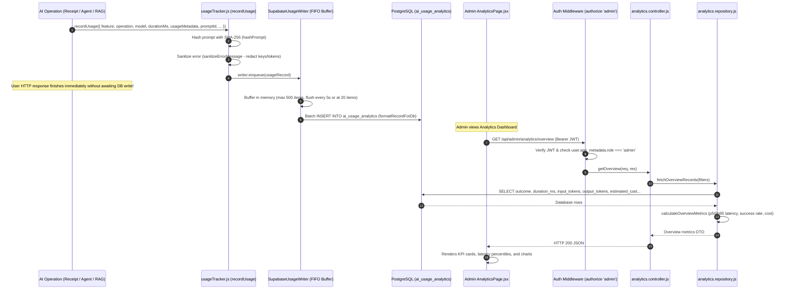

# SpendWise AI Data Flow 04: Admin AI Analytics

> **Inspection Baseline**: Commit `3634a4e6c61c797a9aed12d81043494c65e5d817`  
> **Inspection Date**: October 27, 2026  
> **Capability Classification**: Platform Observability & Telemetry Infrastructure

---

## 1. Overview & Architecture

The Admin AI Analytics subsystem provides observability into all AI operations across SpendWise (receipt multimodal extraction, expense agent tool-calling, and RAG knowledge retrieval). The system is engineered to satisfy three non-negotiable requirements:

1. **Zero Impact on User Latency**: Telemetry recording is completely decoupled from request-response cycles. Writes are buffered in memory via a bounded FIFO queue and flushed asynchronously to Supabase PostgreSQL in batched background transactions.
2. **Absolute Data Privacy**: Prompt texts, LLM responses, receipt images, OCR extracts, and financial records are **never stored** in the analytics database. Telemetry records only cryptographic hashes, token counts, execution latencies, and sanitized error messages.
3. **Rigorous Data Provenance**: Token counts and cost calculations clearly distinguish between provider-verified numbers, deterministic historical backfills, and missing/unpriced records without corrupting raw audit trails.



---

## 2. Frontend Navigation & Authorization

### 2.1 Route Guard & Admin Surface
- **Frontend Route**: Protected by `AdminRoute` in [`client/src/shared/components/AdminRoute.jsx`](../../client/src/shared/components/AdminRoute.jsx) which checks `user?.app_metadata?.role === 'admin'` or `user?.role === 'admin'`. Non-admin users are redirected to `/`.
- **Admin Dashboard Layout**: [`client/src/features/analytics/AnalyticsPage.jsx:L1-L150`](../../client/src/features/analytics/AnalyticsPage.jsx#L1-L150) renders the top-level container, managing time range filters (`24h`, `7d`, `30d`, `all`), model selectors, and tab navigation.
- **Client Components**:
  - [`AnalyticsKpiCards.jsx`](../../client/src/features/analytics/AnalyticsKpiCards.jsx): Renders 4 primary KPI blocks (Total Requests, Success Rate, Average & p95 Latency, Total Cost & Tokens).
  - [`AnalyticsCharts.jsx`](../../client/src/features/analytics/AnalyticsCharts.jsx): Renders time-series request volume and latency trends.
  - [`AnalyticsHistoryTable.jsx`](../../client/src/features/analytics/AnalyticsHistoryTable.jsx): Paginated, searchable request history table with full-dataset sorting.

### 2.2 Backend Authorization
- **Mount Point**: Mounted in [`server/src/routes/adminRoute.js:L13-L22`](../../server/src/routes/adminRoute.js#L13-L22):
  ```javascript
  router.use(authenticate, authorize('admin'));
  router.use('/analytics', analyticsRouter);
  ```
- **Enforcement**: [`server/src/shared/middleware/auth.middleware.js:L37-L50`](../../server/src/shared/middleware/auth.middleware.js#L37-L50) validates that the user's role in Supabase `app_metadata` equals `'admin'`. Any unauthenticated or non-admin request is rejected with HTTP 401 Unauthorized or HTTP 403 Forbidden.

---

## 3. Telemetry Recording Lifecycle

### Step 1: Telemetry Creation (`usageTracker.js`)
When an AI call completes (or fails), `recordUsage` is called in [`server/src/features/analytics/usageTracker.js:L190-L380`](../../server/src/features/analytics/usageTracker.js#L190-L380).
- **Prompt Identification**:
  - `prompt_id`: Registered logical identifier (e.g. `'receipt_extraction'`, `'expense_agent_assistant'`).
  - `prompt_version`: Explicit logical version string (e.g. `'v1'`, `'v2'`).
  - `prompt_hash`: SHA-256 cryptographic hash of the exact resolved prompt text generated by `hashPrompt(text)` ([`usageTracker.js:L12-L21`](../../server/src/features/analytics/usageTracker.js#L12-L21)).
- **Token Extraction**:
  - Input, output, and total tokens extracted directly from provider `usageMetadata`.
  - If token counts are missing from older or failed calls, `token_counts_available` is set to `false`.
- **Cost Calculation**:
  - `calculateRequestCost(model, inputTokens, outputTokens)` ([`pricingConfig.js:L98-L161`](../../server/src/features/analytics/pricingConfig.js#L98-L161)) looks up unit rates from `MODEL_PRICING_REGISTRY`.
- **Error Sanitization**:
  - Errors undergo `sanitizeErrorMessage` ([`usageTracker.js:L35-L55`](../../server/src/features/analytics/usageTracker.js#L35-L55)), scrubbing API keys, JWT tokens, Bearer headers, and database credentials before logging.

### Step 2: Bounded Asynchronous Persistence (`analytics.writer.js`)
Persistence is handled by `SupabaseUsageWriter` in [`server/src/features/analytics/analytics.writer.js:L10-L185`](../../server/src/features/analytics/analytics.writer.js#L10-L185):
- **Bounded In-Memory FIFO Queue**: Maximum queue size is 500 items (`MAX_QUEUE_SIZE = 500`, [`analytics.constants.js:L35`](../../server/src/features/analytics/analytics.constants.js#L35)). If database writes stall, the oldest records are dropped (`saturatedDrops`) to prevent memory leaks or process crashes.
- **Batching & Flush Triggers**: Flushes occur every 5 seconds (`FLUSH_INTERVAL_MS = 5000`) or immediately when the queue reaches 20 records (`BATCH_SIZE = 20`).
- **Resilience**: Flushes use unref timers so the Node process can terminate cleanly during tests or shutdown.

---

## 4. Database Schema & Migration History

Telemetry records are persisted in the `ai_usage_analytics` table in Supabase PostgreSQL:

| Migration File | Key Schema Enhancements |
| :--- | :--- |
| `supabase/migrations/20261020000000_create_ai_usage_analytics.sql` | Initial schema: `id`, `timestamp`, `feature`, `operation`, `model`, `provider`, `outcome`, `duration_ms`, `total_tokens`, `prompt_id`, `prompt_version`, `error`. |
| `supabase/migrations/20261026000004_add_request_history_columns.sql` | Adds `input_tokens`, `output_tokens`, `token_counts_available`, `estimated_cost`, `cost_status`, `tools_executed`, `attempts`, `is_refusal`, `refusal_reason`. |
| `supabase/migrations/20261026000005_split_prompt_version_and_hash.sql` | Introduces dedicated `prompt_hash` column. Separates 64-character SHA-256 hashes from explicit logical versions (`v1`, `v2`), preventing hash truncation in UI. |
| `supabase/migrations/20261027000007_add_token_and_cost_estimation_metadata.sql` | Adds `estimated_input_tokens`, `estimated_output_tokens`, `estimated_total_tokens` to support deterministic historical backfills. |

---

## 5. Metric Provenance Table

This table documents exactly how every metric displayed on the Admin Dashboard is computed, where it originates, and whether it is provider-verified or estimated.

| Dashboard Metric | Frontend Location | API Response Field | Aggregation / Computation Function | Database Source Field(s) | Actual or Estimated? | Related Tests |
| :--- | :--- | :--- | :--- | :--- | :--- | :--- |
| **Total Requests** | `AnalyticsKpiCards.jsx` | `overview.totalRequests` | `records.length` in `calculateOverviewMetrics` ([`analytics.utils.js:L51`](../../server/src/features/analytics/analytics.utils.js#L51)) | `COUNT(id)` / `ai_usage_analytics.id` | **Actual** | [`tests/unit/analytics.test.js:L45-L65`](../../tests/unit/analytics.test.js#L45-L65) |
| **Success Rate** | `AnalyticsKpiCards.jsx` | `overview.successRate` | `(successCount / totalRequests) * 100` ([`analytics.utils.js:L109`](../../server/src/features/analytics/analytics.utils.js#L109)) | `outcome = 'success'` | **Actual** | [`tests/unit/analytics.test.js:L45-L65`](../../tests/unit/analytics.test.js#L45-L65) |
| **Average Latency** | `AnalyticsKpiCards.jsx` | `overview.avgLatencyMs` | `Math.round(sumLatency / latencySampleCount)` ([`analytics.utils.js:L104`](../../server/src/features/analytics/analytics.utils.js#L104)) | `duration_ms` | **Actual** | [`tests/unit/analytics.test.js:L70-L85`](../../tests/unit/analytics.test.js#L70-L85) |
| **p50 Latency (Median)** | `AnalyticsKpiCards.jsx` | `overview.p50LatencyMs` | `calculatePercentile(sortedLatencies, 0.50)` ([`analytics.utils.js:L35-L42`](../../server/src/features/analytics/analytics.utils.js#L35-L42)) | `duration_ms` | **Actual** | [`tests/unit/analytics.test.js:L70-L85`](../../tests/unit/analytics.test.js#L70-L85) |
| **p95 Latency** | `AnalyticsKpiCards.jsx` | `overview.p95LatencyMs` | `calculatePercentile(sortedLatencies, 0.95)` ([`analytics.utils.js:L107`](../../server/src/features/analytics/analytics.utils.js#L107)) | `duration_ms` | **Actual** | [`tests/unit/analytics.test.js:L70-L85`](../../tests/unit/analytics.test.js#L70-L85) |
| **Actual Tokens (In/Out/Total)** | `AnalyticsHistoryTable.jsx` | `record.tokenUsage` | Provider-reported tokens in `recordUsage` ([`usageTracker.js:L240`](../../server/src/features/analytics/usageTracker.js#L240)) | `input_tokens`, `output_tokens`, `total_tokens` | **Actual** (Provider reported) | [`tests/unit/analytics.test.js:L90-L115`](../../tests/unit/analytics.test.js#L90-L115) |
| **Estimated Tokens (Backfill)** | `AnalyticsHistoryTable.jsx` | `record.estimatedTokens` | Deterministic pseudo-random generation based on request ID hash ([`tokenEstimator.js:L40-L95`](../../server/src/features/analytics/tokenEstimator.js#L40-L95)) | `estimated_input_tokens`, `estimated_output_tokens` | **Estimated** (Clearly badged in UI) | [`tests/unit/analyticsTokenEstimator.test.js:L1-L75`](../../tests/unit/analyticsTokenEstimator.test.js#L1-L75) |
| **Calculated Cost (Actual)** | `AnalyticsHistoryTable.jsx` | `record.estimatedCost` | `(in * inRate) + (out * outRate)` via `calculateRequestCost` ([`pricingConfig.js:L115`](../../server/src/features/analytics/pricingConfig.js#L115)) | `estimated_cost` with `cost_status = 'calculated'` | **Verified Estimate** (Exact price applied to actual tokens) | [`tests/unit/analytics.test.js:L120-L145`](../../tests/unit/analytics.test.js#L120-L145) |
| **Backfill Cost** | `AnalyticsHistoryTable.jsx` | `record.estimatedCost` | Pricing rates applied to estimated tokens ([`tokenEstimator.js:L100-L135`](../../server/src/features/analytics/tokenEstimator.js#L100-L135)) | `estimated_cost` with `cost_status = 'estimated_backfill'` | **Estimated** (Clearly marked with `~` prefix in UI) | [`tests/unit/analyticsTokenEstimator.test.js:L80-L120`](../../tests/unit/analyticsTokenEstimator.test.js#L80-L120) |
| **Prompt Version** | `AnalyticsHistoryTable.jsx` | `record.promptVersion` | Extracted and separated from hash via `formatDbToRecord` ([`analytics.repository.js:L63-L82`](../../server/src/features/analytics/analytics.repository.js#L63-L82)) | `prompt_version` | **Actual** (or `'Legacy / unknown'`) | [`tests/unit/analyticsTelemetryRepair.test.js:L1-L60`](../../tests/unit/analyticsTelemetryRepair.test.js#L1-L60) |
| **Prompt Hash** | `AnalyticsHistoryTable.jsx` | `record.promptHash` | Exact 64-char SHA-256 hash ([`analytics.repository.js:L65`](../../server/src/features/analytics/analytics.repository.js#L65)) | `prompt_hash` | **Actual** | [`tests/unit/analyticsTelemetryRepair.test.js:L1-L60`](../../tests/unit/analyticsTelemetryRepair.test.js#L1-L60) |

---

## 6. Request History: Search, Sort, and Pagination

### 6.1 Full-Dataset Search
Unlike naive client-side filtering that only filters the active 10 rows, the search bar in [`AnalyticsHistoryTable.jsx`](../../client/src/features/analytics/AnalyticsHistoryTable.jsx) delegates directly to server-side query filters:
- **Backend Implementation**: [`analytics.repository.js:L205-L222`](../../server/src/features/analytics/analytics.repository.js#L205-L222) builds an `.or()` query in Supabase across:
  - `feature`, `operation`, `model`, `outcome`
  - `prompt_id`, `prompt_version`, `prompt_hash`
  - Exact UUID match on `id`
- **Sanitization**: Search query characters `, % ( )` are safely escaped before passing to Supabase PostgreSQL ILIKE filters.

### 6.2 Full-Dataset Multi-Column Sorting
- **Supported Columns**: `timestamp`, `feature`, `operation`, `model`, `durationMs`, `totalTokens`, `estimatedCost`, `outcome`.
- **Server-Side Execution**: [`analytics.repository.js:L365-L380`](../../server/src/features/analytics/analytics.repository.js#L365-L380) applies `.order(sortColumn, { ascending: sortOrder === 'asc' })` directly to PostgreSQL, ensuring all historical records are sorted before pagination slicing.

### 6.3 Direct Page Navigation & Bounds Validation
- **Direct Page Jump**: [`client/src/shared/components/Pagination.jsx`](../../client/src/shared/components/Pagination.jsx) allows direct entry of target page numbers.
- **Validation**: User input is validated using `validatePagination` ([`client/src/shared/utils/validation.js`](../../client/src/shared/utils/validation.js)), clamping values between 1 and `totalPages`.

---

## 7. Data Privacy Guarantees

SpendWise enforces strict security policies to protect user privacy and sensitive financial details:

1. **Exclusion of Prompt Text**: The `ai_usage_analytics` schema does **not** have a `prompt_text` or `content` column. Prompts are reduced to SHA-256 hashes (`prompt_hash`). Full prompts cannot be reconstructed from telemetry.
2. **Exclusion of Model Responses**: Generated answers, extracted receipt JSON, itemized receipts, and transaction records are strictly excluded from telemetry tables.
3. **Exclusion of Image Data**: Raw receipt bytes, base64 strings, and Supabase Storage URLs are never logged in `ai_usage_analytics`.
4. **Credential Scrubbing**: `sanitizeErrorMessage` ([`usageTracker.js:L35-L55`](../../server/src/features/analytics/usageTracker.js#L35-L55)) strips Google AI Studio keys (`AIza...`), Supabase service role keys, and bearer tokens before saving any error text.

---

## 8. Verification & Tests

The Admin Analytics subsystem is thoroughly verified by tests in `tests/unit/`:

| Test File | Lines | Scope / Verified Behavior |
| :--- | :--- | :--- |
| `tests/unit/analytics.test.js` | [`L40-L150`](../../tests/unit/analytics.test.js#L40-L150) | In-memory and Supabase overview aggregations, percentile calculation accuracy, token counts, pricing rate lookups. |
| `tests/unit/analyticsHistoryTable.test.js` | [`L1-L120`](../../tests/unit/analyticsHistoryTable.test.js#L1-L120) | Full dataset search, multi-column sorting, empty search states, direct page jump validation. |
| `tests/unit/analyticsTelemetryRepair.test.js` | [`L1-L90`](../../tests/unit/analyticsTelemetryRepair.test.js#L1-L90) | Resolution of historical records where SHA-256 hashes were previously stored in `prompt_version`; validation of prompt version vs hash separation. |
| `tests/unit/analyticsTokenEstimator.test.js` | [`L1-L140`](../../tests/unit/analyticsTokenEstimator.test.js#L1-L140) | Deterministic token backfill estimates derived from request ID seed; transparent UI badging of estimated values. |
| `tests/integration/adminAuthRoutes.test.js` | [`L1-L45`](../../tests/integration/adminAuthRoutes.test.js#L1-L45) | Role-based authorization: rejection of unauthenticated requests (HTTP 401) and non-admin users (HTTP 403) on `/api/admin/analytics`. |
