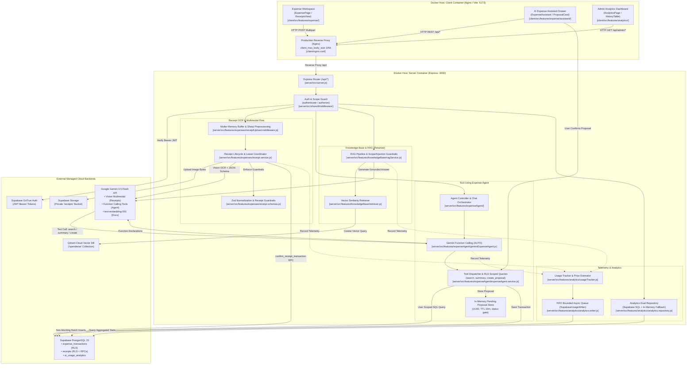

# SpendWise AI Data Flows & Architecture Documentation

**Inspection Revision:** Commit `3634a4e6c61c797a9aed12d81043494c65e5d817` (`refactor-w1`)  
**Inspection Date:** 2026-10-27  
**Scope:** Complete implementation-level, source-traceable AI architecture and data-flow documentation.

---

## 1. System-Level Architecture Diagram

The diagram below reflects the active, verified implementation across Docker containers, the Express application layer, and external cloud services:

---

## 2. Directory Navigation & Flow Map

| Flow | Document | Primary Scope | Actual Entry Point |
|---|---|---|---|
| **Flow A** | [01-receipt-multimodal.md](./01-receipt-multimodal.md) | Main user receipt-image digitization from UI selection to confirmed financial transaction. | `POST /api/receipts/upload` |
| **Flow B** | [01-receipt-multimodal.md#part-2-multimodal-input-and-structured-output](./01-receipt-multimodal.md#part-2-multimodal-input-and-structured-output) | Vision model prompt assembly, strict JSON schema output, Vietnamese date/currency normalization, and guardrails. | [`geminiProvider.js:extractReceiptImage`](../../server/src/shared/integrations/ai/providers/geminiProvider.js#L485-L552) |
| **Flow C** | [02-tool-using-agent.md](./02-tool-using-agent.md) | Natural language expense assistant, Gemini tool declarations, function calling loop, RLS queries, and proposal-confirmation gate. | `POST /api/expense-agent/assistant` |
| **Flow D** | [03-rag-flow.md](./03-rag-flow.md) | Markdown knowledge base chunking, Qdrant indexing, cosine similarity candidate retrieval, and grounded Q&A. | `POST /api/user/chat` & `POST /api/admin/index` |
| **Flow E** | [04-admin-analytics.md](./04-admin-analytics.md) | Request-level telemetry lifecycle, async FIFO batch buffer, pricing calculations, prompt hashing, and admin dashboard queries. | `GET /api/admin/analytics/overview` & `history` |
| **Catalogue** | [05-prompts-guardrails-and-telemetry.md](./05-prompts-guardrails-and-telemetry.md) | Unified reference of all prompts, deterministic guardrails, tools, and external service dependencies. | Cross-cutting reference |

---

## 3. Capability Classification & Milestone 1 Baseline

In accordance with approved Milestone 1 project specifications, capabilities are categorized as follows:

| Capability Tier | Scope & Status | Components Included |
|---|---|---|
| **Committed Milestone 1 AI Capabilities** | Active in default user experience | • **Capability B (Tool-Using Agent):** Conversational assistant with tool calling for transaction search, spending totals, and transaction proposal creation with mandatory user confirmation. • **Capability C (Structured Output):** Receipt OCR constrained to strict schema via Gemini `responseJsonSchema` and Zod normalization. • **Capability D (Multimodal Input):** Direct image processing via Gemini vision models without third-party OCR engines. |
| **Operational Admin & Platform Features** | Active and verified | • **Admin AI Analytics:** Asynchronous telemetry writer, cost calculation, token estimation, and request history table. • **Authentication & Ownership:** Supabase GoTrue authentication, RLS ownership filters, and dedicated database security definer functions. |
| **Optional / Retained Infrastructure** | Implemented, tested, but inactive by default | • **Knowledge Base RAG:** Section chunking (`data/knowledge/`), Qdrant Cloud vector indexing, and cosine retrieval. *Note:* Chat defaults to `strategy: 'agent'` via [`assistant.service.js:L40`](../../server/src/features/assistant/assistant.service.js#L40). RAG remains fully operational when setting `CHAT_STRATEGY=rag`. |

---

## 4. Source-Reference Standard

Every claim in this documentation links directly to the current source code using relative Markdown links:

* Format: `[filepath:L<start>-L<end>](../../filepath#L<start>-L<end>)`
* Example: [`server/src/features/expenses/receipt.service.js:L169-L195`](../../server/src/features/expenses/receipt.service.js#L169-L195)
* Line numbers correspond strictly to commit `3634a4e6c61c797a9aed12d81043494c65e5d817`.
