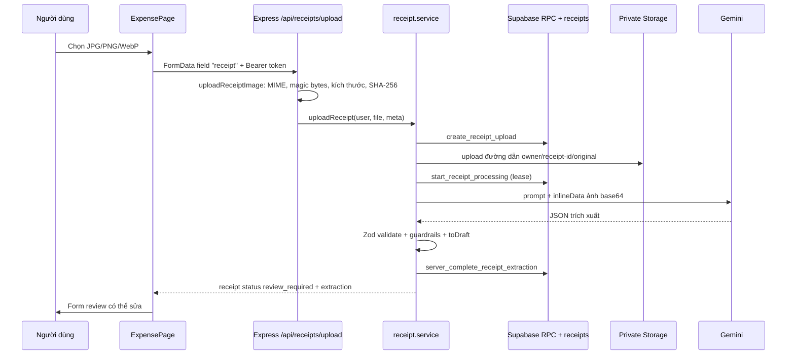

# AI Receipt Scanner: Multimodal AI và Structured Output

**Trạng thái tài liệu:** mô tả code hiện có trong repository. Các khẳng định về Supabase từ xa chỉ được xem là *cần kiểm tra trên Dashboard/test project* nếu không có bằng chứng chạy trực tiếp.

## 1. Multimodal AI là gì trong tính năng này?

Multimodal AI là mô hình nhận nhiều dạng dữ liệu. Ở đây Gemini nhận **ảnh hóa đơn** cùng với prompt văn bản, sau đó trích xuất dữ liệu giao dịch. Đây không phải OCR thuần: ảnh được gửi dưới dạng `inlineData` base64 cùng yêu cầu JSON trong `extractReceiptImage()` tại `server/src/shared/integrations/ai/providers/geminiProvider.js`.

Luồng thực tế:



### Nhập ảnh và kiểm tra trước Gemini

- `client/src/components/expense/ExpensePage.jsx` chặn phía trình duyệt: JPG/PNG/WebP, tối đa 5 MB, hiển thị trạng thái đang xử lý và khóa upload tiếp theo.
- `client/src/services/expenseApi.js` gửi `FormData` với field `receipt` tới `POST /api/receipts/upload`, kèm Bearer token.
- `server/src/features/expenses/receiptUpload.middleware.js` dùng Multer memory storage; `inspectReceiptImage()` kiểm tra magic bytes, MIME phải khớp nội dung, kích thước tối đa 5 MB, ảnh giải mã được bằng Sharp và chiều rộng/cao không quá 8.000 px. Đồng thời tạo SHA-256.
- `server/src/features/expenses/receipt.service.js` tạo row owner-scoped, tải ảnh vào bucket private `receipts`, lấy processing lease rồi gọi Gemini. Nếu upload/extraction lỗi, `cleanUpTemporaryReceipt()` cố xóa object và row tạm; nếu chính cleanup lỗi thì log server giữ thông tin phục hồi an toàn.

Ảnh không đọc được bị chặn ở validation hoặc bị Gemini đánh dấu `documentType: "unknown"`; `enforceReceiptGuardrails()` từ `receiptGuardrails.js` trả lỗi an toàn `NOT_A_RECEIPT`, không tạo transaction.

## 2. Structured Output

Plain text như “VinMart, tổng 183 nghìn” không đủ an toàn để ghi database: dễ thiếu trường, sai kiểu, không kiểm tra được số tiền/ngày, và khó ánh xạ vào form. Provider vì vậy yêu cầu `responseMimeType: 'application/json'`, `responseJsonSchema` và `temperature: 0`; sau đó `validateStructuredOutput(..., receiptExtractionSchema, { throwOnError: true })` xác thực lần nữa bằng Zod.

Schema thực tế nằm ở `server/src/features/expenses/receipt.schemas.js`:

| Field | Kiểu / giới hạn | Ghi chú |
| --- | --- | --- |
| `documentType` | `receipt`, `invoice`, `unknown` | `unknown` bị guardrail từ chối. |
| `transactionType` | `expense`, `income`, `unknown` | `unknown` cuối cùng map thành expense khi tạo draft. |
| `merchant` | string tối đa 120 hoặc `null` | Chuẩn hóa rỗng thành `null`. |
| `transactionDate` | `YYYY-MM-DD` hoặc `null` | Draft dùng ngày hiện tại khi thiếu. |
| `totalAmount` | number dương hoặc `null` | VND nhỏ hơn 1.000 được nhân 1.000 và thêm warning. |
| `currency` | string 3 ký tự, mặc định `VND` | Uppercase. |
| `category` | một trong 9 category ứng dụng | Nhãn AI phổ biến được map về category hợp lệ. |
| `note` | string tối đa 500 hoặc `null` | Có thể sửa trong review. |
| `items` | tối đa 50 `{ name, amount }` | Chấp nhận alias `description/item/product/title`; item không có tên bị bỏ. |
| `warnings` | tối đa 20 string, mỗi string tối đa 200 | Lưu cùng receipt; UI hiện chưa render danh sách warning. |

Ví dụ **minh họa** đúng schema (không phải kết quả live):

```json
{
  "documentType": "receipt",
  "transactionType": "expense",
  "merchant": "VinMart Royal City",
  "transactionDate": "2025-10-24",
  "totalAmount": 183000,
  "currency": "VND",
  "category": "Food & dining",
  "note": null,
  "items": [
    { "name": "Chuối tiêu", "amount": 20000 },
    { "name": "Sữa tươi Vinamilk 1L", "amount": 32000 }
  ],
  "warnings": []
}
```

Prompt `server/prompts/receipts/receipt-v3.md` cũng yêu cầu `183.000 VND` phải trả về `183000`; Zod bổ sung lớp bảo vệ cho trường hợp model vẫn trả `183`/`20` cho VND. Điều này là heuristic, nên người dùng vẫn phải review trước khi lưu.

## 3. Ánh xạ dữ liệu AI đến transaction

`toDraft()` trong `server/src/features/expenses/receipt.service.js` giữ dữ liệu extraction và thêm field phù hợp form: `type`, `date`, `amount`, `note`. `ReceiptReview.jsx` khởi tạo state bằng `{ ...INITIAL_TRANSACTION, ...draft }`.

| Gemini output field | Backend normalized field | Frontend form field | Database column |
| --- | --- | --- | --- |
| `merchant` | `merchant` | `merchant` (editable) | `expense_transactions.merchant` |
| `transactionDate` | `date` | `date` (editable) | `transaction_date` |
| `totalAmount` | `amount` | `amount` (editable, number) | `amount` |
| `category` | `category` | `category` select (editable) | `category` |
| `transactionType` | `type` (`income` hoặc `expense`) | quyết định category select; không có control type riêng | `type` |
| `note` | `note` | `note` textarea (editable) | `note` |
| `items` | `items` giữ trong draft/form payload | chưa có UI editor item riêng | `items` JSONB |
| `warnings` | `warnings` | không có vùng render warning hiện tại | `receipts.warnings` JSONB |

Như vậy merchant, date, amount, category và note được review/sửa trực tiếp. `items` có thể đi cùng payload confirm nhưng chưa hiển thị/sửa riêng; warnings được lưu nhưng chưa hiển thị — đây là phần *đã implement một phần* ở UI.

## 4. Confirm and save

Khi bấm **Confirm and save transaction**:

1. `ReceiptReview.handleConfirm()` kiểm tra merchant và amount dương, chuyển amount sang Number, khóa nút khi đang lưu.
2. `ExpensePage.confirmReceipt()` gọi `expenseApi.confirmReceipt()`.
3. `expenseApi` gửi `POST /api/receipts/:id/confirm` với `{ finalTransaction }` và Bearer token.
4. Route `server/src/features/expenses/expenses.routes.js` áp dụng `authenticate` và `receiptConfirmSchema`; controller gọi `receiptService.confirmReceipt()`.
5. Client Supabase user-scoped gọi RPC `confirm_receipt_transaction`. SQL trong `supabase/migrations/202610230002_secure_receipts.sql` khóa receipt owner bằng `FOR UPDATE`, chỉ nhận `review_required`, validate transaction tối thiểu, insert `public.expense_transactions`, link `receipts.transaction_id`, rồi chuyển status `confirmed` trong cùng transaction.
6. Nếu request confirm lặp lại, RPC trả transaction đã có khi status là `confirmed`; unique `transaction_id` và row lock ngăn duplicate.
7. Frontend tải lại transaction list và đóng review. Transaction hiện trong `TransactionTable.jsx`.

RLS/ownership của receipt được enforce trong RPC và policies. Cần chạy test project Supabase để chứng minh remote RLS/RPC sau khi migration được áp dụng.

## 5. Code walkthrough để bảo vệ trước giảng viên

| File và function | Input → output | Vai trò |
| --- | --- | --- |
| `ExpensePage.jsx` — `uploadReceipt` | File browser → `receipt` state | Kiểm tra nhanh UI, preview, loading và gọi API. |
| `receiptUpload.middleware.js` — `inspectReceiptImage` | Multer file → metadata đã xác thực | Chặn file giả, sai MIME, quá lớn hoặc pixel bomb trước AI. |
| `receipt.service.js` — `uploadReceipt` | User, bytes, metadata → receipt review | Tạo row/path riêng user, Storage private, khởi động lifecycle. |
| `receipt.service.js` — `processStoredReceipt` | Receipt + image → draft review | Lấy lease, gọi extractor, hoàn thành RPC hoặc cleanup lỗi. |
| `geminiProvider.js` — `extractReceiptImage` | `{ buffer, mimeType }` → extraction đã Zod validate | Gửi prompt + bytes ảnh tới Gemini JSON mode, timeout/retry, ghi telemetry. |
| `receipt.schemas.js` — `receiptExtractionSchema` | JSON model → object chuẩn hóa | Kiểm kiểu/field, category/item aliases, heuristic VND. |
| `receiptGuardrails.js` — `enforceReceiptGuardrails` | Extraction → extraction hoặc `ReceiptGuardrailError` | Từ chối non-receipt và text có dấu hiệu instruction injection. |
| `receipt.service.js` — `toDraft` | Extraction → draft UI | Chuyển tên field AI sang form transaction hiện có. |
| `ReceiptReview.jsx` — `handleConfirm` | Form sửa tay → `onConfirm` | Bắt buộc human review và chống double click bằng `busy`. |
| SQL `confirm_receipt_transaction` | Receipt ID + transaction JSON → receipt/transaction JSON | Lưu atomically, owner-only, idempotent. |
