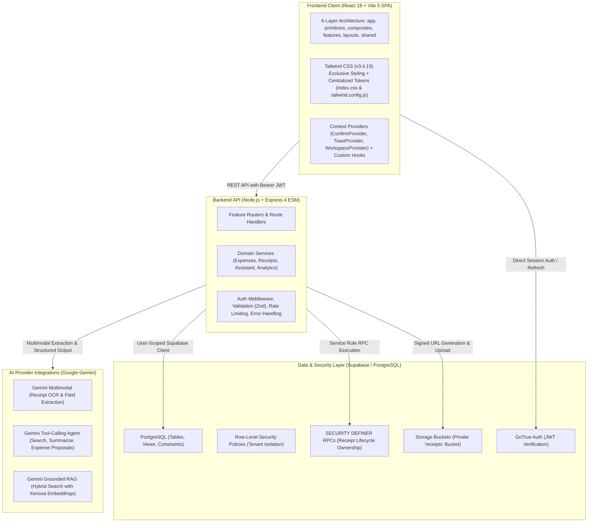
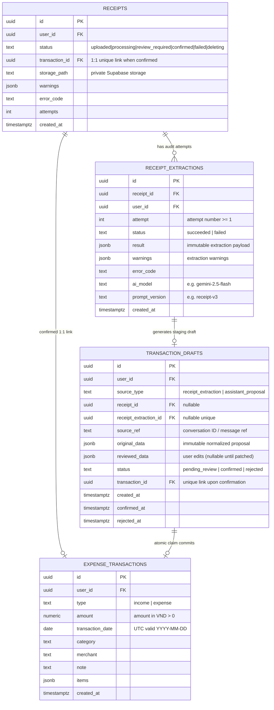
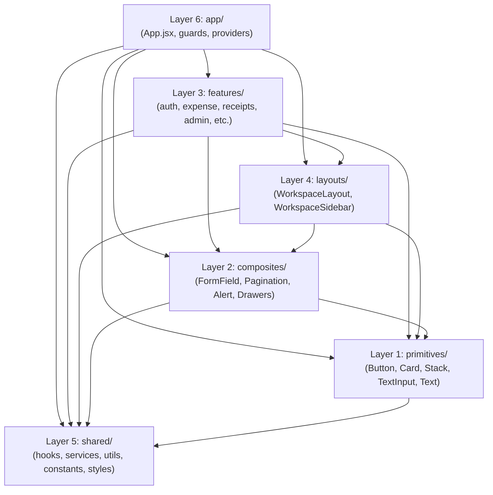
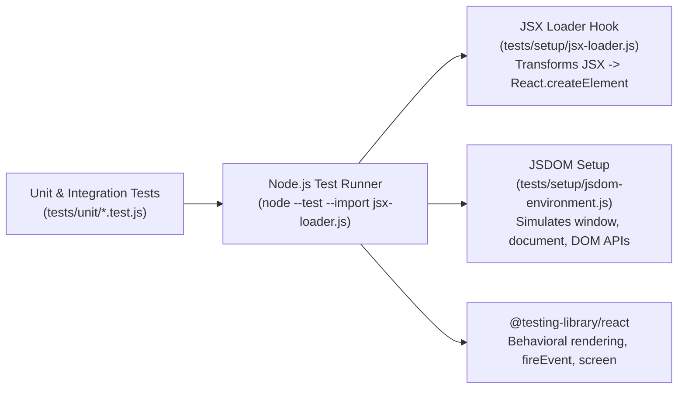

# SpendWise — System Architecture & Engineering Reference

> **Status:** Canonical Architectural Reference (Post-Refactoring Consolidated)  
> **Related Documents:** [`docs/academic/architecture.md`](../academic/architecture.md), [`refactoring-plan.md`](./refactoring-plan.md), [`progress.md`](./progress.md), [`implementation-guidelines.md`](./implementation-guidelines.md), [`adrs/`](./adrs/), [`.agents/rules/project-basics.md`](../../.agents/rules/project-basics.md)

---

## 1. Overview & System Purpose

SpendWise is an intelligent expense tracking, receipt extraction, and financial analytics platform designed with strict architectural boundaries, automated AI pipelines, and enterprise-grade security.

### 1.1 Technology Stack



### 1.2 Core Architectural Invariants

1. **Strict 6-Layer Frontend Architecture:** The client code is structured into six strictly isolated layers: `app/`, `primitives/`, `composites/`, `features/`, `layouts/`, and `shared/`. Dependency flow is strictly unidirectional downwards.
2. **Single-Currency VND Ledger:** `public.expense_transactions` stores all currency amounts in **VND**. Non-VND receipts extracted by Gemini must never be silently converted or persisted; they trigger explicit human confirmation and mandatory currency conversion review before persisting.
3. **Immutable Applied RPC Contracts:** Applied PostgreSQL migrations in `supabase/migrations/` and RPC signatures (`create_receipt_upload`, `start_receipt_processing`, `server_complete_receipt_extraction`, `server_mark_receipt_failed`, `retry_receipt_processing`, `confirm_receipt_transaction`, `begin_receipt_delete`, `finalize_receipt_delete`, `authorize_receipt_preview`) remain immutable and secure.
4. **Stable REST API Contracts:** All public endpoints maintain backwards-compatible JSON response envelopes and standard HTTP status semantics.
5. **Private Storage & Time-Bound Previews:** Receipts are uploaded to a private Supabase Storage bucket with public access revoked. Previews require short-lived, signed URLs generated via PostgreSQL RPC authorization.
6. **Unified Transaction Drafts & Append-Only Extraction Audits:** Candidate transactions originating from AI (multimodal receipt extraction and conversational assistant proposals) are staged in `public.transaction_drafts` with immutable `original_data` and editable `reviewed_data` before committing to `public.expense_transactions`. Every OCR extraction attempt (success or failure) is immutably recorded in `public.receipt_extractions` with `ai_model` and `prompt_version` provenance.
7. **Safe Rejection & Receipt Retention:** Rejecting a transaction draft sets its status to `'rejected'`; it never deletes the source receipt record in `public.receipts` or the uploaded receipt image in Supabase Storage. Confirmation is atomic and idempotent.

---

## 2. Frontend Directory Structure

The frontend application under `client/src/` is organized into the following verified directory layout:

```text
client/src/
│
├── main.jsx                            # Application entry point (Vite bootstrap, DOM root mount)
├── index.css                           # Single global stylesheet entry point (tokens, @tailwind, @layer base)
│
├── app/                                # Application shell & orchestration
│   ├── App.jsx                         # Root router, global providers, and layout wiring
│   ├── guards/                         # Route security wrappers
│   │   ├── AuthenticatedRouteGuard.jsx # Enforces active Supabase session
│   │   └── AdminRouteGuard.jsx         # Enforces admin role access
│   └── providers/                      # Global UI context providers
│       ├── ConfirmProvider.jsx         # Promise-based confirmation dialog context
│       ├── ToastProvider.jsx           # Notification toast dispatch context
│       └── index.js                    # Barrel export
│
├── primitives/                         # Layer 1: Feature-agnostic atomic building blocks
│   ├── Backdrop.jsx                    # Dimmed modal backdrop primitive
│   ├── index.js                        # Barrel export
│   ├── buttons/                        # Button, IconButton
│   ├── cards/                          # Card, CardHeader, CardTitle, CardContent, CardFooter
│   ├── display/                        # Avatar, ChartBar, ColorIndicator, Icon, Icons, Logo
│   ├── feedback/                       # Spinner
│   ├── inputs/                         # TextInput, TextArea, Select, FileInput, PasswordInput
│   ├── labels/                         # Label, Badge, HelperText, ErrorText
│   ├── layout/                         # Stack, Inline, Grid, Spacer, Divider
│   ├── lists/                          # List, ListItem
│   ├── table/                          # Table, TableHead, TableBody, TableRow, TableCell, TableHeaderCell
│   └── typography/                     # Text, Link
│
├── composites/                         # Layer 2: Feature-agnostic multi-primitive components
│   ├── index.js                        # Barrel export
│   ├── dataDisplay/                    # EmptyState, SortableHeader, StatCard
│   ├── feedback/                       # Alert, HealthBadge, ToastContainer, ToastItem
│   ├── forms/                          # FormField (composes Label, HelperText, ErrorText)
│   ├── navigation/                     # Pagination (composes Button, Select, TextInput, Inline)
│   ├── overlays/                       # ConfirmDialog, OverlayDrawer, PushDrawer, Modal
│   ├── search/                         # SearchInput (composes TextInput, IconButton)
│   └── transactions/                   # TransactionFields, TransactionDraftReview (unified review card)
│
├── features/                           # Layer 3: Domain-specific feature modules
│   ├── admin/                          # Admin overview, user role management
│   ├── analytics/                      # AI telemetry dashboard, KPI cards, charts, query history
│   ├── auth/                           # Login, Registration, Password Reset, AuthContext
│   ├── categories/                     # Category reference and configuration (CategoriesView)
│   ├── chat/                           # Domain-agnostic AI conversation UI, PushDrawer, composer, history (Chatbot, useChat)
│   ├── documents/                      # Knowledge-base document CRUD, upload, and chunk inspector
│   ├── expense/                        # Personal Finance module: ExpensePage layout, Transaction ledger (TransactionView, TransactionTable, ManualEntry, TransactionDetails, ExpenseSummaryCards, expenseApi)
│   │   └── assistant/                  # Domain-specific AI Expense Assistant composing features/chat/ (ExpenseAssistant, ExpenseToolResult, expenseAssistantApi)
│   ├── home/                           # Landing showcase hero page (HomePage)
│   ├── knowledgeBase/                  # Knowledge base query tester, stats, vector index overview (KnowledgeBasePage)
│   ├── receipts/                       # Multimodal receipt scanning, OCR extraction review & retry (ScanReceiptView, useReceiptUpload, receiptsApi)
│   ├── systemPrompt/                   # System prompt editor, version history, active prompt selector
│   └── transactionDrafts/              # Transaction draft client service & hook (transactionDraftsApi, useTransactionDrafts)
│
├── layouts/                            # Layer 4: Structural layout shells
│   ├── WorkspaceLayout.jsx             # Authenticated workspace shell with sidebar, health polling, WorkspaceProvider, and content outlet
│   ├── WorkspaceSidebar.jsx            # Responsive navigation sidebar reading user & signout from WorkspaceContext
│   ├── sidebarConfig.js                # Navigation link registry, icons, and role requirements
│   └── index.js                        # Barrel export
│
└── shared/                             # Layer 5: Shared application-wide utilities & infrastructure
    ├── constants/                      # config.js, routes.js, messages.js, uiLabels.js
    ├── context/                        # WorkspaceContext.jsx (WorkspaceProvider, useWorkspace)
    ├── hooks/                          # useDrawer, usePagination, useSearch, useSort, useSession, useHealth, etc.
    ├── services/                       # apiClient.js, supabaseAuth.js, healthApi.js
    ├── transactions/                   # expenseConstants.js, expenseCategories.js, transactionFieldsUtils.js
    └── utils/                          # formatters.js, validation.js, collectionUtils.js, drawerFocus.js
```

---

## 3. Architectural Layers & Responsibilities

The SpendWise frontend is partitioned into six distinct layers with strict boundaries:

### 3.1 Layer 1: Primitives (`client/src/primitives/`)
- **Responsibility:** Atomic, reusable UI building blocks with no business domain logic.
- **Contract:**
  - Primitives own their internal appearance via Design Tokens and Tailwind classes.
  - **Zero Public `className` or `style`:** Primitives do not accept external styling escape hatches. They strip incoming `className` and `style` props to prevent styling leakage.
  - Visual variations are governed solely through explicit, typed `variant`, `size`, `invalid`, and layout props.
- **Categories:**
  - `Backdrop.jsx`: Dimmed modal backdrop primitive with fixed positioning, z-index token, and click dismissal handler.
  - `buttons/`: `Button` (variants: `primary`, `secondary`, `outline`, `ghost`, `danger`, `fab`, `sidebar`, `sidebar-active`, `sidebar-secondary`), `IconButton` (accessible icon button with mandatory aria-label).
  - `cards/`: `Card` (supports responsive padding scale including `xl: 'p-8 max-tablet:p-5 max-mobile:p-4'`), `CardHeader`, `CardTitle`, `CardContent`, `CardFooter`.
  - `display/`: `Avatar` (variants: `default`, `dark`, `brand`, `sidebar`), `ChartBar` (supports runtime percentage width/height and dynamic fill colors), `ColorIndicator`, `Icon`, `Icons` (custom SVGs), `Logo`.
  - `feedback/`: `Spinner` (loading indicator with size variants).
  - `inputs/`: `TextInput` (size variants `sm`, `md`, `lg`; trailing `endPadding` variants `none`, `sm`, `lg`), `TextArea` (size `sm`/`md`, resize `vertical`/`none`, `maxHeight` `none`/`composer`), `Select`, `FileInput`, `PasswordInput` (encapsulates eye toggle button with endPadding).
  - `labels/`: `Label` (accessible form label with required indicator), `Badge`, `HelperText`, `ErrorText`.
  - `layout/`: `Stack` (vertical flex), `Inline` (horizontal flex), `Grid` (CSS grid), `Spacer` (token-scale space), `Divider`.
  - `lists/`: `List`, `ListItem`.
  - `table/`: `Table` (variants: `default`, `compact`, `comfortable`), `TableHead`, `TableBody`, `TableRow`, `TableCell` (supports `truncate`, `mono`, `nowrap`), `TableHeaderCell`.
  - `typography/`: `Text` (polymorphic typography primitive; variants: `body`, `body-sm`, `secondary`, `caption`, `kicker`, `eyebrow`, `sidebar-eyebrow`, `heading`, `title`, `display`, etc.; semantic colors: `primary`, `secondary`, `muted`, `inverse`, `brand`, `sidebar`, `sidebar-muted`, etc.), `Link`.

### 3.2 Layer 2: Composites (`client/src/composites/`)
- **Responsibility:** Multi-primitive combinations that solve generic UI patterns without domain logic.
- **Contract:**
  - Composed entirely from Primitives.
  - Domain-agnostic and fully reusable across any feature.
- **Modules:**
  - `dataDisplay/`: `EmptyState` (standard zero-data UI), `SortableHeader`, `StatCard` (standard metric card, reused in `ExpenseSummaryCards`).
  - `feedback/`: `Alert` (callouts: `info`, `warning`, `error`, `success`), `HealthBadge` (system connection status indicator, promoted from `features/admin/`), `ToastContainer`, `ToastItem`.
  - `forms/`: `FormField` (composes `Stack`, `Label`, input slot, `HelperText`, `ErrorText`).
  - `navigation/`: `Pagination` (composes `Button`, `IconButton`, `Select`, `TextInput`, `Inline`, with `w-page-jump` scoped input width).
  - `overlays/`: `ConfirmDialog`, `OverlayDrawer` (composes `Backdrop`), `PushDrawer`, `Modal` (composes `Backdrop`).
  - `search/`: `SearchInput` (composes `TextInput` and clear `IconButton`).
  - `transactions/`: `TransactionFields` (feature-agnostic controlled inputs for transaction details: type, amount, date, category, merchant, note), `TransactionDraftReview` (unified candidate transaction review, validation, foreign currency warning, line item list, and confirm/reject card backed by controlled drafts, shared by `ScanReceiptView` and `ExpenseAssistant`).

### 3.3 Layer 3: Features (`client/src/features/`)
- **Responsibility:** Domain-specific business logic, views, forms, state management, and API calls.
- **Contract:**
  - Each feature folder is self-contained and exposes a public facade via `index.js`.
  - Features may compose Primitives, Composites, Layouts, and Shared utilities.
  - **No Cross-Feature Direct Imports:** A feature cannot directly import internal components or state from another feature. If logic is shared, it must be promoted to `shared/` or composed at the `app/` router level.
  - **Domain Boundaries & Core Responsibilities:**
    - **Transaction (`features/transaction/`):** Financial transaction ledger domain. Owns `TransactionPage.jsx`, manual transaction entry dialog (`ManualEntry.jsx`), detailed modal inspection (`TransactionDetails.jsx`), transaction ledger table (`TransactionTable.jsx`), overview summary metrics (`TransactionSummaryCards.jsx`), and dedicated ledger HTTP client (`transactionApi.js`). The `/expense/*` workspace route shell lives in `layouts/ExpenseLayout.jsx`.
    - **Receipt (`features/receipt/`):** Multimodal document ingestion domain. Owns receipt image uploads, extraction retry queue, and interactive draft review (`ScanReceiptPage.jsx`), upload lifecycle hooks (`useReceiptUpload.js`), and dedicated document API client (`receiptApi.js`).
    - **Transaction Draft (`features/transactionDraft/`):** Centralized client-side candidate transaction staging domain. Owns the API client (`transactionDraftApi.js`) and state management hook (`useTransactionDrafts.js`) for listing, fetching, patching, confirming, and rejecting transaction drafts. Backed by `/api/transaction-draft`.
    - **Chat (`features/chat/`):** Domain-agnostic conversation interface and drawer presentation system. Owns `Chatbot`, `ChatComposer`, `ChatMessageItem`, `ChatHistoryTab`, `useChat`, and local conversation persistence (`chatHistory.js`). Contains zero expense-specific business logic.
    - **Expense Assistant (`features/expenseAssistant/`):** Domain-specific AI assistant implementation (Model A architecture). Composes generic `features/chat/` primitives (`Chatbot`, `useChat`) via inversion of control render slots (`renderToolResult`, `renderBeforeComposer`, `renderAttachmentAction`) to provide financial assistance, structured tool rendering (`ExpenseToolResult`), Human-in-the-Loop transaction draft reviews (`TransactionDraftReview`), in-drawer receipt extraction (`useReceiptUpload` + `TransactionDraftReview`), and workspace synchronization (`notifyTransactionsChanged`). Consumes canonical agent endpoints from `expenseAssistantApi.js` and draft actions injected from `app/App.jsx`.

#### 3.3.1 Domain Model Responsibilities & Entity Relationships

The financial bookkeeping and AI ingestion workflow is governed by four clearly delineated entities:



1. **Transaction (`public.expense_transactions`):**
   - The authoritative, committed financial ledger.
   - Enforces the **Single-Currency VND Ledger Invariant** (`amount > 0` in VND) and strict UTC calendar date validation.
   - Rows are created either directly by the user via `ManualEntry` or through atomic confirmation of a `TransactionDraft`.
   - Links back to `public.receipts` 1:1 via `transaction_id`.
2. **Receipt (`public.receipts`):**
   - Represents an uploaded physical/digital receipt document.
   - Owns storage path references in the private Supabase Storage `receipts` bucket, extraction lease tokens (`processing_lease_id`), and lifecycle status (`uploaded`, `processing`, `review_required`, `confirmed`, `failed`, `deleting`).
   - **Receipt Lifecycle & Retention Invariant:** When a candidate draft is rejected or dismissed by the user, **the receipt is never deleted**. Its row in `public.receipts` and its image file in private storage are retained for record-keeping and audit trails. Hard deletion occurs only during internal cleanup of security-rejected uploads (`NOT_A_RECEIPT`, `PROMPT_INJECTION_REJECTED`).
3. **Receipt Extraction (`public.receipt_extractions`):**
   - Append-only, immutable audit record created for every OCR extraction attempt (whether successful or failed).
   - Enforced by a database `BEFORE UPDATE` trigger that raises an exception if modification is attempted.
   - Captures `ai_model`, `prompt_version`, raw `result`, `warnings`, and `error_code`, providing complete observability into model performance over time.
4. **Transaction Draft (`public.transaction_drafts`):**
   - Centralized staging model for all candidate transactions before they hit the committed ledger.
   - Supports two source types: `'receipt_extraction'` (originating from multimodal OCR) and `'assistant_proposal'` (originating from tool-calling conversational AI).
   - `original_data` preserves the exact normalized fields proposed by the AI and is never overwritten.
   - `reviewed_data` holds user-adjusted values (amount, merchant, date, category, note).
   - Valid statuses: `'pending_review'`, `'confirmed'`, `'rejected'`. No auto-expiration state exists; pending assistant drafts remain accessible across sessions until explicitly confirmed or rejected.

#### 3.3.2 Manual Entry vs. Scan Receipt Separation

* **Manual Entry (`features/expense/ManualEntry.jsx`):**
  - Dedicated non-AI form presented as a modal dialog or standalone card.
  - Designed for direct, intentional bookkeeping when no physical receipt is scanned.
  - Directly invokes `expenseApi.create` (`POST /api/transactions`), validating required fields, positive VND amounts, and UTC calendar dates.
  - Implements complete modal accessibility: focus trapping, Escape dismissal (guarded against active saving), and focus restoration.
* **Scan Receipt (`features/receipts/ScanReceiptView.jsx`):**
  - Multimodal document ingestion interface that replaces legacy `ReceiptsView`.
  - Coordinates file upload to private Supabase Storage, background OCR processing via Gemini, retry triggers for failed uploads (`POST /api/receipts/:id/retry`), and list presentation of pending drafts.
  - Renders `TransactionDraftReview` with receipt image previews, itemized line items, foreign currency warnings, and atomic confirm/reject controls.

#### 3.3.3 Chat vs. Expense Assistant Dependency Boundary

SpendWise maintains a strict decoupling between conversational UI and personal finance domain logic:
* **Generic Chat (`features/chat/`):**
  - 100% domain-agnostic slot-based chat UI (`Chatbot.jsx`, `ChatComposer.jsx`, `ChatMessageItem.jsx`, `useChat.js`).
  - Contains zero imports from `expense`, `receipts`, or `transactionDrafts`.
  - Exposes controlled inversion-of-control slots: `avatarIcon`, `quickActions`, `renderToolResult`, `renderBeforeComposer`, and `renderAttachmentAction`.
* **Expense Assistant (`features/expenseAssistant/`):**
  - Domain composition component (`ExpenseAssistant.jsx`) that wraps `Chatbot` and `useChat`.
  - Dispatches financial queries to `POST /api/expense-assistant` via `expenseAssistantApi.js`.
  - Renders custom financial tool results (`ExpenseToolResult.jsx`) and embeds the shared `TransactionDraftReview` component for transaction proposals.
  - Receives receipt upload methods (`useReceiptUpload`, `receiptsApi`) and transaction draft handlers (`onConfirmDraft`, `onRejectDraft`, `onSaveDraft`) via props from `app/App.jsx`.
  - **Zero Cross-Feature Imports:** Neither `chat` imports `expense`, nor `expense` imports internal `receipts` components directly. All cross-domain collaboration is wired at the top-level orchestration layer (`app/App.jsx`).

#### 3.3.4 Shared Confirmation & Rejection Workflow

All candidate transactions—regardless of whether they originated from a scanned receipt or a chat prompt—are confirmed and rejected through a single unified workflow backed by `server/src/features/transactionDrafts/`:
* **Atomic Claim & Idempotent Confirmation (`POST /api/transaction-drafts/:id/confirm`):**
  1. The client sends final reviewed fields (or accepts the draft as-is).
  2. The server executes an atomic claim query (`UPDATE public.transaction_drafts SET status='confirmed', confirmed_at=now() WHERE id=$1 AND user_id=$2 AND status='pending_review' RETURNING *`).
  3. If the draft was already claimed/confirmed concurrently (e.g. rapid double-clicks or duplicate network retries), the service detects that `status === 'confirmed'` and idempotently returns the existing linked `transaction` with HTTP 200 OK.
  4. For `source_type === 'receipt_extraction'`, confirmation invokes the existing `confirm_receipt_transaction` RPC to link `receipts.transaction_id` and update receipt status to `confirmed`.
  5. For `source_type === 'assistant_proposal'`, confirmation inserts directly into `public.expense_transactions`.
  6. The created transaction ID is linked to `transaction_drafts.transaction_id`.
* **Safe Rejection (`POST /api/transaction-drafts/:id/reject`):**
  1. Sets `transaction_drafts.status = 'rejected'` and records `rejected_at = now()`.
  2. For receipt-backed drafts, the associated record in `public.receipts` and the uploaded image in Supabase Storage are **retained untouched**, ensuring audit compliance.
  3. Re-rejecting an already rejected draft is idempotent and returns the rejected draft. Rejecting an already confirmed draft returns HTTP 400 Bad Request.

### 3.4 Layer 4: Layouts (`client/src/layouts/`)
- **Responsibility:** Page-level structural layouts and shells that frame views.
- **Contract:**
  - `WorkspaceLayout.jsx` provides the master authenticated shell. It receives `{ user, onSignOut, onHealthError, overlays, children }` from its parent `AuthenticatedRouteGuard` (within `WorkspaceRouteShell`), instantiates `WorkspaceProvider` with health polling and user state, renders `HealthBadge` in a centralized header bar, and renders `<WorkspaceSidebar />` with zero props alongside main scrollable `<WorkspaceContent>` (`children ?? <Outlet />`).
  - `WorkspaceSidebar.jsx` reads `user` and `onSignOut` directly from `useWorkspace()` (with fallback to `signOut()` and duplicate-click guards), completely eliminating `sidebarProps` and `onSignOut` prop-drilling through page components.
  - Scoped layout structure and responsive behavior are authored strictly using Tailwind CSS utility classes consuming standardized layout tokens (`w-sidebar`, `pl-sidebar`, `max-w-workspace`) and breakpoint screens (`max-desktop`, `max-tablet`, `max-mobile`). No standalone `.css` files are used.

### 3.5 Layer 5: Shared (`client/src/shared/`)
- **Responsibility:** Application-wide singletons, infrastructure, utilities, context, and hooks.
- **Contract:**
  - `constants/`: Configuration flags, route paths (`APP_ROUTES`), UI labels, error messages.
  - `context/`: `WorkspaceContext.jsx` exposing `WorkspaceProvider` and `useWorkspace()` hook managing user identity, signout coordination, health state, and cross-view reactive refresh versions (`transactionsVersion`, `notifyTransactionsChanged`, `receiptsVersion`, `notifyReceiptsChanged`).
  - `hooks/`: Generic React hooks (`useDrawer`, `usePagination`, `useSearch`, `useSort`, `useSession`, `useChatScroll`, `useHealth`, `useReceiptUpload`).
  - `services/`: Network clients (`apiClient.js`), Supabase authentication adapter (`supabaseAuth.js`), health API.
  - `utils/`: Pure utility functions (`formatters.js`, `validation.js`, `collectionUtils.js`, `drawerFocus.js`, `overlayStack.js`).
  - *(Note: Legacy standalone `.css` files under `shared/styles/` have been eliminated; styling is centralized exclusively in `client/tailwind.config.js` and `client/src/index.css` per ADR-0005).*

### 3.6 Layer 6: App Orchestration (`client/src/app/`)
- **Responsibility:** Application root bootstrap, routing table, route security guards, and global context providers.
- **Contract:**
  - `App.jsx` mounts top-level providers (`ToastProvider`, `ConfirmProvider`), declares client routes, and attaches `AuthenticatedRouteGuard` and `AdminRouteGuard`.
  - Mounts `WorkspaceRouteShell` once as a persistent React Router layout route wrapping `/home`, `/expense/*`, `/admin/analytics`, and `/admin/knowledge-base`. It composes `AuthenticatedRouteGuard -> WorkspaceLayout + WorkspaceExpenseAssistant` overlay.
  - `AdminRouteGuard` inspects `useWorkspace().user` first when nested inside the Workspace shell to avoid redundant session polling on internal route transitions.

---

## 4. Dependency Rules & Boundaries

To prevent cyclical dependencies and maintain clear separation of concerns, the frontend enforces a strict unidirectional dependency hierarchy:



### 4.1 Prohibited Dependency Boundaries

| Forbidden Import Direction | Reason | Correct Alternative |
| :--- | :--- | :--- |
| `primitives/` $\rightarrow$ `composites/`, `features/`, `layouts/` | Primitives must remain atomic and uncoupled from composite structures or business logic. | Compose primitives inside composites or features. |
| `composites/` $\rightarrow$ `features/` | Composites must remain business-agnostic and universally reusable. | Place domain-specific combinations inside `features/<feature-name>/`. |
| `features/A/` $\rightarrow$ `features/B/` | Direct coupling between feature domains creates tight coupling and circular references. | Lift common models, hooks, or helpers into `shared/`, or coordinate at the `app/` level. |
| `shared/` $\rightarrow$ `primitives/`, `composites/`, `features/` | Infrastructure and pure utilities must not depend on UI rendering layers. | Pass components as callbacks, children, or parameters into shared utilities. |
| Primitives $\rightarrow$ Native Elements with arbitrary `className` | Prevents style leaking and visual regressions. | Use semantic `variant` props and Design Tokens. |

---

## 5. Component Architecture & Design Principles

### 5.1 Controlled Variant Prop API
Primitives and Composites do not expose arbitrary CSS class passthroughs. Instead, visual variants are modeled explicitly through semantic props mapped internally to Tailwind utility classes:

```jsx
// Correct: Intent-driven semantic variants mapped internally to Tailwind tokens
<Button variant="primary" size="md" disabled={isSubmitting}>
  Save Changes
</Button>

<Alert variant="error" title="Validation Failed">
  Please provide a valid VND amount.
</Alert>

// Prohibited: Arbitrary class leakage (stripped before rendering to DOM)
<Button className="my-custom-blue-button mt-4">Save</Button>
```

### 5.2 Layout vs. Appearance Separation
1. **Appearance Ownership:** Primitives own their internal padding, background colors, borders, typography, and focus outlines via Tailwind classes mapped internally.
2. **Layout Ownership:** External margins, spacing between elements, and positioning are governed exclusively by Layout Primitives (`Stack`, `Inline`, `Grid`, `Spacer`, `Divider`) or semantic container elements (`<header>`, `<section>`, `<form>`).

### 5.3 Drawer Architecture: PushDrawer vs. OverlayDrawer
SpendWise strictly distinguishes between two drawer patterns and prohibits unifying them into a single component with conditional mode props:

1. **`PushDrawer` (`composites/overlays/PushDrawer.jsx`):**
   - **Role:** Non-modal companion side panel that shares layout space and pushes main content.
   - **Usage:** Chatbot and AI Expense Assistant (`ExpenseAssistant`). Mounted persistently at the Workspace route shell level as a fixed non-flow overlay across all Workspace routes (`/home`, `/expense/*`, `/admin/*`).
   - **Behavior:** No backdrop, no body scroll locking, no focus trapping. Main page controls remain interactive while the drawer is open. The drawer preserves conversation, active proposal, and receipt drafting state across route transitions. Cross-view data updates trigger `notifyTransactionsChanged()` and `notifyReceiptsChanged()` in `WorkspaceContext`.
2. **`OverlayDrawer` (`composites/overlays/OverlayDrawer.jsx`):**
   - **Role:** Modal slide-over panel for focused workflows.
   - **Usage:** Knowledge Base document inspection (`/admin/knowledge-base`).
   - **Behavior:** Renders `Backdrop`, locks body scroll (`lockBodyScroll`), traps `Tab` focus, and dismisses on `Escape` or backdrop click.

### 5.4 Page Layout & Responsive Conventions
All primary feature views (`HomePage`, `ExpenseLayout`, `TransactionPage`, `ScanReceiptPage`, `CategoriesPage`, `AIUsagePage`, `KnowledgeBasePage`) adhere to standard page structure and responsive patterns:
1. **Structural Flow:** Every page follows a unified `FeaturePage -> PageHeader -> Stack` hierarchy for consistent vertical rhythm and heading hierarchy.
2. **Responsive Scrolling Priority:** Vertical page scrolling is prioritized across viewports. Tables (`TransactionTable`, `DocumentTable`, `AIUsageHistoryTable`) use local horizontal scroll containment (`Table responsive` / `overflow-x-auto`).
3. **Toolbar Wrapping:** Toolbars, action groups, filter rows, and pagination headers compose `Inline` with explicit `wrap` and `justify="between"` to prevent clipping or viewport overflow on narrow screens.
4. **Scoping and Density:** `Pagination` uses scoped jump input widths (`w-page-jump`). `ReceiptReview` supports `compact` mode with constrained image previews (`max-h-96 object-contain`) when rendered inside the `ExpenseAssistant` drawer.
5. **Feature vs. Shared Boundary:** Shared widgets live in `primitives/` and `composites/` (`StatCard`, `HealthBadge`). Feature-specific stylistic configurations (e.g. `BUBBLE_BASE_CLASSES`, `INLINE_CODE_CLASSES` in chat, and `ChartLoadingState` in analytics) remain encapsulated within their feature modules.

### 5.5 Exceptional CSS Policy
SpendWise strictly enforces a **Tailwind-only** styling policy for all ordinary component, layout, and feature styling:
1. **Zero Standalone CSS Files:** No standalone `.css` files may be created in `client/src/`. All styles are authored as Tailwind utility classes consuming centralized design tokens.
2. **Architectural Approval Gate:** Pure Vanilla CSS rules are permitted only for complex visual effects that are technically impossible or prohibitively convoluted in Tailwind CSS, subject to explicit architectural approval.
3. **Current Exception Count:** Currently, **zero** Vanilla CSS exceptions exist across the codebase.
4. **Data-Driven Inline Styles:** Dynamic inline `style` attributes are permitted exclusively for runtime-calculated, data-driven values (e.g., `ChartBar.jsx` calculating width/height percentage and dynamic `fillColor`). Consumer-supplied `style` props on Primitives and Composites are strictly stripped.

---

## 6. Application Composition & Data Flow

### 6.1 Bootstrap Lifecycle
1. **HTML Mounting (`client/index.html`):** Loads viewport metadata, fonts, and script entry `client/src/main.jsx`.
2. **DOM Bootstrap (`client/src/main.jsx`):** Wraps `<App />` in React 18 `createRoot` and mounts to `#root`.
3. **App Initialization (`client/src/app/App.jsx`):**
   - Configures `BrowserRouter`.
   - Mounts global providers: `ToastProvider` and `ConfirmProvider`.
   - Resolves routing tree with `AuthenticatedRouteGuard` and `AdminRouteGuard`.

### 6.2 Authentication Lifecycle (Supabase GoTrue)
1. **Session Check:** On initial load, `useSession()` queries `supabaseAuth.getSession()`.
2. **Token Refresh:** Supabase GoTrue manages automatic background token refreshes via local storage and web storage events.
3. **Route Guards:**
   - Unauthenticated users attempting to access `/expense`, `/receipts`, or `/admin/*` are redirected to `/login` via `AuthenticatedRouteGuard`.
   - Authenticated non-admin users attempting to access `/admin/*` are redirected to `/expense` via `AdminRouteGuard`.
4. **API Requests:** `apiClient.js` automatically attaches the active Supabase JWT to the `Authorization: Bearer <token>` header for all authenticated backend requests.

### 6.3 End-to-End Execution Sequence: Receipt-to-Transaction Flow

```mermaid
sequenceDiagram
    actor User
    participant View as ScanReceiptView / TransactionDraftReview
    participant Hook as useReceiptUpload / useTransactionDrafts
    participant API as apiClient.js (HTTP)
    participant Server as Express Server (receipt.service & transactionDrafts.service)
    participant Gemini as Gemini AI (OCR & Extraction)
    participant DB as Supabase PostgreSQL

    User->>View: Select receipt image (JPEG/PNG/WebP <= 5MB)
    View->>Hook: handleFileSelect(file)
    Hook->>API: POST /api/receipts/upload (FormData)
    API->>Server: Forward upload payload
    Server->>DB: RPC create_receipt_upload (status='uploaded')
    Server->>DB: Upload image to private 'receipts' bucket
    Server->>DB: RPC start_receipt_processing (lease acquired)
    Server->>Gemini: Multimodal extraction with receipt-v3.md prompt
    Gemini-->>Server: JSON extraction (merchant, date, amount, items, currency)
    Server->>DB: RPC server_complete_receipt_extraction (status='review_required')
    Server->>DB: INSERT into receipt_extractions (status='succeeded', ai_model, prompt_version)
    Server->>Server: createDraft({ sourceType: 'receipt_extraction', receiptId, receiptExtractionId, data })
    Server->>DB: INSERT into transaction_drafts (status='pending_review')
    Server-->>API: 201 Created { receipt, draft }
    API-->>View: Render TransactionDraftReview component
    Note over View, User: If currency != 'VND', display warning banner.<br/>User reviews, corrects fields, and submits.
    User->>View: Click Confirm and save transaction
    View->>API: POST /api/transaction-drafts/:id/confirm { reviewedFields }
    API->>Server: transactionDrafts.service: confirmDraft
    Server->>DB: Atomic claim (UPDATE transaction_drafts SET status='confirmed' WHERE status='pending_review')
    Server->>DB: RPC confirm_receipt_transaction (creates expense_transaction & links receipt)
    Server->>DB: UPDATE transaction_drafts SET transaction_id = tx.id
    Server-->>API: 200 OK { draft, transaction }
    API-->>View: Show success toast and update workspace ledger
    Note over View, User: If user clicks Discard/Reject:<br/>POST /api/transaction-drafts/:id/reject<br/>Draft marked 'rejected'; receipt and storage file are retained untouched.
```

### 6.4 AI Expense Agent & Proposal Flow

```mermaid
sequenceDiagram
    actor User
    participant Chat as Chatbot / ExpenseAssistant
    participant API as apiClient.js
    participant Server as Express Server (expenseAssistant.service & transactionDrafts.service)
    participant Gemini as Gemini Function Calling
    participant DB as Supabase DB

    User->>Chat: "Spent 45000 VND on lunch at Pho 24"
    Chat->>API: POST /api/expense-assistant { message, conversationId }
    API->>Server: runExpenseAssistantForUser(...)
    Server->>Gemini: Run agent loop with function declarations
    Gemini-->>Server: Function call: create_transaction({ amount: 45000, category: 'Food', ... })
    Server->>Server: createDraft({ sourceType: 'assistant_proposal', sourceRef: conversationId, data })
    Server->>DB: INSERT into transaction_drafts (status='pending_review')
    Server-->>API: Return tool result { draftId, draft }
    API-->>Chat: ExpenseToolResult renders TransactionDraftReview
    Note over Chat, User: User reviews proposed fields directly in chat card.<br/>No in-memory Map; draft is persisted in DB.
    User->>Chat: Click "Confirm and save transaction"
    Chat->>API: POST /api/transaction-drafts/:id/confirm { reviewedFields }
    API->>Server: confirmDraft(draftId)
    Server->>DB: Atomic claim (UPDATE transaction_drafts SET status='confirmed' WHERE status='pending_review')
    Server->>DB: INSERT into expense_transactions (user-scoped RLS client)
    Server->>DB: UPDATE transaction_drafts SET transaction_id = tx.id
    Server-->>API: 200 OK { draft, transaction }
    API-->>Chat: Update card state & notify workspace ledger
```

### 6.5 Workspace Shell & Expense Routing Architecture

#### Workspace Route Shell Boundary
The application structures authenticated views inside a persistent layout route (`WorkspaceRouteShell` in `App.jsx`):
1. **Single Mount:** `WorkspaceRouteShell` is mounted once and wraps all authenticated workspace subroutes (`/home`, `/expense/*`, `/admin/analytics`, `/admin/knowledge-base`).
2. **Layout & Overlay Coordination:** It renders `AuthenticatedRouteGuard`, which obtains the authenticated `user` session and `onSignOut` handler and passes them to `WorkspaceLayout` alongside `WorkspaceExpenseAssistant` attached via the `overlays` prop.
3. **Workspace Context:** `WorkspaceLayout` encapsulates `WorkspaceProvider` to provide `user`, `onSignOut`, system health polling (`useHealth()`), and reactive notification counters (`transactionsVersion`, `notifyTransactionsChanged`, `receiptsVersion`, `notifyReceiptsChanged`). Because `WorkspaceSidebar` accesses `useWorkspace()`, `<WorkspaceSidebar />` is rendered with zero props, and child feature pages never receive or forward `sidebarProps` or `onSignOut`.
4. **Overlay Persistence:** Mounting `WorkspaceExpenseAssistant` at the shell level allows the assistant drawer to remain open across navigation without tearing down conversation or proposal state.

#### Nested Expense Route Structure
The expense domain employs dedicated nested routing under `/expense/*`:
- `/expense` (Index): `ExpenseIndexRedirect` automatically routes users to `/expense/transactions` (or respects legacy navigation state `location.state.view`).
- `/expense/transactions`: `TransactionView.jsx` coordinates transaction listing, search/filter controls, overview summary metrics (`ExpenseSummaryCards`), manual transaction entry dialog (`ManualEntry.jsx`), and detailed modal inspection with receipt preview (`TransactionDetails.jsx`).
- `/expense/receipts`: `WorkspaceScanReceipt` / `ScanReceiptView.jsx` coordinates receipt uploads, pending status extraction, failed receipt retry queues, and interactive draft review/confirmation using `TransactionDraftReview`. Navigation label in `sidebarConfig.js` is **"Scan Receipt"**.
- `/expense/categories`: `CategoriesView.jsx` displays expense categorization rules.
- **Layout Outlet & Dual Error Handling:** `ExpensePage.jsx` functions as the persistent header and layout frame for the `/expense/*` subroutes, hosting `PageHeader`, route navigation buttons/tabs, and a dismissible page-level `<Alert variant="error">` banner (`setError` supplied via `<Outlet context={{ ...parentContext, setError }} />`) for persistent inline error visibility alongside ephemeral toast notifications (`useToast()`) dispatched by views.

### 6.6 Backend Architecture: Transaction Drafts & Receipt Extraction History

To eliminate in-memory proposal volatility, guarantee OCR auditability, and unify confirmation logic, a dedicated backend domain `server/src/features/transactionDrafts/` serves as the single source of truth for candidate transactions.

#### REST API Endpoints (`/api/transaction-drafts`)

All endpoints require Supabase JWT authentication (`authenticate` middleware) and operate under user-scoped Row-Level Security:

| Method | Path | Request Body / Query | Success Response | Description |
| :--- | :--- | :--- | :--- | :--- |
| `GET` | `/api/transaction-drafts` | Query: `?status=pending_review` | `200 OK [draft, ...]` | List transaction drafts for current user |
| `GET` | `/api/transaction-drafts/:id` | Params: `id: uuid` | `200 OK draft` | Retrieve single draft by ID |
| `PATCH` | `/api/transaction-drafts/:id` | Body: `{ reviewedData }` | `200 OK draft` | Update user-reviewed fields for a pending draft |
| `POST` | `/api/transaction-drafts/:id/confirm` | Body: `{ ...reviewedFields }` | `200 OK { draft, transaction }` | Atomically claim, validate, commit to ledger, and link |
| `POST` | `/api/transaction-drafts/:id/reject` | Params: `id: uuid` | `200 OK { draft }` | Mark draft rejected; retains receipt and storage file |

#### Deprecated & Retired Endpoints
* `POST /api/receipts/:id/confirm`: **Retired**. Client confirmation is handled via `POST /api/transaction-drafts/:id/confirm`.
* `DELETE /api/receipts/:id` (user discard): **Retired**. Replaced by `POST /api/transaction-drafts/:id/reject`, preserving receipt records and uploaded files in storage.
* `POST /api/expense-agent/proposals/:id/confirm`: **Retired**. In-memory proposals replaced by persistent drafts.
* `DELETE /api/expense-agent/proposals/:id`: **Retired**. Replaced by draft rejection endpoint.

#### Enriched Endpoints
* `GET /api/transactions/:id`: Enriched to include linked receipt metadata `{ receipt: { id, status } }`. Allows `TransactionDetails.jsx` to render receipt inspection and fetch authorized signed preview URLs (`GET /api/receipts/:id/preview`).

---

## 7. Styling Architecture & Design Tokens

Per ADR-0005 (`FE-REF-11`), SpendWise utilizes **Tailwind CSS (`v3.4.19`) as the exclusive styling system** across the client application. All 19 legacy standalone Vanilla CSS stylesheets have been eliminated, consolidating the styling architecture into a single global entry point (`client/src/index.css`) and centralized configuration (`client/tailwind.config.js`).

### 7.1 Single Entry Point (`client/src/index.css`)

`client/src/index.css` is the sole stylesheet in the frontend application. It contains three distinct layers:

1. **Runtime CSS Custom Properties (`:root`):**
   Per the token cleanup in `FE-FIX-12E`, `client/tailwind.config.js` is the canonical source of truth for all utility scales (colors, spacing, typography, sizing, borders, shadows, z-index, animations). The `:root` block in `client/src/index.css` is streamlined to define strictly the 6 runtime CSS custom properties needed for baseline defaults and runtime SVG rendering:
   - Baseline defaults consumed by `@layer base`: `--font-family-sans`, `--color-bg-page`, `--color-text-primary`, `--line-height-normal`.
   - Runtime SVG dynamic rendering in `AnalyticsCharts.jsx`: `--color-slate-200`, `--color-slate-500`.
   This optimization reduced compiled `index.css` from 51.24 kB to 39.94 kB.
2. **Tailwind Directives:**
   ```css
   @tailwind base;
   @tailwind components;
   @tailwind utilities;
   ```
3. **`@layer base` Resets & Defaults:** Global CSS resets (box-sizing, 0 margins/paddings), `#root` full-height constraints, and baseline body typography and background.

### 7.2 Centralized Design Token System (`client/tailwind.config.js`)

All visual tokens are defined and mapped in `client/tailwind.config.js` to enable first-class Tailwind utility consumption:

#### 1. Color System
- **`brand`:** `DEFAULT` (`#09090b`), `hover` (`#27272a`), `light` (`#bae6fd`).
- **`surface`:** `DEFAULT` (`#ffffff`), `subtle` (`#f8fafc`), `muted` (`#f1f5f9`), `hover` (`#e2e8f0`), `glass` (`rgba(255, 255, 255, 0.72)`).
- **`content`:** `primary` (`#0f172a`), `secondary` (`#334155`), `muted` (`#64748b`), `inverse` (`#ffffff`).
- **`border`:** `DEFAULT` (`#e2e8f0`), `hover` (`#64748b`), `glass` (`rgba(255, 255, 255, 0.8)`).
- **`status`:** `success`, `danger` / `error`, `warning`, `info` (each with `DEFAULT`, `bg`, `border`, `text`, `accent`).
- **`domain`:** `income` (emerald green scale) and `expense` (red scale).
- **`sidebar`:** `DEFAULT` (`#09090b`), `surface` (`rgba(9, 9, 11, 0.88)`), `fg` (`#ffffff`), `muted` (`#cbd5e1`), `active` (`rgba(255, 255, 255, 0.16)`), `hover` (`rgba(255, 255, 255, 0.1)`), `border` (`rgba(255, 255, 255, 0.22)`), `avatar` (`rgba(255, 255, 255, 0.2)`).
- **`overlay`:** `DEFAULT` (`rgba(15, 23, 42, 0.5)`), `blur` (`rgba(15, 23, 42, 0.4)`), `dark` (`rgba(0, 0, 0, 0.7)`).

#### 2. Spacing Scale
- **Numeric 4px Grid:** `0` (0px), `0.5` (2px), `1` (4px), `1.5` (6px), `2` (8px), `2.5` (10px), `3` (12px), `3.5` (14px), `4` (16px), `5` (20px), `6` (24px), `7` (28px), `8` (32px), `10` (40px), `12` (48px), `14` (56px).
- **Semantic Spacing Tokens:** `none` (0px), `2xs` (2px), `xs` (4px), `sm` (8px), `md` (16px), `lg` (24px), `xl` (32px), `2xl` (48px).

#### 3. Typography Scale
- **`fontFamily`:** `sans` (`-apple-system, BlinkMacSystemFont, "Segoe UI", Roboto, ...`), `mono` (`ui-monospace, SFMono-Regular, Menlo, Monaco, ...`).
- **`fontSize`:** `2xs` (0.625rem / 1.2), `xs` (0.75rem / 1.4), `sm` (0.875rem / 1.5), `base` (0.9375rem / 1.5), `lg` (1.125rem / 1.25), `xl` (1.5rem / 1.2), `2xl` (1.875rem / 1.15 / -0.025em), `display` (`clamp(2.25rem, 4vw, 4rem)` / 1 / -0.06em).
- **`fontWeight`:** `normal` (400), `medium` (500), `semibold` (600), `bold` (700).
- **`lineHeight`:** `none` (1), `tight` (1.2), `snug` (1.25), `normal` (1.5), `relaxed` (1.6).
- **`letterSpacing`:** `tighter` (-0.06em), `tight` (-0.025em), `normal` (0em), `wide` (0.05em), `wider` (0.09em).

#### 4. Radii & Shadows
- **`borderRadius`:** `sm` (4px), `md` (6px), `lg` (8px), `xl` (12px), `full` (9999px).
- **`boxShadow`:** `card`, `card-hover`, `button-hover`, `modal`, `drawer`, `push-drawer`, `sidebar`, `toast`, `fab`, `focus`, `focus-danger`.

#### 5. Z-Index Scale
- `sidebar`: `5` (fixed workspace navigation).
- `assistant`: `20` (floating desktop chat launcher).
- `mobile-assistant`: `100` (open desktop assistant container / mobile chat sheet).
- `mobile-drawer`: `101` (mobile drawer navigation overlay).
- `modal`: `1000` (modal dialog content).
- `backdrop`: `1000` (modal background dimmer).
- `drawer`: `1001` (modal OverlayDrawer content).
- `toast`: `2000` (application notifications).

#### 6. Layout Dimensions & Responsive Screens
- **Widths / Max-Widths:** `sidebar` (280px), `sidebar-compact` (178px), `push-drawer` (410px), `push-drawer-max` (`min(760px, 100vw)`), `drawer` (720px), `workspace` (1340px), `modal-sm` (400px), `modal-md` (520px), `modal-lg` (620px), `modal-xl` (760px).
- **Responsive Screens:** `xs: 420px`, `mobile: 540px`, `tablet: 840px`, `desktop: 1120px`.

### 7.3 Component ClassName Stripping & Variant Encapsulation
Primitives and Composites encapsulate their Tailwind utility classes internally:
- All external `className` and `style` props passed to Primitives or Composites are stripped before rendering.
- Appearance is altered strictly through controlled props (`variant`, `size`, `disabled`, `invalid`, `fullWidth`).
- Layout primitives (`Stack`, `Inline`, `Grid`, `Spacer`, `Divider`) handle external layout and arrangement.

### 7.4 Exceptional CSS Policy
SpendWise strictly enforces a **zero standalone CSS** policy:
1. No `.css` files may be introduced in `client/src/` outside `client/src/index.css`.
2. Pure Vanilla CSS is prohibited for ordinary styling (currently **0 exceptions** across the entire project).
3. Dynamic runtime inline styles (`style={{ ... }}`) are permitted exclusively for dynamic data-driven values calculated at runtime (e.g. `ChartBar.jsx` percentage widths/heights and dynamic colors).

---

## 8. State & Provider Architecture

### 8.1 State Management Taxonomy

| State Type | Scope | Management Mechanism | Examples |
| :--- | :--- | :--- | :--- |
| **Global UI State** | Application-wide | React Context Providers in `app/providers/` and `shared/context/` | `ConfirmProvider` (dialog prompt), `ToastProvider` (notification queue), `WorkspaceProvider` (health, counters, user) |
| **Authentication State** | Application-wide | Supabase GoTrue Auth client via `useSession` / `useWorkspace` | Active user, session tokens, role claims |
| **Domain Data State** | Feature-level | Custom hooks with React `useState` & `useEffect` | `useReceiptUpload`, `useTransactions`, `useDocuments`, `useAnalytics` |
| **Transient UI State** | Component-level | React `useState` / `useReducer` | Form input values, dropdown open state, active modal |

### 8.2 Provider Details & Shared Toast Convention
- **Shared Toast Convention (`ToastProvider`):** Mounted once at root `App.jsx` with `<ToastContainer>`. Feature views (`KnowledgeBasePage`, `AnalyticsPage`/`useAnalytics`, `TransactionView`, `ReceiptsView`) and Workspace health transition errors consume `useToast()` (`toast.success`, `toast.error`, `toast.warning`, `toast.info`). Form-specific validation errors remain displayed inline via `FormField` (`ErrorText`) or local `Alert` callouts, eliminating duplicate error banners.
- **`ConfirmProvider`:** Exposes a promise-based `confirm({ title, message, confirmText, cancelText, variant })` API via `useConfirm()`. Resolves `true` when confirmed and `false` when cancelled or dismissed via `Escape`.
- **`WorkspaceProvider`:** Re-exported through `app/providers/index.js` and mounted in `WorkspaceLayout`. Exposes `useWorkspace()` across all workspace pages.

---

## 9. Testing Architecture & Test Execution

SpendWise uses a pure, fast, dependency-lean testing architecture built directly on the Node.js native test runner (`node:test`) and Node.js assertion library (`node:assert/strict`).

### 9.1 Testing Harness Configuration



### 9.2 Key Testing Invariants & Test Suite Consolidation
1. **Consolidated, Lean Suite (`FE-FIX-12C`):** The automated test suite contains 653 passing tests across 187 suites in 53 test files (45 unit, 8 integration). Obsolete and implementation-detail refactor test files were removed or merged into canonical long-lived suites (`frontendStandardization.test.js` and `drawerAccessibility.test.js`), ensuring zero test duplication and rapid CI feedback (<15s).
2. **Behavioral Testing over Source Regex:** Tests must interact with components through user events and assert on DOM output and accessibility attributes, rather than inspecting raw source files with filesystem regexes.
3. **Simulated JSDOM Environment:** `tests/setup/jsdom-environment.js` configures browser globals (`window`, `document`, `navigator`, `localStorage`, `HTMLElement`, `CustomEvent`) allowing true React component rendering.
4. **Zero Babel/Webpack Test Overhead:** Custom ESM loader `tests/setup/jsx-loader.js` compiles JSX syntax on the fly without heavy transpiler build steps.

---

## 10. Development & Build Commands

All primary development, testing, and production build workflows are managed via standard npm scripts:

| Command | Purpose | Output / Verification |
| :--- | :--- | :--- |
| `npm test` | Runs the full backend and frontend automated test suite (653 tests across 187 suites, 53 files). | All unit and integration test assertions pass. |
| `npm --prefix client run build` | Executes Vite production bundle compilation. | Produces optimized assets in `client/dist/` with zero build errors. |
| `npm --prefix client run dev` | Starts Vite local development server. | Spawns SPA dev server with HMR at `http://localhost:5173`. |
| `npm run dev` | Runs backend Express server in development mode. | Spawns API server with Nodemon at `http://localhost:5000`. |

---

## 11. Architectural Constraints & Evolution Guidelines

Future contributors and automated agents must adhere to the following rules when extending SpendWise:

### 11.1 Adding a New Primitive
1. Create primitive file in `client/src/primitives/<category>/<PrimitiveName>.jsx`.
2. Do **not** accept `className` or `style` props. Strip them explicitly before passing attributes to native DOM elements.
3. Use controlled variant and size props mapped to Tailwind utility classes or Design Tokens.
4. Export the primitive from `client/src/primitives/<category>/index.js` and `client/src/primitives/index.js`.
5. Add behavioral unit tests verifying variant mappings, accessibility attributes, and element semantics.

### 11.2 Adding a New Composite
1. Create composite file in `client/src/composites/<category>/<CompositeName>.jsx`.
2. Compose strictly from existing Primitives (`Stack`, `Inline`, `Button`, `Card`, `Text`, etc.).
3. Keep the component business-agnostic. Do not import from `features/` or call domain-specific APIs.
4. Export from `client/src/composites/<category>/index.js` and `client/src/composites/index.js`.

### 11.3 Adding a New Feature or Page
1. Create feature directory in `client/src/features/<featureName>/`.
2. Keep all domain-specific UI, forms, and hooks local to the feature directory.
3. If the feature requires backend communication, define an API helper using `shared/services/apiClient.js`.
4. Register the route in `shared/constants/routes.js` and mount it within `app/App.jsx`.
5. Wrap protected routes with `AuthenticatedRouteGuard` or `AdminRouteGuard`.
6. If adding to workspace navigation, register the entry in `layouts/sidebarConfig.js`.

### 11.4 Styling Policy
1. Do not introduce standalone `.css` files anywhere in `client/src/`. All component, layout, and feature styling must use Tailwind CSS utility classes.
2. Consume centralized design tokens configured in `client/tailwind.config.js` and `client/src/index.css`.
3. Do not pass arbitrary `className` or `style` props to Base Primitives or Composites (they will be stripped). Use explicit semantic props (`variant`, `size`, `invalid`, `disabled`, `fullWidth`).
4. External margins and spacing must be governed exclusively by Layout Primitives (`Stack`, `Inline`, `Grid`, `Spacer`, `Divider`) or semantic layout containers (`<header>`, `<section>`, `<form>`).
5. Follow the Exceptional CSS Policy: Vanilla CSS is disallowed for ordinary styling (currently zero exceptions exist); dynamic inline styles are restricted strictly to runtime-calculated data values (such as `ChartBar.jsx` percentage dimensions).

---

## 12. Known Risks & Verification Status

### 12.1 Stale Test References (Test Harness Non-Modification Invariant)
Per repository instructions and coordinator rulings (`#8`, `#22`), test files (`tests/**/*.test.js`) are strictly preserved and were **intentionally not modified** during the transaction draft and confirmation refactoring. Consequently, legacy test suites that directly import deleted or relocated components (such as `ReceiptsView.jsx`, `TransactionForm.jsx`, `ReceiptReview.jsx`, or `TransactionProposalCard.jsx`) will fail until the test suites are formally updated in a dedicated test maintenance cycle. Updating these imports to test the new canonical components (`composites/transactions/TransactionDraftReview`, `features/expense/ManualEntry`, `features/receipts/ScanReceiptView`, and `features/transactionDrafts/`) is tracked in [`refactoring-plan.md`](./refactoring-plan.md).

### 12.2 Verification Actually Performed
1. **Frontend Production Build:** `npm --prefix client run build` executed cleanly with exit code `0` (183 modules transformed in ~10.6s, zero bundling errors).
2. **Backend Syntax Validation:** `node --check` passed across all server files in `server/src/features/transactionDrafts/`, `server/src/features/expenses/`, `server/src/features/expenseAgent/`, and `server/src/server.js`.
3. **Targeted Backend Unit Tests:** `node --test tests/unit/expenses.test.js` passed with 6/6 assertions passing.

### 12.3 Verification Deferred & Non-Executed Checks
1. **No Runtime / Browser Testing:** No automated end-to-end browser tests (Playwright/Cypress) or manual interactive UI verification were performed in this headless development environment.
2. **Local-Only Database Migration:** The schema migration `supabase/migrations/202611160008_transaction_drafts_and_extractions.sql` is authored as LOCAL-ONLY and has not been applied to remote staging or production Supabase environments.

---

> [!NOTE]
> For historical audits, baseline reports, and pre-refactoring component inventories, see [`docs/engineering/audits/`](./audits/).
