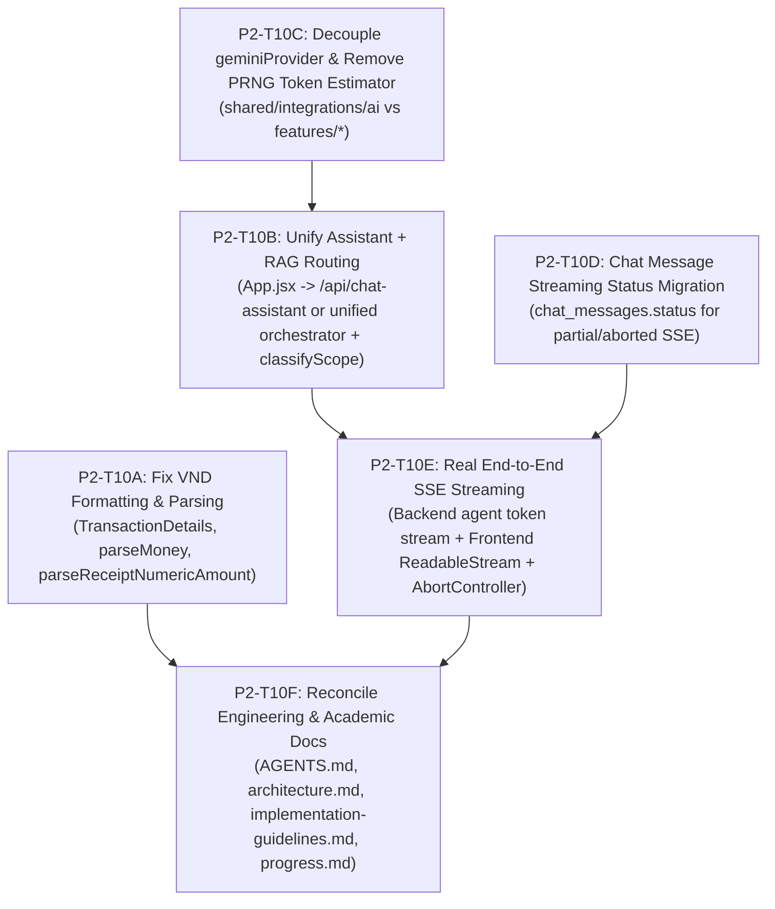

# Phase 2 Gap Audit & Reconciliation (`phase-2-gap-reconciliation-audit.md`)

**Date:** `2026-11-17`  
**Auditor Role:** Senior Software Architect & Independent Software Auditor  
**Scope:** Read-only, evidence-based audit of the SpendWise codebase against the Phase 2 implementation roadmap (`P2-T01`–`P2-T10`) and Phase 3 readiness.  
**Repository Baseline:** Branch `provider-adapter`, HEAD `e01596f` (`retire draft`), clean working tree.

---

## 1. Executive Summary

SpendWise has completed substantial Phase 2 infrastructure work—most notably database-backed Chat History (`P2-T08`), browser-local IndexedDB TransactionDrafts (`P2-T05`/`P2-T07`), stateless Receipt OCR & atomic confirmation (`P2-T06`), and retirement of legacy server-side `transaction_drafts` / `receipt_extractions` (`P2-T09`). Automated unit and integration tests pass at **`690/690` (`196` suites, `0` failures, `0` skipped)** in this audit run.

However, **four major architectural and functional gaps remain open or partial**, preventing Phase 2 from being declared fully complete:

1. **VND & Currency Consistency Defects (`OPEN` — High):**
   - `client/src/features/transaction/TransactionDetails.jsx` (lines `134`, `167`) appends a literal `₫` after `formatMoney(...)`, which already formats VND with `₫` (`Intl.NumberFormat('en-US', { style: 'currency', currency: 'VND' })`), causing duplicated **`₫50,000 ₫`** rendering.
   - `parseReceiptNumericAmount` (`server/src/features/receipt/receipt.schema.js:77-92`) does not strip Vietnamese lowercase/uppercase `đ`/`Đ` (`U+0111`/`U+0110`) or space-separated thousands (`'50 000'`), returning `null` for inputs like `'183.000đ'` or `'50 000'`.
   - `parseMoney` (`client/src/shared/utils/formatters.js:96-104`) treats `.` as a decimal separator (`replace(/[^\d.-]/g, '')`), turning `'183.000đ'` into `183` instead of `183000`.
2. **RAG Not Integrated into the Active Assistant (`OPEN` — Critical):**
   - The active frontend assistant (`client/src/app/App.jsx:9,64`) calls `askExpenseAssistant` (`POST /api/expense-assistant`), which invokes `runExpenseAssistantForUser` (`server/src/features/expenseAssistant/expenseAssistant.service.js:123-171`).
   - `runExpenseAssistantForUser` does **not** call `executeRAG` or `retrieveRelevantChunks`, and does **not** invoke `classifyScope` for deterministic out-of-scope refusal.
   - `orchestrateChat` (`server/src/features/chatAssistant/chatAssistant.service.js:37-47`) defaults `CHAT_STRATEGY` to `'agent'`, which delegates to `runExpenseAssistantForUser` with `sources: []` and `retrieval: null`. `orchestrateRAGChat` has no expense tools, leaving RAG and Expense Agent split into disconnected paths.
3. **Real End-to-End SSE Streaming Not Wired (`PARTIAL` / `OPEN` — High):**
   - Backend `POST /api/chat-assistant/stream` (`chatAssistant.controller.js:32-89`) and `geminiProvider.generateAnswerStream` (`geminiProvider.js:300-440`) exist, **but**:
     - `orchestrateAgentChatStream` (`chatAssistant.service.js:150-176`) runs `await orchestrateAgentChat(...)` synchronously and emits a single `delta` containing the entire answer—no token-by-token streaming for the active agent path.
     - The frontend (`client/src/features/chat/`) has **zero** `EventSource`, `ReadableStream`, `AbortController`, or `text/event-stream` consumption; `FormattedMessageText.jsx` / `useTextReveal.js` only perform a client-side progressive word reveal after receiving a complete JSON response.
     - `public.chat_messages` (`202611170010_chat_history.sql:49-59`) enforces `char_length(trim(content)) >= 1` and lacks a `status` column (`streaming` / `completed` / `aborted` / `error`), which blocks clean partial-message persistence during real SSE streaming.
4. **Provider Boundary & Token Estimation Legacy Artifacts (`PARTIAL` — Medium) & Stale Documentation (`OPEN` — Medium):**
   - `server/src/shared/integrations/ai/providers/geminiProvider.js:5-9` still imports higher-level feature modules (`features/aiUsage` and `features/receipt`).
   - `server/src/features/aiUsage/tokenEstimator.js:12-34` still retains deterministic PRNG estimation (`getDeterministicRandom`, `deterministicIntInRange`) used as a fallback in `aiUsage.repository.js:115` when `usageMetadata` is absent.
   - Canonical documentation (`AGENTS.md:96`, `docs/engineering/architecture.md`, `docs/engineering/implementation-guidelines.md`, `docs/academic/user-stories.md`) still documents retired `public.transaction_drafts`, `public.receipt_extractions`, `/api/transaction-drafts`, and claims SSE streaming is already implemented.

---

## 2. Current Repository State

| Attribute | Observed Value |
| :--- | :--- |
| **Git Branch** | `provider-adapter` |
| **HEAD Commit** | `e01596f retire draft` |
| **Recent Commits** | `e01596f` (retire draft), `4567271` (persistant chatbot), `aca5c8a` (draft indexedDB), `9472d0a` (`run`), `4e42c58` (`run`), `5a564a9` (`run`), `7b1b0a7` (`run`), `3eafe78` (`run`), `2dea99d` (`run`), `1593dda` (`adapter`) |
| **Working Tree** | Clean (audit report only added by this task) |
| **Automated Test Suite (`npm test`)** | `690` passed, `0` failed, `0` skipped across `196` suites (`14190.483ms`) |
| **Live Environment Checks** | Live Supabase DB, live Qdrant container, Docker image build, and live browser E2E were **not** executed in this read-only audit (`UNVERIFIED` at runtime). |

---

## 3. Historical Task Reconciliation (`P2-T01` – `P2-T09`)

> [!NOTE]
> `docs/engineering/progress.md` records entries for `P2-T08` and `P2-T09` (lines `74-75`), while `P2-T01`–`P2-T07` are absent from `docs/engineering/refactoring-plan.md` and `progress.md`. Statuses below reflect direct inspection of current code, migrations, and test execution in this session.

| Task ID | Task Scope | Status | Evidence & Notes |
| :--- | :--- | :--- | :--- |
| **P2-T01** | AI Provider Abstraction / Adapter Baseline | `PARTIAL` | `server/src/shared/integrations/ai/index.js` and `providers/geminiProvider.js` exist and tests pass, but `geminiProvider.js:5-9` still imports `features/aiUsage` and `features/receipt` directly, violating downward dependency boundaries. |
| **P2-T02** | Read-Only Prompts, Docker Packaging & Admin KB Enforcement | `UNVERIFIED` (Runtime) / `PASS` (Tests) | Integration tests confirm removed admin document/prompt mutation routes return `404` while read-only inspection and `/re-index` remain mounted. Docker packaging and live container execution were not run in this audit. |
| **P2-T03** | Safe Non-Destructive Qdrant Re-Indexing | `PASS` (Code/Tests) / `UNVERIFIED` (Live Qdrant) | `retriever.js:33` queries `searchVectorPoints` via `vectorStore.js`. Live Qdrant alias switching was not tested against a running Qdrant instance. |
| **P2-T04 / P2-T04-FIX** | Strict Role Separation (User vs Admin vs Guest) | `PASS` (Integration Tests) | Integration suite (`tests/...`) verifies Admin loads `/api/health` and Knowledge Base read-only APIs without `403` while User-only and Admin-only boundaries hold. |
| **P2-T05** | Frontend IndexedDB Draft Store | `PASS` | `client/src/features/transactionDraft/draftStorage.js` and `useTransactionDrafts.js` manage per-user IndexedDB drafts; referenced by `docs/engineering/architecture.md:57`. |
| **P2-T06** | Stateless Receipt OCR & Atomic Receipt Confirmation | `PASS` (Code/Tests) / `UNVERIFIED` (Live DB RPC) | `receipt.service.js:53,59` performs stateless extraction without pre-confirmation `receipt_extractions` writes; confirmation commits atomically via `confirm_staged_receipt_transaction` (live Supabase RPC not executed). |
| **P2-T07** | Wire Frontend Receipt & Assistant Draft Workflows to IndexedDB | `PASS` | `TransactionDraftReview.jsx:80-100,181-182` stages and preserves drafts in IndexedDB and confirms/discards locally without server draft tables. |
| **P2-T08** | Database-Backed Chat History | `PASS` (with minor resilience caveats) | `202611170010_chat_history.sql` defines `public.chat_conversations` and `public.chat_messages` with RLS and ownership trigger; `chatController.js` hydrates DB state with `userSeq`/`selectionSeq` guards. Live DB migration unapplied/untested here. |
| **P2-T09** | Retire Legacy Server-Side Drafts & Receipt Extractions | `PASS` (Code) / `UNVERIFIED` (Live DB) | Legacy `/api/transaction-draft` mount and `receipt_extractions` writes removed; `202611170011_retire_legacy_drafts_and_extractions.sql` authored. Docs (`AGENTS.md`, `architecture.md`) remain un-reconciled. |

---

## 4. Area A — VND & Currency Consistency Audit

### 4.1 Frontend Formatting (`formatMoney`) vs `TransactionDetails.jsx`
* **Observation (`client/src/shared/utils/formatters.js:79-87`):** `formatMoney(amount)` uses `Intl.NumberFormat('en-US', { style: 'currency', currency: 'VND', maximumFractionDigits: 0 })`, which produces strings already prefixed with **`₫`** (e.g., `₫50,000`).
* **Defect (`OPEN` — High):** `client/src/features/transaction/TransactionDetails.jsx:134` renders `{formatMoney(current?.amount || 0)} ₫` and line `167` renders `{formatMoney(item.amount)} ₫`. This produces **`₫50,000 ₫`** in the UI.
* **Clean Sibling Views (`PASS`):** `TransactionTable.jsx:126`, `TransactionSummary.jsx`, `ToolSearchResults.jsx:37`, `ToolSpendingSummary.jsx`, `PendingReceiptList.jsx:11`, and `DraftLineItems.jsx:24` invoke `formatMoney(...)` without an extra `₫`.

### 4.2 Numeric Parsing (`parseMoney` & `parseReceiptNumericAmount`)
* **Defect (`OPEN` — High) — `parseReceiptNumericAmount` (`server/src/features/receipt/receipt.schema.js:77-92`):**
  * Strips `/[$₫€£¥]|VND|USD|EUR/gi`, which **omits** Vietnamese `đ` / `Đ` (`U+0111` / `U+0110`) and **does not strip** whitespace thousand separators (`'50 000'`).
  * Inputs such as `'183.000đ'` or `'50 000'` fail numeric coercion (`NaN` $\rightarrow$ `null`).
* **Defect (`OPEN` — High) — `parseMoney` (`client/src/shared/utils/formatters.js:96-104`):**
  * Uses `String(value).replace(/[^\d.-]/g, '')`, treating `.` as a decimal point. On Vietnamese-formatted input `'183.000đ'`, this yields `Number('183.000')` = **`183`** instead of **`183000`** (a 1000x under-reporting bug).

### 4.3 Foreign Currency Warning & Preservation
* **Status: `PASS`**
* `server/src/features/receipt/receipt.schema.js:187-195` adds a currency warning when `extraction.currency !== 'VND'`.
* `server/src/features/receipt/receipt.service.js:53,59` omits `amount` and populates `foreignAmount` so foreign totals are never silently saved as VND.
* `client/src/shared/transactions/transactionFieldsUtils.js:80-115` (`getForeignCurrencyContext`, `buildReceiptReviewForm`) avoids pre-filling the VND `amount` field from `foreignAmount`.
* `client/src/composites/transactions/TransactionDraftReview.jsx:80-100,181-182` preserves `currency`, `foreignAmount`, and `warnings` across IndexedDB edits and failed confirmation retries.

### 4.4 Assistant Proposal Consistency
* **Status: `PARTIAL`**
* `server/src/features/expenseAssistant/expenseAssistant.schema.js:51-55` (`createTransactionArgsSchema`) reuses `transactionSchema` (`amount: z.coerce.number().positive()`) and UTC calendar date validation.
* The Gemini prompt instructs normalizing `"500k"` / `"500.000đ"` to numeric `500000`, but if a provider or caller supplies a raw formatted string like `'50 000'` or `'183.000đ'`, `z.coerce.number()` rejects it.

---

## 5. Area B — Unified AI & RAG Architecture Audit

### 5.1 Disconnected RAG & Active Expense Assistant (`OPEN` — Critical)
* **Frontend Wiring:** `client/src/app/App.jsx:9,64` passes `onAsk={askExpenseAssistant}` (`POST /api/expense-assistant`) to `ExpenseAssistant`. Nothing in the active UI calls `POST /api/chat-assistant` (`sendChatMessage` in `chatApi.js` is only an unused default prop fallback overridden by `App.jsx`).
* **Backend Strategy Split:**
  * `POST /api/expense-assistant` routes to `runExpenseAssistantForUser` (`server/src/features/expenseAssistant/expenseAssistant.service.js:123-171`), which never calls `executeRAG`, `retrieveRelevantChunks`, or `classifyScope`.
  * `POST /api/chat-assistant` calls `orchestrateChat` (`server/src/features/chatAssistant/chatAssistant.service.js:37-47`), which defaults `CHAT_STRATEGY` to `'agent'`—delegating straight back to `runExpenseAssistantForUser` and returning `sources: []`, `retrieval: null`.
  * `orchestrateRAGChat` (`chatAssistant.service.js:60-122`) runs `executeRAG` + `generateAnswer`, but has **zero access** to expense tools (`search_transactions`, `get_spending_summary`, `create_transaction`).
* **Impact:** Users cannot ask SpendWise policy/knowledge-base questions in the live assistant and receive grounded citations (`sources`), nor combine KB guidance with personal finance tools in a single unified assistant.

### 5.2 Guardrails & Retrieval Resilience
* **RAG Guardrails (`PASS` in `ragService.js`):** `executeRAG` (`server/src/features/knowledgeBase/ragService.js:34-153`) enforces `detectPromptInjection`, `classifyScope`, similarity threshold rejection (`INSUFFICIENT`), and graceful `RETRIEVAL_ERROR` handling when Qdrant is unreachable.
* **Expense Assistant Gap (`PARTIAL`):** `runExpenseAssistantForUser` (`expenseAssistant.service.js:125-135`) runs `detectPromptInjection` on the message and conversation history, but **skips `classifyScope`**, relying solely on LLM system instructions to refuse off-topic queries.

### 5.3 Provider Boundary & Token Estimation Telemetry
* **Provider Layering Violation (`PARTIAL` — Medium):** `server/src/shared/integrations/ai/providers/geminiProvider.js:5-9` directly imports `recordUsage, hashPrompt` from `features/aiUsage`, `RECEIPT_CATEGORIES, receiptExtractionSchema` from `features/receipt`, `enforceReceiptGuardrails` from `features/receipt/receiptGuardrails.js`, and `getReceiptPrompt` from `features/receipt/receiptPrompt.js`. Shared infrastructure (`shared/integrations/ai/`) should not depend upward on feature modules.
* **Token Telemetry (`PARTIAL` — Medium):** `geminiProvider.js:222-225,377-378` captures real `usageMetadata` when returned by Gemini, **but** `server/src/features/aiUsage/tokenEstimator.js:12-34` still implements deterministic PRNG estimation (`getDeterministicRandom`, `deterministicIntInRange`, `ESTIMATION_PROFILES`), which `aiUsage.repository.js:115` uses as a fallback when `usageMetadata` is missing.

---

## 6. Area C — Real SSE Streaming Audit

### 6.1 Backend SSE Endpoint & Orchestrator (`PARTIAL` — High)
* **Controller (`server/src/features/chatAssistant/chatAssistant.controller.js:32-89`):** `chatStream` validates input pre-stream, sets `Content-Type: text/event-stream; charset=utf-8`, `Cache-Control: no-cache, no-transform`, `X-Accel-Buffering: no`, wires `AbortController` to `res.on('close', ...)`, and formats `event: <name>\ndata: <json>\n\n`.
* **Provider (`geminiProvider.js:300-440`):** `generateAnswerStream` wraps `ai.models.generateContentStream(...)`, measures `timeToFirstTokenMs`, and captures final `usageMetadata`.
* **Orchestrator Gap (`chatAssistant.service.js:150-176`):** `orchestrateAgentChatStream` executes `await orchestrateAgentChat(query, options)` synchronously and emits a **single** `delta` event with the full `result.answer`. Thus, even if called, the default `'agent'` strategy does **not** stream tokens incrementally.

### 6.2 Frontend Streaming Absence (`OPEN` — High)
* Searching `client/src` confirms **zero** usage of `EventSource`, `ReadableStream`, `AbortController`, `text/event-stream`, or `/api/chat-assistant/stream`.
* `client/src/features/chat/FormattedMessageText.jsx:129-156` and `client/src/shared/hooks/useTextReveal.js:21-62` implement a **simulated client-side word-by-word reveal animation** on already-completed HTTP JSON responses.
* There is no client-side Cancel/Stop Generation control, no real-time token streaming, and no reconnect/error-recovery state for interrupted streams.

### 6.3 Database Schema Readiness for Streaming (`OPEN` — Medium)
* `supabase/migrations/202611170010_chat_history.sql:49-59` defines `public.chat_messages` with `content text not null check (char_length(trim(content)) >= 1)` and **no `status` column** (`streaming` / `completed` / `aborted` / `error`). Real SSE streaming with partial-message persistence will require a schema migration to track message lifecycle status or defer DB insert until stream completion/abort.

---

## 7. Area D — Chat History Regression Audit (`P2-T08`)

* **Stale-Request & Cross-User Isolation (`PASS`):** `client/src/features/chat/chatController.js:22-23,61,95-101,130,168` maintains `userSeq` and `selectionSeq` counters, clears the previous user's `localStorage` cache on user switch, shows cached items while `historyLoading` is true, and discards out-of-order responses from `listConversations()` / `getConversation()`.
* **Persistence Error Swallowing (`PARTIAL` — Low):** In `chatController.js:229-244`, `appendMessageToConversation` wraps `ensureConversationPersisted` and `historyApi.appendMessage` in a silent `try { ... } catch {}` (`// Message remains in UI state; error surfaced if send flow fails`). If `historyApi.appendMessage` fails independently of `onSendMessage`, the message remains in React/localStorage state without a retry banner or DB persistence, disappearing on next reload.
* **Post-Await User Switch Guard in `sendMessage` (`PARTIAL` — Low):** `chatController.js:299-345` captures `targetConversationId` before `await onSendMessage(...)`, but does not check `currentUserSeq !== userSeq` before appending the assistant response.

---

## 8. Area E — Documentation Alignment Audit

| Document | Drift / Stale Content Found | Status |
| :--- | :--- | :--- |
| `AGENTS.md` (line `96`) | Still states candidate transactions stage in `public.transaction_drafts` and confirm via `POST /api/transaction-drafts/:id/confirm` (retired in `P2-T09`). | `OPEN` |
| `docs/engineering/architecture.md` (lines `264-312`, `480-523`, `549-563`, `755`) | Line `57` was updated for IndexedDB + `P2-T09`, **but** Sections 3, 4, sequence diagrams, and REST API tables still document `public.transaction_drafts`, `public.receipt_extractions`, and `/api/transaction-drafts`. | `OPEN` |
| `docs/engineering/implementation-guidelines.md` (lines `148-173`) | Still mandates `public.transaction_drafts`, `public.receipt_extractions`, and `/api/transaction-drafts`. | `OPEN` |
| `docs/engineering/refactoring-plan.md` & `progress.md` | `refactoring-plan.md` lacks `P2-T01`–`P2-T10` tracking; `progress.md` logs only `P2-T08` and `P2-T09` (`P2-T01`–`P2-T07` missing). | `OPEN` |
| `docs/academic/architecture.md` & `user-stories.md` | `user-stories.md:325` marks `US-12` SSE streaming as `"Implemented / Verified & Passing"` based on `TextReveal` + backend `/stream`, overstating real client-side SSE streaming. | `OPEN` |

---

## 9. Implementation Dependency Map

---

## 10. Findings Register

| ID | Area | Finding | Status | Severity | File / Symbol Citations | Evidence | Dependencies | Recommended Next Action |
| :--- | :--- | :--- | :--- | :--- | :--- | :--- | :--- | :--- |
| **F-01** | Area A (VND) | Duplicate `₫` rendered in transaction detail & line items (`₫50,000 ₫`) | `OPEN` | `High` | `client/src/features/transaction/TransactionDetails.jsx:134,167`; `client/src/shared/utils/formatters.js:79-87` (`formatMoney`) | `formatMoney` returns `₫50,000`; `TransactionDetails.jsx` appends literal ` ₫` | None | Remove trailing ` ₫` in `TransactionDetails.jsx:134,167` and add unit test |
| **F-02** | Area A (VND) | `parseReceiptNumericAmount` fails on `đ`/`Đ` and space-separated thousands (`'183.000đ'`, `'50 000'`) | `OPEN` | `High` | `server/src/features/receipt/receipt.schema.js:77-92` | Regex `/[$₫€£¥]|VND|USD|EUR/gi` excludes `đ`/`Đ` and whitespace | None | Normalize `đ`/`Đ` and spaces before thousand/decimal disambiguation |
| **F-03** | Area A (VND) | `parseMoney` turns `'183.000đ'` into `183` instead of `183000` | `OPEN` | `High` | `client/src/shared/utils/formatters.js:96-104` | `replace(/[^\d.-]/g, '')` treats `.` as decimal separator | None | Reuse/align VND-safe thousand-separator parsing helper and unit test |
| **F-04** | Area A (VND) | Foreign currency receipts warn, omit VND `amount`, and preserve `foreignAmount` across IndexedDB edits | `PASS` | `Low` | `receipt.schema.js:187-195`; `receipt.service.js:53,59`; `transactionFieldsUtils.js:80-115`; `TransactionDraftReview.jsx:80-100,181-182` | Verified in code and passing tests | None | Keep invariant covered in regression suite |
| **F-05** | Area B (AI/RAG) | RAG is disconnected from the active Assistant UI and default agent strategy | `OPEN` | `Critical` | `client/src/app/App.jsx:9,64`; `chatAssistant.service.js:37-47`; `expenseAssistant.service.js:123-171` | UI calls `/api/expense-assistant`; `/api/chat-assistant` defaults to `'agent'` with `sources: []` | F-07 | Route active assistant through unified orchestrator supporting both KB RAG and expense tools |
| **F-06** | Area B (AI/RAG) | `runExpenseAssistantForUser` omits `classifyScope` deterministic out-of-scope check | `PARTIAL` | `Medium` | `server/src/features/expenseAssistant/expenseAssistant.service.js:123-135`; `ragService.js:57` | `ragService.js` calls `classifyScope`; `expenseAssistant.service.js` only calls `detectPromptInjection` | F-05 | Apply `classifyScope` (or intent router) before LLM invocation |
| **F-07** | Area B (AI/RAG) | `geminiProvider.js` imports higher-level feature modules (`features/aiUsage`, `features/receipt`) | `PARTIAL` | `Medium` | `server/src/shared/integrations/ai/providers/geminiProvider.js:5-9` | Direct imports violate downward dependency rule | None | Inject telemetry callback & schema/prompt inputs from caller/service |
| **F-08** | Area B (AI/RAG) | `tokenEstimator.js` still uses PRNG estimation fallback | `PARTIAL` | `Medium` | `server/src/features/aiUsage/tokenEstimator.js:12-34`; `aiUsage.repository.js:115` | `getDeterministicRandom` / `deterministicIntInRange` invoked when `usageMetadata` absent | None | Replace PRNG fallback with explicit `null`/missing-telemetry status or deterministic char/4 heuristic |
| **F-09** | Area C (SSE) | `orchestrateAgentChatStream` simulates streaming with 1 full `delta` after awaiting complete agent turn | `PARTIAL` | `High` | `server/src/features/chatAssistant/chatAssistant.service.js:150-176` | Awaits `orchestrateAgentChat` then emits single `delta` | F-05 | Stream Gemini response tokens after tool execution in agent follow-up turn |
| **F-10** | Area C (SSE) | Frontend has zero real SSE consumption (`ReadableStream`/`EventSource`/`AbortController`) | `OPEN` | `High` | `client/src/features/chat/useTextReveal.js`; `FormattedMessageText.jsx:129-156` | `git grep` finds 0 SSE clients in `client/src`; `useTextReveal` is local animation only | F-09, F-11 | Implement `fetch` + `ReadableStream` SSE parser + `AbortController` stop button |
| **F-11** | Area C (SSE) | `chat_messages` lacks `status` column and forbids empty content for streaming placeholders | `OPEN` | `Medium` | `supabase/migrations/202611170010_chat_history.sql:49-59` | `char_length(trim(content)) >= 1` and no `status` field | None | Add migration for `status` (`streaming`/`completed`/`aborted`/`error`) or persist on completion/abort |
| **F-12** | Area D (Chat) | `appendMessageToConversation` silently swallows DB persistence errors; `sendMessage` lacks post-await `userSeq` guard | `PARTIAL` | `Low` | `client/src/features/chat/chatController.js:229-244,299-345` | Empty `catch {}` on `historyApi.appendMessage`; no `userSeq` check after `onSendMessage` | None | Surface non-blocking retry/sync warning and check `userSeq` after await |
| **F-13** | Area E (Docs) | Canonical docs (`AGENTS.md`, `architecture.md`, `implementation-guidelines.md`, `progress.md`, `user-stories.md`) contain retired draft/SSE claims | `OPEN` | `Medium` | `AGENTS.md:96`; `docs/engineering/architecture.md:264-312,549-563`; `docs/engineering/implementation-guidelines.md:148-173` | References `public.transaction_drafts`, `receipt_extractions`, `/api/transaction-drafts` | F-01..F-10 | Update docs after remaining Phase 2 fixes land |
| **F-14** | Runtime | Live Supabase migrations (`0010`, `0011`), live Qdrant alias switch, Docker build, and browser E2E unexecuted in audit | `UNVERIFIED` | `Medium` | `supabase/migrations/202611170010_chat_history.sql`, `202611170011_retire_legacy_drafts_and_extractions.sql` | Read-only audit did not execute live DB/Qdrant/Docker/browser checks | All | Run staged runtime smoke test in Phase 2 closeout |

---

## 11. Recommended Remaining Phase 2 Tasks

1. **`P2-T10A` — VND Formatting & Parsing Consistency Fix**
   - *Scope:* Remove duplicate `₫` in `TransactionDetails.jsx:134,167`; fix `parseMoney` (`formatters.js`) and `parseReceiptNumericAmount` (`receipt.schema.js`) for `đ`/`Đ`, dot/comma thousand separators, and space-separated thousands (`'50 000'`).
   - *Acceptance Criteria:* `formatMoney(50000)` renders `₫50,000` everywhere; `parseMoney('183.000đ') === 183000`; `parseReceiptNumericAmount('183.000đ') === 183000` and `'50 000' === 50000`; regression unit tests added.
2. **`P2-T10B` — Unified Assistant Routing (Expense Tools + KB RAG + `classifyScope`)**
   - *Scope:* Wire `App.jsx` and backend orchestration so a single assistant endpoint/service classifies intent between personal finance tools and SpendWise Knowledge Base RAG (with `sources` returned to UI) and enforces `classifyScope` deterministically.
   - *Acceptance Criteria:* Policy/FAQ queries return grounded RAG answers with `sources`; transaction queries execute user-scoped tools; off-topic queries return deterministic refusal.
3. **`P2-T10C` — Real End-to-End SSE Streaming & Chat History Compatibility**
   - *Scope:* Implement true token streaming in agent follow-up generation (`geminiProvider.generateAnswerStream`), add `status` support (or safe completion/abort persistence) for `chat_messages`, and wire `fetch` + `ReadableStream` + `AbortController` (Stop button) in `client/src/features/chat/`.
   - *Acceptance Criteria:* Live SSE chunks render progressively as received from server; aborting stops server generation via `AbortSignal`; DB history reflects completed/aborted state cleanly.
4. **`P2-T10D` — Provider Boundary Cleanup, Telemetry Integrity & Documentation Reconciliation**
   - *Scope:* Remove `features/*` imports from `geminiProvider.js`; eliminate PRNG estimation from `tokenEstimator.js`; update `AGENTS.md`, `architecture.md`, `implementation-guidelines.md`, `refactoring-plan.md`, `progress.md`, and `user-stories.md` to match actual implementation; execute live DB/Qdrant/Docker/browser smoke verification.
   - *Non-Destructive Constraints:* Author any new SQL changes as forward-only local migrations; do not modify applied migrations (`0001`–`0011`) or reset live Qdrant collections.

---

## 12. Proposed Phase 3 AI Architecture Audit Scope

Once Phase 2 closeout tasks (`P2-T10A`–`P2-T10D`) are complete, Phase 3 auditing should focus on:
1. **Multi-Turn Tool + RAG Intent Routing Accuracy:** Evaluate hybrid queries (e.g., *"Can I log a 500k Grab ride under Transport according to SpendWise rules?"*) and tool-selection precision.
2. **Streaming Resilience & Backpressure:** Test mid-stream network drops, `AbortController` cleanup, rate-limiter interaction, and partial-message DB consistency.
3. **AI Cost & Latency Observability:** Verify 100% real `usageMetadata` capture across `generateAnswer`, `generateAnswerStream`, `generateToolTurn`, `generateToolFollowup`, and receipt OCR without synthetic PRNG estimates.
4. **Prompt Versioning & Regression Evaluation:** Automated golden-set evaluation for Vietnamese/English receipt OCR (`đ`, space-thousands, foreign currency) and RAG grounding faithfulness.

---

## 13. Final Assessment

SpendWise's Phase 2 codebase is **architecturally solid in its core data-ownership boundaries** (strict Role Separation, IndexedDB local drafts, stateless receipt OCR + atomic confirmation, DB-backed Chat History with RLS, and clean `690/690` automated test pass rate), **but Phase 2 is NOT yet complete**. Closing the remaining **VND formatting/parsing bugs (`F-01`–`F-03`)**, **unifying RAG with the active Assistant (`F-05`)**, **wiring real end-to-end SSE streaming (`F-09`–`F-11`)**, and **reconciling stale documentation (`F-13`)** should be completed and verified before transitioning to Phase 3.
