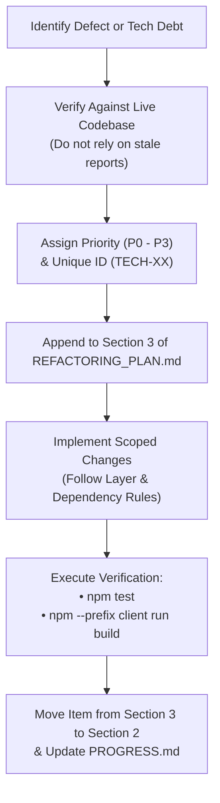

# SpendWise — Master Refactoring Backlog & Engineering Roadmap

> **Status:** Canonical Living Backlog  
> **Last Updated:** 2026-11-16  
> **Related Documents:** [`architecture.md`](./architecture.md), [`progress.md`](./progress.md), [`implementation-guidelines.md`](./implementation-guidelines.md), [`adrs/`](./adrs/), [`documentation-maintenance.md`](./documentation-maintenance.md)

---

## 1. Purpose and Maintenance Rules

This document is the **single source of truth** for all active and completed engineering refactoring across SpendWise.

### Maintenance Principles
1. **Single Living Backlog:** No competing or parallel refactoring roadmaps may exist. All frontend and fullstack refactoring tasks are tracked here.
2. **Verified Completion Record:** Completed tasks are never deleted. They are preserved in Section 2 with their verified scope, observed test counts, and artifact references.
3. **Consolidated Findings:** New findings discovered during development or evaluation are distilled and prioritized in Section 3 of this document, with accepted architecture decisions recorded in [`docs/engineering/adrs/`](./adrs/).
4. **Evidence-Based Status:** Tasks are marked complete only after running the actual test suite (`npm test`) and production build (`npm --prefix client run build`) and observing clean exit code `0`.

---

## 2. Completed Work Matrix

### 2.1. Frontend Stabilization & Architecture Refactoring Tasks (`FE-FIX` / `FE-REF` / `FE-TEST`)

| Task ID | Scope | Verification Result | Status | Summary of Delivered Changes |
|---|---|---|---|---|
| **`FE-FIX-01`** | Chatbot PushDrawer layout, responsive sizing, pointer isolation | 6/6 tests pass | **Completed** | Fixed `.chat-assistant` pointer-events: none / auto isolation; added responsive maximized toggle; pinned composer at viewport bottom; independent vertical scrolling for messages container. |
| **`FE-FIX-02`** | OverlayDrawer stacking, accessibility, focus trapping, scroll locking | 10/10 tests pass | **Completed** | Separated modal `OverlayDrawer` (with `Backdrop`, dialog role, aria-modal, inert on closed, focus trap, body scroll lock) from non-modal `PushDrawer`; coordinated multi-layer Escape dismissal via `overlayStack.js`. |
| **`FE-FIX-03`** | Chatbot proposal lifecycle, expiration handling, conversation isolation | 14/14 tests pass | **Completed** | Added proposal expiration detection (400, 404, 409 status codes); separate `isConfirming` and `isCancelling` busy states; isolated conversation message streams; clamped history payload to 1000 characters. |
| **`FE-FIX-04`** | WorkspaceSidebar dark contrast, ReceiptsView accessibility, SVG sizing | 7/7 tests pass | **Completed** | Standardized `WorkspaceSidebar` user section and responsive breakpoints; associated `<label htmlFor="upload-receipt">` with `<input id="upload-receipt">`; normalized standalone SVG dimensions (`EditIcon`, `DeleteIcon`, `GoogleMark`). |
| **`FE-FIX-05`** | Feature loading, search, form states, and Escape coordination | 12/12 tests pass | **Completed** | Added refresh control and duplicate-click protection to `AnalyticsFilters`; checking/in-sync badge logic in `KnowledgeBaseStats`; SearchInput Escape clearing with `e.stopPropagation()`; `DocumentEditor` saving state; `ResetPasswordPage` unconfigured Supabase notice. |
| **`FE-REF-06`** | CSS architecture normalization & dead CSS removal | 11/11 tests pass | **Completed** | Consolidated shared component stylesheets under `client/src/shared/styles/components/`; eliminated dead classes (`.chat-card`, `.chat-fab`, `.stats-container`, etc.); established design tokens in `tokens.css`; verified 100% cascade order. |
| **`FE-REF-07`** | Source architecture refactoring & 6-layer separation | Verified | **Completed** | Established 6 architectural layers: `app/`, `primitives/`, `composites/`, `features/`, `layouts/`, `shared/`. Standardized semantic variant APIs across buttons, badges, and cards; eliminated arbitrary `className` leakage into base components. |
| **`FE-TEST-08`** | Behavioral frontend test migration | 792/792 tests pass | **Completed** | Replaced brittle filesystem source-regex tests (`fs.readFileSync` + `assert.match`) with live DOM behavioral tests using React Testing Library and User Event under Node.js test runner via on-the-fly JSX loader (`tests/setup/jsx-loader.js`). |
| **`FE-DOC-09`** | Documentation consolidation & living backlog | 833/833 tests pass | **Completed** | Consolidated canonical `architecture.md`, `refactoring-plan.md`, `progress.md`, archived audits, and updated implementation guidelines. |
| **`FE-REF-11`** | Tailwind CSS migration & design system standardization | Verified (100% tests pass, Vite build clean) *(Note: Post-audit FE-AUDIT-12 identified 817 passed / 1 failed; fixed in FE-FIX-12A)* | **Completed** | Established Tailwind CSS (`v3.4.19`) as the exclusive frontend styling system; consolidated 19 legacy `.css` files into single `client/src/index.css` and centralized `client/tailwind.config.js`; migrated all Primitives, Composites, Layouts, and Feature views to pure Tailwind utility classes; purged dead Vanilla CSS classes; enforced strict `className`/`style` stripping; codified ADR-0005. |
| **`FE-FIX-12A`** | Restore Test Quality Gate | 35/35 targeted pass; 819/819 full suite pass | **Completed** | Split and updated `RouteLoadingFallback` and `AnalyticsCharts` `Inline` assertions in `tests/unit/frontendStandardization.test.js`; resolved stale admin-gate class assertion to restore clean 819/819 passing suite. |
| **`FE-FIX-12B`** | Component Encapsulation & Legacy Class Cleanup | Verified (819/819 pass, clean build) | **Completed** | Strengthened component ownership across `WorkspaceSidebar`, `AuthLayout`, `Button`, `Avatar` (`sidebar` variant), `Text` (`sidebar`/`sidebar-muted` colors, `sidebar-eyebrow` variant), `Card` (`xl` responsive padding), `TextInput` (`endPadding`), `TextArea` (`size`, `resize`, `maxHeight`), and `PasswordInput`; eliminated parent descendant selector hacks and removed 35+ obsolete Vanilla CSS classes across 33 frontend files. |
| **`FE-FIX-12C`** | Test Suite Consolidation | 653/653 tests pass across 187 suites (53 files) | **Completed** | Audited and classified all 66 test files into Categories 1–7; merged runtime `overlayStack.js` tests into `drawerAccessibility.test.js` and long-lived native-control, 6-layer import boundary, and Tailwind/token integrity audits into `frontendStandardization.test.js`; removed 13 obsolete/refactor-specific/implementation-detail test files (`66 -> 53` test files: 45 unit + 8 integration). |
| **`FE-FIX-12D`** | Documentation Accuracy & Alignment | Verified (653/653 pass, clean build) | **Completed** | Corrected `HealthBadge` and `Backdrop` paths across academic and engineering architecture docs, updated `index.css` description, documented token architecture source of truth (`FE-FIX-12E`) and test consolidation metrics (`FE-FIX-12C`), and added transparent historical correction notes for `FE-REF-11`. |
| **`FE-FIX-12E`** | Token Architecture Cleanup & Semantic Dimensions | Verified (index.css 51.24 kB -> 39.94 kB) | **Completed** | Established `client/tailwind.config.js` as canonical source of truth for all Tailwind utility scales; streamlined `client/src/index.css` `:root` to retain only the 6 required runtime/base CSS custom properties (`--color-slate-200`, `--color-slate-500`, `--font-family-sans`, `--color-bg-page`, `--color-text-primary`, `--line-height-normal`); added semantic dimension/transition tokens to replace arbitrary bracket values. |
| **`FE-REF-13`** | Workspace & Feature Page Consistency Refactor | Verified (653/653 pass, clean build in ~22s) | **Completed** | Established persistent `WorkspaceRouteShell` and `WorkspaceContext` (`user`, `onSignOut`, `health`, reactive counters); centralized `HealthBadge` into `WorkspaceLayout`; refactored `/expense` into dedicated nested routes (`/expense/transactions`, `/expense/receipts`, `/expense/categories`, `ExpenseIndexRedirect`); promoted single root toast convention; mounted `ExpenseAssistant` persistently across workspace routes; standardized `PageHeader` and responsive wrapping across all feature views. |
| **`FE-REF-15`** | Expense & Chat Architecture Audit and Reorganization | Verified (653/653 pass, clean build in ~18s) | **Completed** | Audited domain boundaries between Expense, Transaction, Receipt, Chat, and Assistant; restored `ExpenseSummaryCards`; established `receiptsApi.js` in `features/receipts/` and eliminated cross-feature import from `ReceiptsView` to `expenseApi`; introduced `assistantApi.js` in `features/expense/assistant/`; codified Assistant as domain composition of generic Chat primitives; established complete feature barrel facades (`index.js`). |
| **`FE-REF-16`** | Assistant & Chat Responsibility Cleanup | Verified (653/653 pass, clean build) | **Completed** | Removed redundant `assistantApi.js` passthrough, consolidating all agent endpoints directly into canonical `expenseApi.js`; removed unreferenced `sendAssistantMessage` backward-compatibility shim in `chatApi.js`; audited and verified responsibility boundaries across `ExpenseAssistant.jsx`, `useChat.js`, and `Chatbot.jsx`. |
| **`FULL-REF-17`** | Unified Transaction Drafts, Immutable Extractions & Confirmation Consolidation | Verified (`npm --prefix client run build` clean in ~10.6s, `node --check` passed, `node --test tests/unit/expenses.test.js` 6/6 pass) | **Completed** | Unified candidate transactions under `public.transaction_drafts` and immutable attempt history in `public.receipt_extractions` (`202611160008` migration, local-only); replaced ephemeral proposal Map with DB-backed drafts; consolidated review UI into `composites/transactions/TransactionDraftReview` and `TransactionFields`; created dedicated `server/src/features/transactionDrafts/` mounted at `/api/transaction-drafts` with atomic claim & idempotent re-confirm; safe rejection retaining receipts; introduced `ManualEntry` and `TransactionDetails` in `features/expense/`, `ScanReceiptView` in `features/receipts/`, `features/transactionDrafts/`, and `shared/transactions/`; updated sidebar label to "Scan Receipt"; codified ADR-0006. |

---

### 2.2. Foundation Fullstack Tasks (`TASK-00` through `TASK-11`)

| Task ID | Scope | Verification Result | Status | Summary of Delivered Changes |
|---|---|---|---|---|
| **`TASK-00`** | Verification Baseline & Diagnostics | 480 passed / 9 failed | **Completed** | Captured baseline test suite state, identified prompt loader CRLF bugs and auth redirect regressions. |
| **`TASK-01`** | Package file:.. link & Docker Compose fix | Build passed | **Completed** | Replaced root `file:..` self-dependency with standard package metadata for clean Docker builds. |
| **`TASK-02`** | Normalize CRLF in Prompt Loaders | 5 tests resolved | **Completed** | Stripped Windows CRLF `\r\n` from Markdown prompt templates to guarantee exact prompt checksums. |
| **`TASK-03`** | Sidebar Navigation & Auth Redirects | 4 tests resolved | **Completed** | Enforced role-based access control in `sidebarConfig.js`; prevented admin route leakage to standard users. |
| **`TASK-04`** | Assistant Auth Guard & Model Config | Verified | **Completed** | Guarded SSE chat assistant endpoints with authenticated Supabase JWT verification. |
| **`TASK-05`** | Calendar Date Validation Across Schemas | Verified | **Completed** | Implemented strict UTC round-trip calendar date validation (`isValidIsoCalendarDate`) across all Zod schemas. |
| **`TASK-06`** | Amount, Zero-Item & Non-VND Normalization | Verified | **Completed** | Enforced single-currency VND ledger invariants; flagged non-VND receipts for human VND entry; preserved 0-value items. |
| **`TASK-07`** | Proposal Map Expiry Pruning | Verified | **Completed** | Added automatic TTL eviction for stale in-memory transaction proposals to prevent memory leaks. |
| **`TASK-08`** | ReceiptReview Warnings & Non-VND Gate | Verified | **Completed** | Separated non-fatal OCR warnings from blocking validation errors in `ReceiptReview.jsx`. |
| **`TASK-09`** | Ledger Search Clear & Form Validation | Verified | **Completed** | Reset pagination to page 1 on search; added duplicate submission protection in `TransactionForm`. |
| **`TASK-10`** | Dead Code Removal & AI Facade Export | Verified | **Completed** | Cleaned up unused endpoints and exposed clean public API facades. |
| **`TASK-11`** | Documentation Synchronization | Verified | **Completed** | Synchronized README, system prompt documentation, and progress tracker. |

---

## 3. Active Backlog & Technical Debt

The following tasks represent the active refactoring and optimization backlog for SpendWise.

### Priority System
- **`P0` (Blocker):** Critical functional correctness or security defect. Must be addressed before production release.
- **`P1` (High):** Significant correctness, usability, or architectural debt that impacts reliability or developer velocity.
- **`P2` (Medium):** Important architectural cleanup, optimization, or maintainability enhancement.
- **`P3` (Low):** Minor visual polish, developer experience improvement, or non-blocking future enhancement.

---

### Backlog Items

#### Item `TECH-01`: Form Field ARIA Live Region Announcements (`P1`)
- **Area:** `composites/forms/`, `composites/feedback/`
- **Description:** While error texts in `FormField` and `ErrorText` render conditionally, screen readers do not always announce them dynamically if the container lacks `aria-live="polite"` or an accessible `id` referenced by `aria-describedby` on the input control.
- **Expected Outcome:** Ensure all `FormField` instances bind `aria-describedby` to the error element's `id` and announce validation failures dynamically.
- **Dependencies:** None.
- **Verification Criteria:** Component behavioral tests verifying `input.getAttribute('aria-describedby') === errorEl.id`.

#### Item `TECH-02`: Route-Level Chunk Code-Splitting (`P2`)
- **Area:** `app/App.jsx`
- **Description:** Several heavy route pages (`AnalyticsPage`, `KnowledgeBasePage`, `ExpensePage`) are imported directly in `App.jsx`, bundling their dependencies into the primary vendor chunk rather than lazy loading.
- **Expected Outcome:** Convert route components to `React.lazy()` with `<Suspense fallback={<RouteLoadingFallback />}>` to reduce initial bundle size below 150 kB gzip.
- **Dependencies:** None.
- **Verification Criteria:** `npm --prefix client run build` shows separate code-split asset chunks for each primary route.

#### Item `TECH-03`: High-Volume Transaction Table Virtualization (`P2`)
- **Area:** `features/expense/TransactionTable.jsx`
- **Description:** For users with thousands of historical records, client-side rendering of large tables without row virtualization may cause frame drops during rapid scrolling.
- **Expected Outcome:** Implement lightweight windowing/virtualization for transaction lists exceeding 100 items per page.
- **Dependencies:** Server pagination contract (currently capped at 10–50 items per page, so impact is currently low).
- **Verification Criteria:** Smooth 60fps scrolling performance tested with 200 items in DOM benchmark.

#### Item `TECH-04`: Comprehensive Dark Theme Token Coverage (`P3`)
- **Area:** `client/src/index.css` (formerly `shared/styles/tokens.css`), `client/tailwind.config.js`, `composites/`
- **Description:** While `WorkspaceSidebar` and base tokens support dark styling variants (`--color-sidebar-*`), some composite components (`Modal`, `StatCard`, `EmptyState`) have hard-coded light-mode background classes (`bg-white`, `border-slate-200`).
- **Expected Outcome:** Fully decouple hard-coded color utility classes into semantic design tokens (`--color-surface-bg`, `--color-surface-border`, `--color-text-primary`) supporting a global `[data-theme="dark"]` attribute.
- **Dependencies:** None.
- **Verification Criteria:** All composite component tests pass under dark mode styling snapshots.

#### Item `TECH-05`: Headless Browser Visual Regression CI Suite (`P3`)
- **Area:** `tests/`
- **Description:** The current test suite relies on `jsdom` + React Testing Library for fast, offline behavioral unit testing. It does not execute real browser rendering engines (Chromium/WebKit).
- **Expected Outcome:** Introduce an optional Playwright visual regression smoke suite for critical user flows (Receipt scan upload, Chat assistant proposal confirmation).
- **Dependencies:** CI environment with GPU/browser binary support.
- **Verification Criteria:** Playwright smoke tests pass headlessly on PR branches.

#### Item `TECH-06`: Test Suite Update for Canonical Transaction Drafts & Composites (`P1`)
- **Area:** `tests/unit/`, `tests/integration/`
- **Description:** In adherence to repository invariants and coordinator directives (`#8`, `#22`), test files (`tests/**/*.test.js`) were strictly left unedited during `FULL-REF-17`. Legacy unit tests referencing removed or relocated files (`TransactionForm.jsx`, `ReceiptReview.jsx`, `ReceiptsView.jsx`, `TransactionProposalCard.jsx`, old expense constants) need to be updated to import the new canonical components (`composites/transactions/TransactionDraftReview`, `features/expense/ManualEntry`, `features/receipts/ScanReceiptView`, and `features/transactionDrafts/`).
- **Expected Outcome:** Modernize all test harnesses to reflect the new feature-first paths and unified draft confirmation endpoints, restoring full test suite pass rate without shims.
- **Dependencies:** None.
- **Verification Criteria:** `npm test` runs with 100% assertions passing against canonical files.

---

## 4. Maintenance Workflow

Contributors discovering new bugs, architectural debt, or performance bottlenecks must follow this workflow:

1. **Verify first:** Verify the issue against the actual codebase. Never paste raw audit outputs without validating whether the code has already been refactored.
2. **Assign priority:** Use the P0–P3 definitions. State clear expected outcomes and verification criteria.
3. **Implement cleanly:** Respect the 6 architectural layers (`app/`, `primitives/`, `composites/`, `features/`, `layouts/`, `shared/`) and semantic variant policies.
4. **Log evidence:** Upon completion, record the exact test counts and build times in [`docs/engineering/progress.md`](./progress.md) and update Section 2 of this plan.
