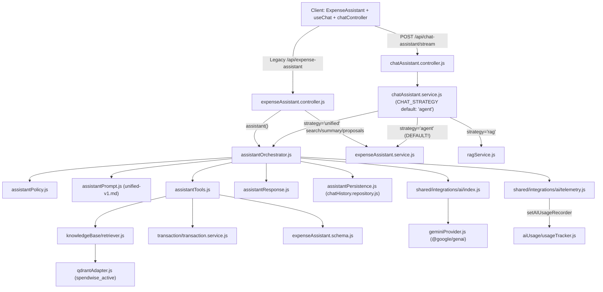

# P3-T01 — AI Architecture Gap Audit

**Phase:** Phase 3 — AI Architecture  
**Task:** P3-T01 — AI Architecture Gap Audit  
**Mode:** Strictly Read-Only, Evidence-Based Audit  
**Branch / HEAD:** `provider-adapter` @ `405e203 telemetry cleanup`  
**Audit Date:** `2026-11-17`  
**Final Recommendation:** **FIX REQUIRED**

---

## 1. Executive Summary

SpendWise's Phase 2 implementation (`P2-T01` through `P2-T15`) established a solid foundation for personal finance AI: a unified assistant orchestrator (`server/src/features/chatAssistant/assistantOrchestrator.js`), a provider-neutral AI boundary (`server/src/shared/integrations/ai/`), blue/green Qdrant indexing with alias switching (`spendwise_active`), server-authoritative streaming persistence (`begin_chat_stream_turn`), and non-fabricated AI usage telemetry (`usage_source`).

However, this read-only audit identified **5 confirmed P1 defects**, **6 P2 architectural/maintainability weaknesses**, and **4 P3 enhancements/potential risks** that prevent the current AI subsystem from operating reliably at its intended Phase 2 baseline or scaling cleanly in Phase 3:

1. **Default Strategy Regression (`P1`):** `SERVER_CONFIG_DEFAULTS.CHAT_STRATEGY` is `'agent'` (`server/src/constants/config.js:66`), causing `POST /api/chat-assistant` and `POST /api/chat-assistant/stream` to route to the legacy 1-tool fake-SSE `agent` path by default instead of the `unified` orchestrator whenever `CHAT_STRATEGY` is unset in the environment.
2. **Server-Authoritative History Self-Denial (`P1`):** `loadServerAuthoritativeHistory` loads up to `16` `user` + `assistant` turns (`assistantPersistence.js:10, 36-49`), which `orchestrateUnifiedChatStream` passes into `evaluateRequestPolicy` $\rightarrow$ `sanitizeClientHistory` (`assistantPolicy.js:52-90`). Because `sanitizeClientHistory` enforces `MAX_HISTORY_TURNS = 8` (throwing `400` after SSE headers are already flushed) and strips all `role !== 'user'` turns, any conversation exceeding 8 turns fails deterministically, and all persisted assistant turns are silently discarded.
3. **AbortError Retried as Transient (`P1`):** `executeWithRetry` (`geminiProvider.js:115-135`) classifies `error.name === 'AbortError'` as `isTimeout` $\rightarrow$ `isTransient`, causing client-aborted requests to be retried up to `3` times with exponential backoff.
4. **Streaming `rawAssistantContent` & Unsanitized `delta` Emissions (`P1`):** `generateToolTurnStream` (`geminiProvider.js:769-772`) overwrites `rawAssistantContent` per chunk instead of accumulating parts, risking lost `functionCall` parts in multi-chunk tool responses; `orchestrateUnifiedChatStream` (`assistantOrchestrator.js:541-596`) emits raw `delta` chunks without `sanitizeGeneratedOutput` or `[S#]` validation, emits `sources` after `delta`s, and collapses `\n\n` markdown formatting in `assistantResponse.js:31` (`/\s{2,}/g`).
5. **Bidirectional Feature Coupling (`P1`/`P2`):** `chatAssistant` imports from `expenseAssistant` (`chatAssistant.service.js:3`, `assistantTools.js:7-11`, `assistantPrompt.js:5`), while `expenseAssistant.controller.js:7` imports `orchestrateUnifiedChat` from `chatAssistant/assistantOrchestrator.js`.

**Verdict:** **FIX REQUIRED.** The single-orchestrator architecture (Option B) is sound and **no multi-agent redesign is warranted**, but the confirmed P1 defects above must be resolved before Phase 3 feature expansion.

---

## 2. Repository Baseline

### 2.1 Git & Working-Tree State
- **Branch:** `provider-adapter`
- **HEAD Commit:** `405e203 telemetry cleanup`
- **Recent History:** `405e203` $\leftarrow$ `1760b48` $\leftarrow$ `73c97b5` $\leftarrow$ `03b386a` $\leftarrow$ `6a4fbb5` (`SSE`)
- **Initial Working Tree (`git status --porcelain`):** Clean (0 modified/untracked files before creating this report).

### 2.2 AI-Related Module Inventory
- **Unified & Legacy Chat Orchestration:** `server/src/features/chatAssistant/` (`assistantOrchestrator.js`, `assistantPolicy.js`, `assistantTools.js`, `assistantResponse.js`, `assistantPrompt.js`, `assistantPersistence.js`, `chatAssistant.service.js`, `chatAssistant.controller.js`, `chatAssistant.schema.js`, `chatAssistant.route.js`)
- **Legacy Expense Agent & Shared Tool Schemas:** `server/src/features/expenseAssistant/` (`expenseAssistant.controller.js`, `expenseAssistant.service.js`, `expenseAssistant.schema.js`, `expenseAssistant.route.js`, `expenseAssistantPrompt.js`, `geminiExpenseAssistant.js`)
- **Knowledge Base & RAG:** `server/src/features/knowledgeBase/` (`chunker.js`, `indexer.js`, `retriever.js`, `ragService.js`, `ragPrompt.js`, `promptBuilder.js`, `vectorStore.js`, `knowledgeBase.service.js`, `knowledgeBase.controller.js`, `knowledgeBase.route.js`, `knowledgeBase.schema.js`)
- **Receipt OCR:** `server/src/features/receipt/receipt.service.js`, `receipt.schema.js`
- **AI Provider & Telemetry Boundary:** `server/src/shared/integrations/ai/` (`index.js`, `contracts.js`, `telemetry.js`, `providers/geminiProvider.js`), `server/src/shared/integrations/vector/qdrantAdapter.js`, `server/src/shared/guardrails/` (`promptInjection.js`, `scopeGuard.js`, `responseValidator.js`)
- **AI Usage Analytics:** `server/src/features/aiUsage/` (`usageTracker.js`, `aiUsage.repository.js`, `aiUsage.service.js`, `tokenEstimator.js`, `pricingConfig.js`, etc.)
- **Prompts & Canonical Corpus:** `server/prompts/agents/unified-v1.md`, `server/prompts/knowledgeBase/system-v1.md`, `server/prompts/knowledgeBase/grounded-v1.md`, `server/prompts/receipts/receipt-v3.md`, `data/knowledge/spendwise_user_guide.md`
- **Frontend Consumers:** `client/src/features/chat/` (`useChat.js`, `chatController.js`, `chatApi.js`, `sseParser.js`), `client/src/features/expenseAssistant/` (`ExpenseAssistant.jsx`, `ExpenseToolResult.jsx`, `expenseAssistantApi.js`), `client/src/app/App.jsx`

### 2.3 Documentation vs. Implementation Verification
- `docs/engineering/architecture.md` and `docs/reports/phase-2/P2-T15-documentation-alignment.md` accurately describe the unified assistant's intended design (`POST /api/chat-assistant`, `/stream`, `assistantOrchestrator.js`, `begin_chat_stream_turn`, `usage_source`).
- **Verified Discrepancies:**
  1. `architecture.md` and `P2-T15` treat `POST /api/chat-assistant` as the active unified orchestrator, whereas `SERVER_CONFIG_DEFAULTS.CHAT_STRATEGY = 'agent'` (`server/src/constants/config.js:66`) routes `/api/chat-assistant` to the legacy `agent` path unless `CHAT_STRATEGY=unified` is explicitly set in `.env`.
  2. `docs/engineering/unified-assistant-architecture.md` (§14.2–14.3) specifies `sources` before `delta` and streaming `[S#]` filtering; the actual `orchestrateUnifiedChatStream` emits `sources` *after* `delta`s (`assistantOrchestrator.js:544, 591-595`) and does not filter `delta`s.

### 2.4 Test & Build Baseline (Executed at `HEAD` `405e203`)
- **`npm test`:** **719 passed, 0 failed, 0 skipped** across **209 suites** (`13681.67 ms`, offline with mocked external services).
- **`npm --prefix client run build`:** **Passed** (`vite v6.4.4`, `269` modules transformed in `20.94s`).

---

## 3. Current AI Architecture Map

---

## 4. Module Dependency and Responsibility Analysis

| Module | Primary Responsibility | Coupling / Boundary Assessment |
| :--- | :--- | :--- |
| `chatAssistant/` | Unified orchestrator, policy, tools, response shaping, stream persistence | **Cohesive internally**, but `assistantOrchestrator.js` (738 lines) duplicates the multi-round tool loop, usage accumulator, and forced-KB reminder across `orchestrateUnifiedChat` and `orchestrateUnifiedChatStream`. |
| `chatAssistant` $\leftrightarrow$ `expenseAssistant` | Legacy expense agent + shared Zod tool schemas + `getVietnamDate` | **Bidirectional coupling:** `chatAssistant` imports `expenseAssistant.service.js`, `expenseAssistant.schema.js`, and `geminiExpenseAssistant.js`; `expenseAssistant.controller.js:7` imports `assistantOrchestrator.js`. |
| `knowledgeBase/` | Chunking, indexing, Qdrant vector retrieval, RAG prompt assembly | `retriever.js` is cleanly reusable by `assistantTools.js`; `ragService.js` mixes guardrails, retrieval, and prompt assembly for the legacy `rag` strategy. |
| `shared/integrations/ai/` | Provider registry, capability contracts, telemetry bridge, Gemini adapter | `telemetry.js` cleanly breaks upward `shared` $\rightarrow$ `aiUsage` dependency. However, `geminiProvider.js` still embeds `sharp` image preprocessing (`:1, 475-487`), `validateChatResponse` (`:285`), and leaks raw `Candidate.content` (`:634, 771`). |
| `aiUsage/` | Token normalization, cost estimation, ring buffer + Supabase sink | Cleanly decoupled via `setAIUsageRecorder`; `aiUsage.repository.js` persists `usage_source` (`202611170014`) but omits `cached_tokens`. |
| `client/features/chat/` & `expenseAssistant/` | Slot-based generic chat UI + domain tool/proposal rendering | Cleanly decoupled; `App.jsx` wires `sendChatMessage` and `sendChatMessageStream` to `ExpenseAssistant`. |

**Unnecessary Complexity / Duplication Identified:**
- **Duplicated Orchestration Loops:** `orchestrateUnifiedChat` (`lines 96–321`) and `orchestrateUnifiedChatStream` (`lines 330–738`) in `assistantOrchestrator.js` duplicate tool-round execution, `canExecuteTool` gating, forced-KB reminder, and usage accumulation (~220 lines of near-identical logic).
- **Duplicate Tool Declarations & Schemas:** `UNIFIED_TOOL_DECLARATIONS` (`assistantTools.js:18-76`) duplicates `SEARCH_TRANSACTIONS_TOOL`, `SPENDING_SUMMARY_TOOL`, and `CREATE_TRANSACTION_TOOL` (`geminiExpenseAssistant.js:8-50`), with subtle schema drift (`create_transaction` uses `amount: { minimum: 0.01 }` and unconstrained `category`, while `propose_transaction` uses `minimum: 1` and `enum: ALL_CATEGORIES`).
- **Dead/Redundant Legacy Strategy Surface:** `orchestrateAgentChatStream` (`chatAssistant.service.js:177-203`) fakes SSE by awaiting the full non-streaming response, yet remains the default behavior for `/api/chat-assistant/stream`.

---

## 5. Findings Classified by Severity

### P1 — Major Correctness, Security, Reliability, or Architectural Risks

#### F-01: Default `CHAT_STRATEGY` Routes `/api/chat-assistant` to Legacy `agent` Path
- **Classification:** Confirmed defect
- **Severity:** **P1**
- **Affected Files:** `server/src/constants/config.js:66`, `server/src/config.js:32`, `server/src/features/chatAssistant/chatAssistant.service.js:38, 152`
- **Evidence:** `SERVER_CONFIG_DEFAULTS.CHAT_STRATEGY` is `'agent'` (`constants/config.js:66`). `config.js:32` resolves `chatStrategy` to `'agent'` when `process.env.CHAT_STRATEGY` is unset. `chatAssistant.service.js:38, 152` evaluates `(process.env.CHAT_STRATEGY || config.chatStrategy || 'unified').toLowerCase()`, which resolves to `'agent'`.
- **Failure Scenario:** Out-of-the-box deployments without `CHAT_STRATEGY=unified` in `.env` route all frontend `POST /api/chat-assistant/stream` traffic to `orchestrateAgentChatStream`, bypassing RAG, server-authoritative persistence, tri-state scope, and genuine SSE streaming.
- **Root Cause:** Phase 2 (`P2-T12`/`P2-T13`) added the `'unified'` fallback in `chatAssistant.service.js` without updating `SERVER_CONFIG_DEFAULTS.CHAT_STRATEGY` from `'agent'` to `'unified'`.
- **Recommended Resolution:** Change `SERVER_CONFIG_DEFAULTS.CHAT_STRATEGY` to `'unified'` (and add a startup/integration test verifying default strategy without env override).
- **Dependencies:** None. **Complexity:** Low.

#### F-02: `loadServerAuthoritativeHistory` (16 turns, `user`+`assistant`) Conflicts with `sanitizeClientHistory` (8 turns, `user`-only)
- **Classification:** Confirmed defect
- **Severity:** **P1**
- **Affected Files:** `server/src/features/chatAssistant/assistantPersistence.js:10, 36-49`, `server/src/features/chatAssistant/assistantOrchestrator.js:353, 371-391`, `server/src/features/chatAssistant/assistantPolicy.js:52-90`, `server/src/features/chatAssistant/assistantPrompt.js:61-71`
- **Evidence:** `loadServerAuthoritativeHistory` slices up to `MAX_AUTHORITATIVE_HISTORY_TURNS = 16` rows including `role === 'assistant'` (`status === 'completed'`). `orchestrateUnifiedChatStream` passes this array to `evaluateRequestPolicy` $\rightarrow$ `sanitizeClientHistory`, which rejects `rawHistory.length > 8` with `statusCode: 400` (`assistantPolicy.js:59-65`) and drops all `role !== 'user'` turns (`assistantPolicy.js:78`). Furthermore, `orchestrateUnifiedChatStream` executes this check *after* `res.flushHeaders()` (`chatAssistant.controller.js:50`), returning HTTP 200 SSE with `failed` DB status instead of HTTP 400.
- **Failure Scenario:** Any user conversation that accumulates 9+ persisted turns in `chat_messages` deterministically fails on the next streaming message with `History may contain at most 8 turns.` and marks the new assistant row as `failed`. For conversations $\le 8$ turns, all assistant replies are silently stripped before reaching the LLM.
- **Root Cause:** Server-authoritative DB history (`P2-T13`) was wired into the client-history sanitizer (`P2-T12`) without separating trusted DB history from untrusted client history.
- **Recommended Resolution:** Separate `sanitizeClientHistory` (for untrusted `req.body.history` on sync/unpersisted paths) from `formatAuthoritativeHistory` (for DB-loaded `completed` turns), align turn/character limits, and format trusted `user`/`assistant` turns as structured conversation context (still wrapping user/assistant text as data, not system instructions).
- **Dependencies:** None. **Complexity:** Low–Medium.

#### F-03: `executeWithRetry` Retries `AbortError` as a Transient Timeout
- **Classification:** Confirmed defect
- **Severity:** **P1**
- **Affected Files:** `server/src/shared/integrations/ai/providers/geminiProvider.js:115-135`
- **Evidence:** `isTimeout` includes `error?.name === 'AbortError'` (`line 117`), and `isTransient` includes `isTimeout` (`line 123`). When `attemptNumber <= maxRetries`, `executeWithRetry` sleeps (`1200ms * 2^(n-1)`) and retries.
- **Failure Scenario:** When a client cancels/aborts an SSE request during `generateToolTurnStream` initialization (`ai.models.generateContentStream`), the provider retries the aborted call 3 times (~8.4s wasted) instead of failing fast.
- **Root Cause:** `AbortError` was grouped with `AIResponseTimeoutError` in `isTimeout`.
- **Recommended Resolution:** Exclude `error?.name === 'AbortError'` (and `signal?.aborted`) from `isTransient` so client cancellations terminate immediately without retry.
- **Dependencies:** None. **Complexity:** Low.

#### F-04: Streaming `rawAssistantContent` Overwrite, Unsanitized `delta` Emissions, and Markdown Whitespace Destruction
- **Classification:** Confirmed defect
- **Severity:** **P1**
- **Affected Files:** `server/src/shared/integrations/ai/providers/geminiProvider.js:769-772`, `server/src/features/chatAssistant/assistantOrchestrator.js:541-596`, `server/src/features/chatAssistant/assistantResponse.js:31, 38`
- **Evidence:**
  1. `geminiProvider.js:770-772`: `if (candidate?.content) { rawAssistantContent = candidate.content; }` overwrites `rawAssistantContent` on every stream chunk instead of merging parts, so multi-chunk responses lose earlier `functionCall` or `text` parts.
  2. `assistantOrchestrator.js:541-544`: `delta` events emit raw `chunk.text` without `sanitizeGeneratedOutput`, meaning system prompt leaks or simulated `<retrieved_context>` tags stream to the client before `finalizeAssistantResponse` runs at `done`. Additionally, `sources` is emitted at `line 591` *after* all `delta`s have already streamed.
  3. `assistantResponse.js:31`: `.replace(/\s{2,}/g, ' ')` collapses all `\n\n` paragraph breaks and markdown list indentation into single spaces. Line 38 `sanitizedAnswer || validated.answer` falls back to `validated.answer` if stripping an invalid `[S99]` leaves an empty string, restoring the fabricated citation.
- **Failure Scenario:** Multi-paragraph or bulleted assistant answers lose all formatting in `done.answer`; a response consisting solely of `[S99]` retains `[S99]`; multi-chunk tool-call streams lose `functionCall` parts in `rawAssistantContent`.
- **Root Cause:** `generateToolTurnStream` reused single-turn chunk accumulation naively, and `assistantResponse.js` used `\s{2,}` instead of `[ \t]{2,}`.
- **Recommended Resolution:** Accumulate `candidate.content.parts` across stream chunks in `geminiProvider.js`; apply streaming `sanitizeGeneratedOutput` (or buffer/sanitize) and `[ \t]{2,}` normalization in `assistantResponse.js` without falling back to unstripped `validated.answer`; emit `sources` before final answer streaming when tools run in non-streaming rounds or document post-stream `sources` contract explicitly.
- **Dependencies:** None. **Complexity:** Medium.

#### F-05: Bidirectional Feature Dependency (`chatAssistant` $\leftrightarrow$ `expenseAssistant`)
- **Classification:** Architectural weakness
- **Severity:** **P1**
- **Affected Files:** `server/src/features/chatAssistant/chatAssistant.service.js:3`, `assistantTools.js:7-11`, `assistantPrompt.js:5`, `server/src/features/expenseAssistant/expenseAssistant.controller.js:7`
- **Evidence:** `chatAssistant` imports `runExpenseAssistantForUser` (`chatAssistant.service.js:3`), schemas (`assistantTools.js:7-11`), and `getVietnamDate` (`assistantPrompt.js:5`) from `expenseAssistant/`, while `expenseAssistant.controller.js:7` imports `orchestrateUnifiedChat` from `chatAssistant/assistantOrchestrator.js`.
- **Failure Scenario:** Creates a feature-level circular dependency graph, complicating module extraction, testing, and deprecation of legacy `expenseAssistant` endpoints.
- **Root Cause:** `expenseAssistant.controller.js` was cut over to `orchestrateUnifiedChat` while shared schemas/helpers remained inside `expenseAssistant/`.
- **Recommended Resolution:** Move shared tool arg schemas (`searchTransactionsArgsSchema`, `spendingSummaryArgsSchema`, `createTransactionArgsSchema`) and `getVietnamDate` into `shared/` (or `transaction/` + `shared/utils/date.js`) so `expenseAssistant` depends unidirectionally on `chatAssistant` (or retires into thin route adapters).
- **Dependencies:** None. **Complexity:** Low–Medium.

---

### P2 — Significant Maintainability, Extensibility, or Quality Concerns

#### F-06: Orchestrator Leaks Gemini-Specific `contents` / `functionCall` / `functionResponse` Wire Format
- **Classification:** Architectural weakness
- **Severity:** **P2**
- **Affected Files:** `server/src/features/chatAssistant/assistantOrchestrator.js:159, 251-262, 304-313, 572-575, 629-640, 689-698`
- **Evidence:** `assistantOrchestrator.js` builds Gemini `contents` arrays (`{ role: 'model', parts: [{ functionCall }] }`, `{ role: 'user', parts: [{ functionResponse }] }`) and passes `turn.rawAssistantContent` directly.
- **Failure Scenario:** Integrating a second provider (e.g., OpenAI or Anthropic) via `registerAIProvider` requires either translating Gemini's `parts` structure inside every non-Gemini adapter or rewriting `assistantOrchestrator.js`.
- **Recommended Resolution:** Define a provider-neutral message/tool-turn format (`{ role, content, toolCalls, toolResults }`) in `shared/integrations/ai/contracts.js` and translate to/from Gemini `parts` inside `geminiProvider.js`.
- **Dependencies:** F-04. **Complexity:** Medium.

#### F-07: Duplicated Tool-Loop Logic Between Sync and Stream Orchestrators
- **Classification:** Architectural weakness
- **Severity:** **P2**
- **Affected Files:** `server/src/features/chatAssistant/assistantOrchestrator.js:96-321` vs `330-738`
- **Evidence:** Both functions duplicate round looping, deadline checks, `canExecuteTool` gating, `forcedKbReminderSent`, usage accumulation, and state initialization.
- **Recommended Resolution:** Extract a shared internal turn-execution core (or async generator yielding normalized orchestrator events) consumed by both sync and stream entry points, as originally envisioned in `unified-assistant-architecture.md` §6.
- **Dependencies:** F-02, F-04. **Complexity:** Medium.

#### F-08: Synchronous Inline DB Checkpointing Inside SSE Token Loop
- **Classification:** Potential risk
- **Severity:** **P2**
- **Affected Files:** `server/src/features/chatAssistant/assistantOrchestrator.js:545-552`
- **Evidence:** `await checkpointStreamAttempt(...)` is awaited inside `for await (const chunk of stream)`.
- **Failure Scenario:** Transient Supabase latency stalls SSE chunk delivery; a checkpoint DB error aborts an otherwise healthy AI generation stream.
- **Recommended Resolution:** Make `checkpointStreamAttempt` non-blocking / non-fatal (with serialized in-flight guard so checkpoints don't race out of order).
- **Dependencies:** None. **Complexity:** Low.

#### F-09: Legacy `ragService.js` Hardcodes `<student_question>` Template & Bypasses Per-Chunk Threshold Filtering
- **Classification:** Architectural weakness
- **Severity:** **P2**
- **Affected Files:** `server/prompts/knowledgeBase/grounded-v1.md:11-15`, `server/src/features/knowledgeBase/ragPrompt.js:26`, `server/src/features/knowledgeBase/ragService.js:113-175`
- **Evidence:** `grounded-v1.md` wraps user input in `<student_question>` ("question from the student"). `ragService.js:113-127` passes *all* `retrievedChunks` to `formatContextSections` if `bestScore >= similarityThreshold`, even if chunks 2–4 have scores well below threshold. (By contrast, `assistantTools.js:140` checks `bestScore >= similarityThreshold` and passes all chunks as well.)
- **Recommended Resolution:** Rename `<student_question>` to `<user_question>` in `grounded-v1.md` / `ragPrompt.js` (updating `promptInjection.js` signatures if needed) and filter individual chunks below a minimum floor (or document the top-K inclusion rule).
- **Dependencies:** None. **Complexity:** Low.

#### F-10: Regex-Only Scope & Capability Routing Brittleness
- **Classification:** Architectural weakness
- **Severity:** **P2**
- **Affected Files:** `server/src/features/chatAssistant/assistantPolicy.js:38-42, 158-229`, `server/src/shared/guardrails/scopeGuard.js:7-64`
- **Evidence:** `evaluateRequestPolicy` uses 5 regexes (`POLICY_CUE_PATTERN`, `FINANCE_READ_PATTERN`, `QUESTION_QUERY_PREFIX`, `PROPOSAL_INTENT_PATTERN`, `KB_DOCS_PATTERN`) to assign `capability` and `allowedTools`. `UNKNOWN` scope still sets `requiresKbEvidence: true` and `allowedTools: [SEARCH_KNOWLEDGE_BASE]`.
- **Failure Scenario:** Multi-turn follow-ups (e.g., `"Yes, log it"` or `"What about last month?"` without repeating keywords) or Vietnamese-language queries fail to match English-only regexes, falling into `UNCLASSIFIED` (`KB_DOCS` only) and losing access to `search_transactions` / `propose_transaction`.
- **Recommended Resolution:** Preserve safe conversation capability continuity for follow-ups or broaden `UNKNOWN` handling with deterministic code-enforced tool-less redirect (as designed in `unified-assistant-architecture.md` §9.2) rather than forcing `requiresKbEvidence: true` on ambiguous queries.
- **Dependencies:** F-02. **Complexity:** Medium.

#### F-11: Missing Retrieval Quality & End-to-End AI Evaluation Harness
- **Classification:** Architectural weakness
- **Severity:** **P2**
- **Affected Files:** `server/src/features/knowledgeBase/`, `tests/`
- **Evidence:** All 719 tests use mocked `retrieverFn`, mocked Qdrant, and mocked Gemini clients. There is no offline retrieval benchmark (Recall@K / MRR against `data/knowledge/spendwise_user_guide.md`), no prompt regression suite, and no live-model smoke evaluation script.
- **Recommended Resolution:** Add a lightweight offline RAG + prompt evaluation dataset and script (`npm run eval:ai` or similar) measuring retrieval hit rate, citation validity, tool selection accuracy, and guardrail pass rate.
- **Dependencies:** F-01, F-02. **Complexity:** Medium.

---

### P3 — Optimizations and Future Enhancements

#### F-12: `cachedTokens` Captured in Memory but Not Persisted to `ai_usage_analytics`
- **Classification:** Future enhancement
- **Severity:** **P3**
- **Affected Files:** `server/src/features/aiUsage/aiUsage.repository.js:19-50`, `supabase/migrations/202611170014_add_usage_source_to_ai_usage.sql`
- **Evidence:** `normalizeUsageMetadata` and `assistantOrchestrator.js` capture `cachedTokens`, but `formatRecordForDb` does not write `cached_tokens` because the table lacks the column.

#### F-13: `chat_messages` Lacks `tool_trace` and `proposals` Columns for Multi-Tool Turns
- **Classification:** Future enhancement
- **Severity:** **P3**
- **Affected Files:** `server/src/features/chatHistory/chatHistory.repository.js:172-209`, `supabase/migrations/202611170012_chat_streaming_lifecycle.sql`
- **Evidence:** `finalizeStreamMessage` only persists a single `tool_name` and `tool_result`, so multi-tool unified turns lose intermediate tool trace metadata on reload.

#### F-14: Single-File Knowledge Corpus (`spendwise_user_guide.md`) and Hardcoded `vectorSize: 3072`
- **Classification:** Potential risk / Future enhancement
- **Severity:** **P3**
- **Affected Files:** `data/knowledge/spendwise_user_guide.md`, `server/src/constants/config.js:12`, `server/src/features/knowledgeBase/indexer.js:92`
- **Evidence:** `VECTOR_CONFIG.DEFAULT_SIZE` is hardcoded to `3072`. Switching embedding models or providers with a different dimension will fail `validateEmbedding` unless `VECTOR_SIZE` is configurable per embedding model.

#### F-15: `geminiProvider.js` Embeds `sharp` Image Preprocessing & Output Guardrails
- **Classification:** Architectural weakness
- **Severity:** **P3**
- **Affected Files:** `server/src/shared/integrations/ai/providers/geminiProvider.js:1, 285, 475-487`
- **Evidence:** `prepareImageForExtraction` (`sharp`) and `validateChatResponse` live inside `geminiProvider.js` rather than the `receipt` feature / orchestration layer.

---

## 6. RAG Architecture Assessment

- **Strengths:** Blue/green Qdrant indexing (`indexer.js` $\rightarrow$ shadow collection $\rightarrow$ point verification $\rightarrow$ atomic `switchActiveAlias` on `spendwise_active` $\rightarrow$ cleanup) is well-engineered and prevents partial-index downtime. Section-based markdown chunking (`## `) with recursive splitting (`1200` chars, `200` overlap) and amendment-aware extra chunking (`AMENDMENT_SCORE_THRESHOLD = 0.55`) fit the current single-document corpus (`spendwise_user_guide.md`, 12 sections).
- **Weaknesses:**
  - `executeSearchKnowledgeBase` (`assistantTools.js:139-150`) and `executeRAG` (`ragService.js:113-153`) gate only on `bestScore >= similarityThreshold` (`0.60`), passing all `topK` chunks even if trailing chunks have low similarity.
  - `assistantTools.js:173` includes `score` in the chunk payload sent to the LLM, which is unnecessary noise.
  - **Independent Retrieval Evaluation:** Retrieval *can* be evaluated independently because `retriever.js` (`retrieveRelevantChunks`) is decoupled from generation, **but** no retrieval evaluation dataset or metric runner currently exists (`F-11`).
  - **Qdrant Redesign Needed?** **No.** The Qdrant alias/shadow architecture is sound and should be preserved.

---

## 7. Prompt Architecture Assessment

- **Strengths:** Prompts are externalized as versioned Markdown files (`server/prompts/agents/unified-v1.md`, `server/prompts/knowledgeBase/system-v1.md`, `grounded-v1.md`, `receipts/receipt-v3.md`), hashed with SHA-256 (`hashPrompt`), and tracked in `aiUsage`. Security boundaries (auth, RLS, Zod schemas, step budgets, citation validation) are enforced in application code rather than relying solely on prompt text.
- **Weaknesses:**
  - `grounded-v1.md` retains legacy `<student_question>` tags (`F-09`).
  - `assistantPrompt.js:17-25` caches `loadPromptTemplate()` in a module-level `let cachedTemplate`, which is fine in production (read-only prompts) but differs from `ragPrompt.js` (which reads per call and supports version selection).
  - Prompt injection resistance relies on finite regexes (`INJECTION_PATTERNS`) + XML/envelope separation; retrieved chunks in `assistantTools.js` are **not** scanned with `detectPromptInjection` or stripped of delimiter tags (unlike `promptBuilder.js:17` in the legacy RAG path, which strips delimiter tags).

---

## 8. Context-Management Assessment

- **Current Design:** Stateless sync (`POST /api/chat-assistant`) accepts client-supplied `history` (up to 8 user-only turns). Streaming (`POST /api/chat-assistant/stream`) loads up to 16 `user` + `completed` `assistant` turns from `chat_messages` (`loadServerAuthoritativeHistory`).
- **Assessment:** **Broken by F-02.** Passing 16 DB turns into `sanitizeClientHistory` (max 8 turns, drops `assistant` turns) causes 400 failures on longer conversations and discards all assistant context. Additionally, there is no token-budgeting check on assembled `contents` across multi-round tool calls.
- **Long-Term Memory / Summarization:** Not needed for SpendWise's task-oriented finance/KB assistant; fixing `F-02` and keeping a bounded sliding window (e.g., 8–16 turns) is sufficient.

---

## 9. Provider Abstraction Assessment

- **Strengths:** `server/src/shared/integrations/ai/contracts.js` (`AI_CAPABILITIES`, `assertCapability`) and `index.js` (`registerAIProvider`, `getAIProvider`) provide a clean registry and capability check.
- **Weaknesses:**
  - `assistantOrchestrator.js` is tightly coupled to Gemini's `contents` / `parts` / `functionCall` / `functionResponse` schema and `rawAssistantContent` (`F-06`).
  - `geminiProvider.js` includes non-provider concerns (`sharp` image resizing, `validateChatResponse`, `F-15`) and retries `AbortError` (`F-03`).
- **Second Provider Readiness:** A second provider (e.g., OpenAI/Anthropic) **cannot** currently be integrated into the unified assistant without modifying `assistantOrchestrator.js` due to `F-06`.

---

## 10. Streaming and Reliability Assessment

- **Strengths:** `begin_chat_stream_turn` RPC (`202611170013`) handles concurrent duplicate `request_id`s atomically with `on conflict` + `unique_violation` recovery. `chatController.js` wires `AbortController` and `res.on('close')`.
- **Weaknesses & Uncovered Races:**
  1. `F-01`: Default `CHAT_STRATEGY='agent'` disables genuine streaming on `/api/chat-assistant/stream`.
  2. `F-02`: `policy.statusCode === 400` runs *after* SSE headers are flushed (`chatAssistant.controller.js:50`), violating HTTP 400 semantics.
  3. `F-03`: `executeWithRetry` retries `AbortError`.
  4. `F-04`: `delta` events stream unsanitized text and `sources` arrives after `delta`s.
  5. `F-08`: Inline `await checkpointStreamAttempt` can stall or fail an active stream.
  6. **Silent `finalizeStreamAttempt` failure (`assistantOrchestrator.js:612`):** If `finalizeStreamAttempt` returns `null` (e.g., row already transitioned), `orchestrateUnifiedChatStream` throws `409` and emits `error` after all `delta`s were already sent.
  7. **Tool execution during cancellation:** `signal` is checked between tool calls, not passed into `listTransactions` / `getSpendingSummary` / `retrieveRelevantChunks` (acceptable for read-only queries, as documented).

---

## 11. Security Assessment

| Control | Enforced By | Assessment |
| :--- | :--- | :--- |
| **Auth & Role Isolation** | `authenticate` + `authorize('user')` middleware (`chatAssistant.route.js:8`), `assertAuthenticatedUser` | **Strong.** Admins receive 403; unauthenticated requests receive 401. |
| **Tenant Data Isolation** | User-scoped Supabase client + PostgreSQL RLS (`auth.uid() = user_id`), closed-over `user`, no `userId` in tool schemas | **Strong.** Structural guarantee; model cannot query another user's data. |
| **Transaction Write Boundary** | `propose_transaction` returns draft only; `POST /api/transaction` confirms | **Strong.** Tools never write to `expense_transactions`. |
| **Prompt & Document Injection** | `detectPromptInjection` regexes on user input; `unified-v1.md` rules | **Moderate.** Finite regexes can be bypassed; `assistantTools.js` does not scan/strip delimiters from retrieved KB chunks before returning them to the model. |
| **Rate Limiting & Budgets** | `chatRateLimiter` (30/min), `MAX_ROUNDS=4`, `MAX_TOOL_CALLS=6`, `REQUEST_DEADLINE_MS=30000` | **Adequate**, though `MAX_MESSAGE_LENGTH=1000` applies to user input while tool results have no total character cap per turn. |

---

## 12. Observability and Evaluation Assessment

- **Current Capabilities:** `usageTracker.js` + `aiUsage.repository.js` record `feature`, `operation`, `provider`, `model`, `outcome` (`success`/`failure`/`refusal`/`aborted`), `durationMs`, `timeToFirstTokenMs` (on `generateAnswerStream`, **not** on `generateToolTurnStream`!), `promptId`, `promptVersion`, `promptHash`, `toolsExecuted`, `usageSource` (`provider_reported`/`derived`/`unavailable`/`unknown`), and estimated cost.
- **Gaps:**
  1. `generateToolTurnStream` (`geminiProvider.js:696-797`) does not measure `timeToFirstTokenMs` or pass it to `orchestrateUnifiedChatStream`.
  2. No `requestId` / `conversationId` correlation ID links `ai_usage_analytics` rows to `chat_messages` or retrieval diagnostics.
  3. No retrieval metrics (hit rate, average `bestScore`, `INSUFFICIENT_EVIDENCE` rate) or citation-stripping warning counts are recorded.
  4. No offline AI quality evaluation suite (`F-11`).

---

## 13. Architecture Alternatives and Trade-Offs

### 13.1 Single Orchestrator vs. Multi-Agent Routing
- **Current Problem:** `assistantOrchestrator.js` is 738 lines and mixes sync/stream loops.
- **Alternative A (Recommended): Refactor existing single orchestrator** into a shared event-yielding core + clean policy/context/provider boundaries.
- **Alternative B: Multi-agent routing** (separate KB agent + Finance agent + Merge agent).
- **Trade-Off:** Multi-agent routing adds 2–3x LLM latency/cost, router misclassification failures, and merge complexity without improving security (all agents share the same user token). **Single orchestrator remains the right architecture** for SpendWise's 4-tool surface.

### 13.2 Provider-Neutral Tool Loop vs. Gemini-Coupled `contents`
- **Current Problem:** `F-06` couples `assistantOrchestrator.js` to Gemini `parts`.
- **Proposed Change:** Introduce provider-neutral turn messages in `contracts.js` and translate in `geminiProvider.js`.
- **Trade-Off:** Small adapter boilerplate (~40 lines in `geminiProvider.js`), high payoff for future model/provider portability. **Recommended in Phase 3.**

---

## 14. Proposed Phase 3 Implementation Roadmap

| Task ID | Work Package | Objective | Dependencies | Affected Files / Modules | Acceptance Criteria | Risk / Complexity |
| :--- | :--- | :--- | :--- | :--- | :--- | :--- |
| **P3-T02** | **Mandatory Corrections** | Fix default `CHAT_STRATEGY='unified'`, `AbortError` retry exclusion, and `assistantResponse.js` newline/fallback bugs (`F-01`, `F-03`, `F-04` partial) | None | `constants/config.js`, `geminiProvider.js`, `assistantResponse.js`, tests | `/api/chat-assistant` defaults to `unified` without env var; `AbortError` makes 1 attempt; markdown newlines preserved; `[S99]` never restored | Low / Low |
| **P3-T03** | **Context & History Fix** | Separate trusted DB history from untrusted client history (`F-02`); preserve `completed` assistant turns; enforce pre-header validation | P3-T02 | `assistantPersistence.js`, `assistantPolicy.js`, `assistantPrompt.js`, `assistantOrchestrator.js` | Conversations > 8 turns succeed; assistant turns included safely as data; invalid requests fail before SSE headers | Medium / Medium |
| **P3-T04** | **Streaming & Reliability** | Fix `generateToolTurnStream` `rawAssistantContent` accumulation, streaming sanitization, `sources` ordering, and non-blocking checkpoints (`F-04`, `F-08`) | P3-T03 | `geminiProvider.js`, `assistantOrchestrator.js`, `chatAssistant.controller.js` | Multi-chunk tool calls preserve all parts; `delta`s sanitized; checkpoint failure does not abort stream | Medium / Medium |
| **P3-T05** | **Module & Provider Boundaries** | Break `chatAssistant` $\leftrightarrow$ `expenseAssistant` cycle (`F-05`); unify sync/stream loop (`F-07`); provider-neutral message contract (`F-06`) | P3-T04 | `chatAssistant/*`, `expenseAssistant/*`, `shared/integrations/ai/*` | Zero bidirectional feature imports; `assistantOrchestrator.js` free of Gemini `parts` literals; all tests pass | Medium / Medium |
| **P3-T06** | **RAG & Prompt Hardening** | Scan/strip delimiters on retrieved chunks in `assistantTools.js`; fix `<student_question>` in `grounded-v1.md` (`F-09`); refine `UNKNOWN` scope (`F-10`) | P3-T03 | `assistantTools.js`, `assistantPolicy.js`, `grounded-v1.md`, `ragPrompt.js` | Poisoned chunks stripped/dropped uniformly in both RAG & unified paths; follow-up queries handled cleanly | Low / Low |
| **P3-T07** | **Evaluation & Observability** | Add offline RAG/prompt eval harness (`F-11`), `timeToFirstTokenMs` on `generateToolTurnStream`, and request correlation IDs | P3-T04 | `geminiProvider.js`, `aiUsage/*`, new `tests/eval/` or `scripts/eval/` | Offline eval script reports Recall@K, citation validity, tool accuracy, and guardrail pass rate | Low / Medium |

*(Optional future enhancements `F-12` `cached_tokens` migration, `F-13` `tool_trace`/`proposals` columns, and `F-14` configurable `vectorSize` are deferred unless Phase 3 adds multi-provider embeddings or persistent multi-tool replay.)*

---

## 15. Hydrogen vs. Swarm Execution Classification

| Task ID | Recommended Mode | Rationale |
| :--- | :--- | :--- |
| **P3-T02** | **Gemini 4 Hydrogen — Solo** | Small, surgical fixes in 3 files with clear unit-test criteria. |
| **P3-T03** | **Gemini 4 Hydrogen — Solo** | Bounded to `chatAssistant/` policy, prompt, and persistence modules. |
| **P3-T04** | **Gemini 4 Hydrogen — Solo** | Bounded to `geminiProvider.js` and `assistantOrchestrator.js` streaming lifecycle. |
| **P3-T05** | **Gemini 4 Hydrogen — Solo** *(or Swarm if combined with 2nd provider)* | Refactoring within `chatAssistant/`, `expenseAssistant/`, and `shared/integrations/ai/` is manageable solo; if a second provider adapter + security review are added concurrently, Swarm (Author + Independent Reviewer) is warranted. |
| **P3-T06** | **Gemini 4 Hydrogen — Solo** | Narrowly scoped prompt and guardrail alignment. |
| **P3-T07** | **Gemini 4 Hydrogen — Solo** | Self-contained evaluation harness and telemetry additions. |

---

## 16. Verification Results

All checks were executed read-only against `provider-adapter` @ `405e203`:

- **`npm test`:** **719 passed, 0 failed, 0 skipped** across **209 suites** (`13681.6734 ms`).
- **`npm --prefix client run build`:** **Passed** (exit code `0`, `vite v6.4.4`, `269` modules transformed in `20.94s`).
- **Source-vs-Docs Inspection:** Verified via direct file reads across `server/src/features/chatAssistant/`, `expenseAssistant/`, `knowledgeBase/`, `aiUsage/`, `shared/integrations/ai/`, `shared/guardrails/`, `client/src/features/chat/`, `expenseAssistant/`, `supabase/migrations/202611170010`–`0014`, and `docs/engineering/`.

---

## 17. Unresolved Questions and Limitations

1. **Live Provider / Qdrant / Supabase Behavior:** This audit was conducted offline; live Gemini API multi-tool streaming chunk shapes (`functionCalls` + `candidates[0].content`), live Qdrant vector counts, and live Supabase RPC execution of `202611170012`/`0013` (marked `LOCAL ONLY`) were not probed.
2. **Production `.env` Configuration:** `server/.env` was not inspected for secrets; whether `CHAT_STRATEGY=unified` is manually set in deployment environments is unverified.

---

## 18. Final Recommendation

**FIX REQUIRED**

SpendWise's Phase 2 unified orchestrator design is architecturally sound and does not require a multi-agent rewrite. However, **P3-T02 through P3-T04** must be executed to resolve the confirmed P1 defects (`CHAT_STRATEGY` defaulting to `'agent'`, 16-vs-8 turn history self-denial, `AbortError` retries, and streaming content/formatting bugs) before building new Phase 3 AI features.
